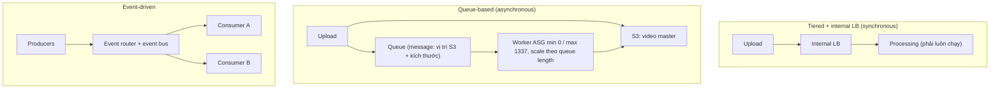

# Event-Driven Architecture

> **TL;DR:** Bài này đi qua các kiểu kiến trúc theo thứ tự tiến hóa: **monolithic → tiered → tiered + load balancer → queue-based (decoupled, async) → microservices → event-driven**. Kiến trúc event-driven gồm **producer** sinh event và **consumer** nhận event, kết nối qua **event router / event bus**. Hệ thống chỉ dùng tài nguyên khi đang xử lý event, và đây là nền tảng của [[Serverless Architecture|serverless]].

## 🖼️ Sơ đồ
![[Event-Driven Architecture.excalidraw]]
*Mở bằng plugin Excalidraw để chỉnh sửa · ảnh tĩnh: [[Event-Driven Architecture.svg]]*

![[Event-Driven Architecture - flow.excalidraw]]
*Mở bằng plugin Excalidraw để chỉnh sửa · ảnh tĩnh: [[Event-Driven Architecture - flow.svg]]*

## Khái niệm cốt lõi
Ví dụ xuyên suốt là **CatTube**: Bob upload video 4K về mèo Whiskers đi nghỉ. Hệ thống phải transcode ra 1080p, 720p, 480p (phần tốn tài nguyên nhất), ngoài ra còn hiển thị video, quản lý playlist/channel, lưu và đọc database. Ba thành phần minh họa: **Upload**, **Processing**, **Store and Manage**.

### 1. Monolithic
- Mọi thành phần nằm trong một "hộp đen", một code base.
- **Fails together**: một phần hỏng (ví dụ upload) có thể kéo cả processing và store/manage hỏng theo.
- **Scales together**: các thành phần coupled chặt và giả định chạy chung server, nên thường chỉ **scale dọc** được ([[Horizontal vs Vertical Scaling]]).
- **Bills together**: mọi thành phần luôn chạy và luôn được cấp tài nguyên, kể cả khi không có video nào để xử lý. Đây là một trong những cách thiết kế kém hiệu quả chi phí nhất.

### 2. Tiered
- Tách monolith thành các tier. Các tier có thể chạy chung hoặc khác server. Ví dụ ở [[Lab - Architecture Evolution]]: DB của WordPress chuyển sang RDS, app vẫn ở EC2.
- Ưu điểm: **scale dọc từng tier độc lập** (processing cần thêm CPU thì chỉ tăng size tier đó).
- Nhược điểm: các tier vẫn **coupled**, vì mỗi tier kết nối tới một endpoint cụ thể của tier khác.

### 3. Tiered + internal load balancer
- Đặt **internal [[Elastic Load Balancer|load balancer]]** giữa các tier. Upload và Store/Manage không biết processing tier có 1 hay 100 instance.
- Mỗi tier **scale ngang** được, có **HA** (instance hỏng thì LB phân phối lại).
- Còn 2 vấn đề:
  1. **Vẫn coupled và synchronous**: upload *expects and requires* processing trả lời ngay. Processing chết hẳn thì upload lỗi. Processing chậm hoặc backlog thì trải nghiệm upload cũng bị ảnh hưởng.
  2. **Không scale về 0 được**: mỗi tier luôn phải có ít nhất một thứ đang chạy, nếu không thì request đồng bộ sẽ thất bại.

### 4. Queue-based decoupled (async)
- **Queue**: hệ thống nhận message (send) và cho phép lấy message ra (receive/poll). Thường có thứ tự **FIFO**, nhưng không phải queue nào cũng đảm bảo điều đó (ví dụ [[SQS Standard vs FIFO|SQS Standard]] chỉ best-effort ordering).
- Luồng xử lý của CatTube:
  1. Upload tier lưu video master 4K vào [[S3 Basics|S3]] rồi gửi **message** vào queue. Message chứa vị trí object trong S3 và các kích thước cần render.
  2. Upload tier **xong việc**. Nó không gọi processing và không quan tâm processing có đang chạy hay không. Giao tiếp đổi từ **synchronous** sang **asynchronous**.
  3. Phía bên kia là [[Auto Scaling Groups|ASG]] **min 0 / desired 0 / max 1337**, có scaling policy theo **queue length** (số message trong queue, xem [[ASG Scaling Policies]]).
  4. Queue có message nên desired 0 → 2. Instance được launch, **poll** queue, lấy message ở đầu queue, tải video từ S3, transcode, rồi **xóa message** khỏi queue.
  5. Queue ngắn lại thì desired 2 → 1. Hết message thì desired 1 → 0, không còn instance nào chạy.
- Đây là mô hình **worker fleet**: tier xử lý scale từ **0 tới gần như vô hạn**, chỉ dựa vào độ dài queue. Hai tier hoàn toàn **decoupled**: bên ghi không quan tâm sức khỏe bên đọc, bên đọc không quan tâm job đến từ đâu.

### 5. Microservices
- Tiếp tục chia nhỏ thì được **microservices**: mỗi service là một ứng dụng nhỏ, tự chủ, có logic riêng, kho dữ liệu riêng và I/O riêng. Một ứng dụng lớn có thể có hàng trăm, hàng nghìn microservice.
- Vai trò: **producer** (Upload sinh event/message), **consumer** (Processing tiêu thụ), hoặc **cả hai** (Store and Manage).
- Thứ mà producer và consumer trao đổi chính là **event**. Có thể dùng queue cho từng cặp, nhưng với kiến trúc lớn thì sẽ có **rất nhiều queue** và trở nên phức tạp.

### 6. Event-driven
- **Producer**: thành phần sinh event khi có chuyện xảy ra, ví dụ khách bấm submit, upload thành công hoặc thất bại, lỗi khi đóng gói đơn hàng, một tiêu chí được thỏa mãn. Producer có thể là phần app giao tiếp với khách, là hạ tầng (EC2), hoặc là thành phần monitoring.
- **Consumer**: phần mềm chờ event mà nó quan tâm, nhận event rồi **hành động** (hiển thị cho khách, điều người xử lý lỗi đóng gói, retry upload...). Một component có thể vừa là producer vừa là consumer, ví dụ sinh event "upload failed" rồi tiêu thụ event để retry.
- **Không ai ngồi chờ**: producer không liên tục poll (Amazon.com không kiểm tra trình duyệt của bạn mỗi giây xem bạn đã bấm "Order" chưa). Consumer **được giao event**, xử lý xong thì dừng và không tốn tài nguyên.
- **Event router + event bus**: điểm trao đổi trung tâm, **highly available**. Producer đẩy event lên **event bus** (luồng thông tin liên tục), **router** quyết định giao event cho consumer nào. Nhờ vậy component không cần biết về nhau và không cần queue giữa mọi cặp. Trên AWS, đây là vai trò của [[EventBridge]].
- So với WordPress trên EC2 (tài nguyên được cấp liên tục, tính tiền cả khi idle): hệ event-driven mặc định ở trạng thái **ít hoặc không dùng tài nguyên**, có event thì cấp tài nguyên và scale lên, xử lý xong thì quay lại trạng thái nghỉ.
- **Kiến trúc event-driven trưởng thành chỉ tiêu tốn tài nguyên khi đang xử lý event**. Đây là thành phần cốt lõi của [[Serverless Architecture]] (với [[Lambda]]).

## Cách hoạt động / Kiến trúc

## Bảng so sánh / số liệu

| Kiến trúc | Coupling | Giao tiếp | Scale | Scale về 0? | Chi phí khi idle |
|---|---|---|---|---|---|
| Monolithic | Rất chặt (fail/scale/bill together) | Nội bộ | Chỉ dọc, cả khối | Không | Cao (luôn chạy đủ) |
| Tiered | Chặt (endpoint cụ thể) | Sync | Dọc, từng tier | Không | Cao |
| Tiered + LB | Vẫn coupled | Sync | Dọc + ngang từng tier, HA | Không | Vẫn phải chạy mỗi tier |
| Queue-based | **Decoupled** | **Async** | Ngang theo queue length | **Có** (worker min 0) | Thấp |
| Event-driven | Decoupled qua event router | Async, push event | Theo event | **Có** | Gần 0 (serverless) |

## 🎯 Mẹo thi SAA-C03
- Từ khóa **"decouple", "tier A không nên phụ thuộc tier B sẵn sàng", "xử lý bất đồng bộ", "chịu được backlog hoặc đột biến tải"** thì đặt **[[SQS]]** giữa hai tier.
- **Worker fleet scale theo độ dài queue** (ví dụ SQS `ApproximateNumberOfMessagesVisible`, hoặc backlog per instance) là mẫu kinh điển: ASG min 0 để tiết kiệm chi phí khi không có job.
- Internal [[Elastic Load Balancer|ALB/NLB]] giữa các tier cho **HA và scale ngang** nhưng **không** decouple: giao tiếp vẫn đồng bộ, tier phía sau phải luôn có instance.
- Lưu **dữ liệu lớn (video, file) vào S3**, message trong queue chỉ chứa **con trỏ** (bucket/key) và metadata. Message queue có giới hạn kích thước nhỏ (SQS tối đa 1 MiB; trước 08/2025 là 256 KB).
- Đề yêu cầu **thứ tự xử lý nghiêm ngặt / exactly-once** thì chọn SQS FIFO. Throughput cao, chấp nhận trùng lặp thì chọn Standard.
- Nhiều producer và consumer, cần định tuyến event theo pattern, **không muốn mỗi cặp một queue** thì chọn **[[EventBridge]]** (event bus). Fan-out một message tới nhiều subscriber thì chọn [[SNS]] (thường SNS + nhiều SQS).
- "Chỉ trả tiền khi có việc, không có server chạy liên tục" thì chọn event-driven + serverless ([[Lambda]], [[S3 Events]], [[EventBridge]]). Monolith là phương án **kém cost-effective** nhất.

## Liên kết
- Tiên quyết: [[Lab - Architecture Evolution]], [[Horizontal vs Vertical Scaling]], [[Elastic Load Balancer]], [[Auto Scaling Groups]]
- Dùng cùng: [[SQS]], [[SQS Standard vs FIFO]], [[SNS]], [[EventBridge]], [[S3 Events]], [[ASG Scaling Policies]]
- Tiếp theo: [[Lambda]], [[Serverless Architecture]], [[Step Functions]], [[Lab - Serverless App Pet-Cuddle-o-Tron]]
- Phân biệt với: [[Compare - SQS vs SNS vs Kinesis]]
- Section: [[_MOC 13 HA and Scaling]]
