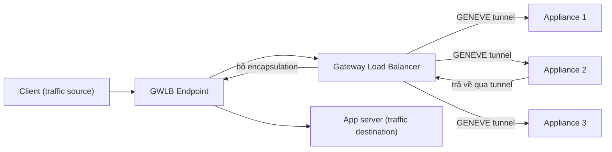

# Gateway Load Balancer

> **TL;DR:** Gateway Load Balancer (GWLB) là thành viên mới nhất của họ [[Elastic Load Balancer|ELB]], dùng để **chạy và scale các security appliance của bên thứ ba** (firewall, IDS/IPS, công cụ phân tích traffic) theo kiểu **inline, transparent**. Traffic được đưa vào qua **GWLB Endpoint** (có thể làm next hop trong route table), rồi GWLB đóng gói gói tin bằng **GENEVE** và gửi **nguyên vẹn** tới các appliance để kiểm tra, sau đó trả về đúng luồng ban đầu.

## 🖼️ Sơ đồ
![[Gateway Load Balancer.excalidraw]]
*Mở bằng plugin Excalidraw để chỉnh sửa · ảnh tĩnh: [[Gateway Load Balancer.svg]]*

## Khái niệm cốt lõi
- **Bài toán**: ứng dụng (Catagram) trong public subnet giao tiếp trực tiếp với Internet, không có lớp kiểm tra ingress/egress. Có thể chèn một **transparent security appliance** vào giữa luồng traffic: lọc exploit khi traffic vào, chặn rò rỉ dữ liệu khi traffic ra.
  - Với 1 instance thì cách này ổn. Nhưng khi ứng dụng **scale elastic** thì số appliance cũng phải tăng giảm theo, mà làm tay thì phức tạp và dễ lỗi.
  - Ứng dụng và appliance bị **tightly coupled**: hỏng bên này ảnh hưởng bên kia. Cách này scale kém ngay cả với 1 ứng dụng, và càng khó với kiến trúc **multi-tenant**.
- **Lý do dùng appliance bên thứ ba** thay vì dịch vụ AWS: doanh nghiệp đã có kỹ năng với sản phẩm đó, có yêu cầu bắt buộc (compliance), hoặc cần tính năng chỉ một vendor cung cấp. GWLB giúp chạy chúng **ở quy mô lớn và dễ quản lý**.
- **Hai thành phần chính**:
  1. **Gateway Load Balancer Endpoint (GWLBE)**: đặt trong VPC nơi traffic cần kiểm tra **bắt nguồn hoặc đi tới** (VPC của ứng dụng). Giống [[Interface VPC Endpoints|interface endpoint]] nhưng có một khác biệt quan trọng: **có thể làm target (next hop) trong route table**, nhờ vậy được chèn vào luồng traffic do route table điều khiển.
  2. **Gateway Load Balancer (GWLB)**: thiết bị **Layer 3/4** (khá giống [[Compare - ALB vs NLB|NLB]]). Nó load balance gói tin tới nhiều backend là **EC2 instance thường chạy phần mềm bảo mật**, thường nằm trong [[Auto Scaling Groups|ASG]] ở một **security VPC** riêng.
- **GENEVE**: giao thức **tunneling**. GWLB tạo tunnel tới các appliance, gói tin gốc được **đóng gói (encapsulate)** và giữ **nguyên** source IP, destination IP, source port, destination port và nội dung. Nhờ vậy appliance thấy đúng gói tin thật, kể cả khi dải IP của security VPC khác hoặc **trùng** với VPC ứng dụng. (Bổ sung: GENEVE chạy trên UDP port 6081.)
- Dùng **target group** giống ALB/NLB.

## Cách hoạt động / Kiến trúc

### Luồng cơ bản

- Appliance có thể quét, chặn, phân tích hoặc chỉnh sửa gói tin, rồi trả về qua **cùng tunnel**. GWLB gỡ lớp GENEVE, chuyển về GWLBE, và gói tin đi tiếp tới đích ban đầu.

### Lợi ích
- **Scale ngang** security appliance: GWLB phân phối traffic qua nhiều appliance, có thể đặt trong ASG để co giãn theo tải ứng dụng.
- **Flow stickiness**: một flow luôn đi qua **cùng một appliance**, nên appliance theo dõi được **trạng thái** của flow (cần cho firewall [[Stateful vs Stateless Firewalls|stateful]]).
- **Abstraction và resilience**: appliance hỏng thì flow chuyển sang appliance khác còn khỏe, giống các ELB khác.
- Không áp đặt feature set: dùng appliance của vendor nào cũng được.

### Kiến trúc điển hình (slide "GWLB Architecture")
- **catagramVPC** `10.16.0.0/16`, 2 AZ. Mỗi AZ có 3 subnet: GWLBE (`10.16.48.0/20`, `10.16.112.0/20`), ALB (`10.16.32.0/20`, `10.16.96.0/20`) và app private (`10.16.80.0/20`, `10.16.144.0/20`). **securityVPC** riêng chứa GWLB và các appliance trong ASG.
- Các route table:

| Route table | Route |
|---|---|
| **Ingress (gateway) route table** gắn với IGW | `10.16.0.0/16 → local`, `10.16.32.0/20 → GWLBE1`, `10.16.96.0/20 → GWLBE2` |
| Subnet GWLBE | `10.16.0.0/16 → local`, `0.0.0.0/0 → IGW` |
| Subnet ALB | `10.16.0.0/16 → local`, `0.0.0.0/0 → GWLBE` cùng AZ |

**Chiều vào (client → app)**:
1. Client gửi tới public IP của ALB, gói tin tới [[VPC Routing and Internet Gateway|IGW]].
2. IGW dịch public IP đích thành private IP của ALB (ví dụ trong `10.16.96.0/20`). **Ingress route table** có route cụ thể nhất cho `10.16.96.0/20` nên gói tin được chuyển tới **GWLBE cùng AZ**.
3. GWLBE gửi tới GWLB ở security VPC. Gói tin được bọc GENEVE, giữ nguyên địa chỉ gốc, và tới một appliance.
4. Appliance phân tích xong thì trả về GWLB, GWLB gỡ encapsulation và chuyển về GWLBE.
5. Địa chỉ gốc vẫn còn nên route table subnet GWLBE dùng route `local` để tới ALB. ALB chọn app instance.

**Chiều về (app → client)**:
1. App trả lời qua ALB. Đích là IP public của client nên subnet ALB dùng **default route → GWLBE** cùng AZ.
2. GWLBE → GWLB → appliance → GWLB → GWLBE.
3. Subnet GWLBE có default route ra IGW. IGW đổi source IP thành public IP của ALB rồi gửi về client.

Kết quả: bảo mật mạng **inline, transparent, scalable, resilient và abstracted**, cho cả hai chiều.

## Bảng so sánh / số liệu

| | ALB | NLB | **GWLB** |
|---|---|---|---|
| Tầng OSI | L7 | L4 | **L3/L4** (gateway + LB) |
| Mục đích | HTTP/HTTPS app | TCP/UDP/TLS hiệu năng cao | **Chèn appliance bảo mật vào luồng traffic** |
| Thay đổi gói tin | Kết thúc kết nối, tạo kết nối mới | Chuyển tiếp | **Không**: bọc GENEVE, giữ nguyên SRC/DST |
| Cách đưa traffic vào | DNS name của LB | DNS name / IP tĩnh | **Route table → GWLB Endpoint** |
| Backend | App instance, IP, Lambda | Instance, IP, ALB | **Virtual appliance** (firewall, IDS/IPS) |

## 🎯 Mẹo thi SAA-C03
- Từ khóa **"third-party virtual appliances / firewall / IDS / IPS / deep packet inspection, cần scale và HA"** thì chọn **Gateway Load Balancer**.
- Thấy **GENEVE** (hoặc UDP 6081) thì đáp án là GWLB.
- **GWLB Endpoint** là cách đưa traffic từ VPC ứng dụng sang GWLB (có thể ở VPC hoặc account khác). Endpoint có thể làm **next hop trong route table**, điều mà interface endpoint thường không làm được.
- Muốn kiểm tra cả traffic **đi vào** từ Internet thì cần **ingress routing**: gắn route table vào IGW (edge association) để đẩy traffic tới GWLBE trước khi tới subnet đích.
- Đừng nhầm với **[[Gateway VPC Endpoints]]** (S3/DynamoDB, không liên quan đến appliance) hay **[[WAF]]** (L7, gắn vào ALB/CloudFront/API Gateway). Cần firewall L7 managed của AWS thì chọn WAF. Cần **appliance của vendor** inline ở L3/L4 thì chọn GWLB.
- GWLB có **flow stickiness**: các gói của một flow đi qua cùng một appliance, cần cho appliance stateful.

## Liên kết
- Tiên quyết: [[Elastic Load Balancer]], [[Interface VPC Endpoints]], [[VPC Routing and Internet Gateway]], [[Layer 3 Network]], [[Layer 4 Transport]]
- Liên quan: [[Auto Scaling Groups]], [[Stateful vs Stateless Firewalls]], [[Layer 7 Firewall]], [[Transit Gateway]], [[NAT Fundamentals]]
- Phân biệt với: [[Compare - ALB vs NLB]], [[Gateway VPC Endpoints]], [[WAF]], [[Compare - Gateway vs Interface Endpoints]]
- Section: [[_MOC 13 HA and Scaling]]
