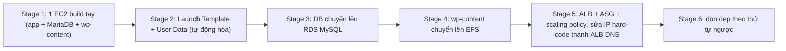
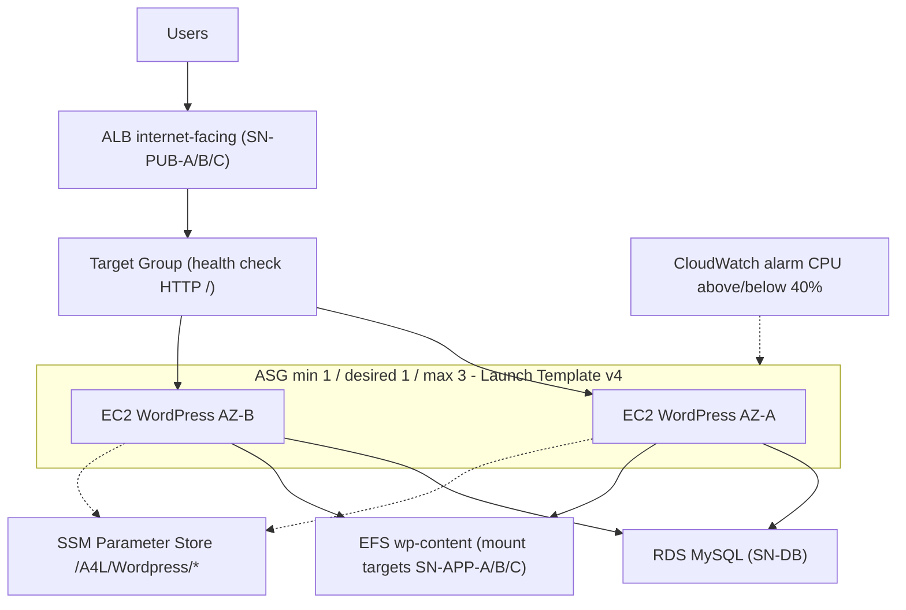

# Lab - Architecture Evolution

> **TL;DR:** Advanced demo nhiều stage: lấy một blog WordPress ("Catagram") chạy hết trên **một EC2 instance** (app + DB + media) rồi từng bước tách nó thành kiến trúc **elastic, self-healing**: [[Launch Templates|Launch Template]] → DB lên [[RDS Architecture|RDS]] → media lên [[EFS]] → [[Elastic Load Balancer|ALB]] + [[Auto Scaling Groups|ASG]] với scaling policy theo CPU. Bài học chính: muốn scale ngang thì instance phải **stateless**. Mọi state (DB, file, config) phải nằm ngoài vòng đời instance.

## 🖼️ Sơ đồ
![[Lab - Architecture Evolution.excalidraw]]
*Mở bằng plugin Excalidraw để chỉnh sửa · ảnh tĩnh: [[Lab - Architecture Evolution.svg]]*

![[Lab - Architecture Evolution - stage5.excalidraw]]
*Mở bằng plugin Excalidraw để chỉnh sửa · ảnh tĩnh: [[Lab - Architecture Evolution - stage5.svg]]*

## Khái niệm cốt lõi
- **Mục đích của lab**: luyện cách "tiến hóa" một kiến trúc từ đơn giản đến scalable. Đây là dạng câu hỏi tình huống hay gặp trong phỏng vấn Solutions Architect và cũng là tư duy nền cho đề SAA-C03.
- **Hạ tầng nền**: một stack [[CloudFormation Basics|CloudFormation]] one-click (`A4LVPC`) tạo [[Custom VPC|VPC]] Animals4life `10.16.0.0/16`. VPC có 3 AZ, mỗi AZ có các tầng subnet public / app / db, kèm sẵn Security Group (`SG-WordPress`, `SG-Database`, `SG-EFS`, `SG-LoadBalancer`) và instance profile `A4LVPC-WordPress`. Xem [[VPC Sizing and Structure]].
- **Hai nơi WordPress lưu dữ liệu**, cần nhớ vì toàn bộ lab xoay quanh việc chuyển chúng ra ngoài:
  1. **Database** (MySQL/MariaDB): nội dung chữ của post, metadata (tác giả, ngày giờ, trạng thái publish, quyền...).
  2. **`wp-content`** (thư mục local): media/ảnh upload, plugins, themes.
- **Nuance riêng của WordPress**: lúc cài, WordPress **hard-code địa chỉ (IP) của site vào database**. Instance đổi public IP (stop/start) hoặc có nhiều instance thì site hỏng, vì nó vẫn trỏ về IP cũ. Mỗi ứng dụng có một kiểu "nuance" như vậy, và kiến trúc sư phải biết để xử lý khi thiết kế kiến trúc elastic.
- **Cấu hình không hard-code**: mọi tham số (DB user, DB name, DB endpoint, password, EFS ID, ALB DNS name) lưu trong [[SSM Parameter Store]] dưới prefix `/A4L/Wordpress/...`. Password dùng kiểu **SecureString** mã hóa bằng [[KMS]] (key `alias/aws/ssm`). Instance đọc các parameter này qua instance role ([[EC2 Instance Roles]]).
- Kết nối vào instance bằng **Session Manager** (không cần SSH key, không cần mở port 22), xem [[EC2 Instance Connect and SSH]].

## Cách hoạt động / Kiến trúc

### Tổng quan các stage

### Stage 1: dựng tay một instance (0234, 0235)
- EC2 `Wordpress-Manual`: Amazon Linux 2, instance free tier (t2.micro), subnet `SN-PUB-A`, auto-assign public IPv4/IPv6, SG cho phép HTTP 80, ổ mặc định 8 GiB gp2. Credit specification chọn *unlimited* nếu account cho phép (account mới thường chỉ được *standard*, xem [[EC2 Instance Types]]).
- Tạo 5 parameter: `DBUser`, `DBName`, `DBEndpoint` (= `localhost`), `DBPassword` và `DBRootPassword` (2 cái sau là SecureString).
- Vào instance, chạy tay: nạp parameter vào biến môi trường → update OS → cài MariaDB, Apache (httpd), wget, `stress` → enable/start dịch vụ → đặt root password MariaDB → tải/giải nén WordPress → sửa `wp-config.php` → sửa quyền → tạo database, user, grant.
- Điểm cần thấy: build tay **chậm, dễ sai, không tự động hóa được**.

**Giới hạn của stage 1** (lặp lại ở các stage sau và được gỡ dần):
| # | Giới hạn | Được gỡ ở |
|---|---|---|
| 1 | Build thủ công, chậm, không automation | Stage 2 |
| 2 | App và DB chung một instance nên không scale riêng được | Stage 3 |
| 3 | DB nằm trên instance, scale in/out là có nguy cơ mất dữ liệu | Stage 3 |
| 4 | Media (`wp-content`) local, scale in/out là có nguy cơ mất media | Stage 4 |
| 5 | Khách kết nối thẳng vào instance: không health check, không auto-heal, không scale | Stage 5 |
| 6 | IP instance bị hard-code trong DB | Stage 5 |

- Minh họa giới hạn 6: **stop rồi start** instance (reboot không đủ) làm public IPv4 đổi (xem [[EC2 Network Interfaces IPs and DNS]]). Mở IP mới thì site không load vì WordPress vẫn tham chiếu IP cũ.

### Stage 2: tự động hóa bằng Launch Template (0236)
- Terminate instance manual. Tạo [[Launch Templates|Launch Template]] `Wordpress`, **version 1** "Single server DB and App": cùng AMI, instance type, SG, instance profile, credit spec. Tất cả lệnh của stage 1 dán vào **User Data** (`#!/bin/bash -xe` ... `rm /tmp/db.setup`), xem [[EC2 User Data Bootstrapping]].
- Launch template là thế hệ mới thay cho *launch configuration*. Template có **versioning** (default version và latest version), dùng để launch instance trực tiếp hoặc làm nguồn cho ASG. Khi launch trực tiếp từ template thì phải tự chọn subnet. Khi dùng với ASG, ASG sẽ lo phần subnet.
- Launch instance `Wordpress-LT` từ template. Đợi vài phút cho bootstrap xong rồi cài WordPress qua web.
- Kết quả: build nhanh và lặp lại được, nhưng **mọi giới hạn kiến trúc khác vẫn còn**.

### Stage 3: tách database lên RDS (0237)
- Tạo **DB subnet group** `WordPressRDSSubnetGroup` gồm 3 subnet DB: `10.16.16.0/20` (AZ-A), `10.16.80.0/20` (AZ-B), `10.16.144.0/20` (AZ-C).
- Tạo RDS **MySQL**, template Free tier (`db.t3.micro`), identifier `a4lwordpress`. Master user/password lấy từ Parameter Store, *Public access = No*, SG `SG-Database`, AZ ưu tiên `us-east-1a` (cùng AZ với EC2), initial DB name = giá trị `DBName`. Thời gian tạo có thể tới khoảng 30 phút. Xem [[RDS Architecture]].
- **Migration** chạy ngay trên instance:
  1. `mysqldump` DB local ra file `a4lwordpress.sql`.
  2. **Xóa rồi tạo lại** parameter `DBEndpoint` với giá trị là endpoint DNS của RDS (khóa học dặn phải delete/recreate, không chỉ edit).
  3. `mysql -h <RDS endpoint> ... < a4lwordpress.sql` để import vào RDS.
  4. `sed` thay `localhost` bằng endpoint RDS trong `/var/www/html/wp-config.php`.
  5. Stop và disable MariaDB local.
- Cập nhật launch template thành **version 2** "Single server App Only": xóa khỏi user data các dòng enable/start MariaDB, dòng đặt root password và khối tạo DB/user. Rồi **Set default version** = 2.
- Kết quả: DB **sống ngoài vòng đời EC2** và scale độc lập với app tier. Đây là bước đầu tiên hướng tới kiến trúc elastic. (Ở lab này chuyển DB bằng dump/import đơn giản. Với migration lớn hoặc cần ít downtime thì dùng [[DMS]].)

### Stage 4: tách media lên EFS (0238)
- Tạo [[EFS]] `A4L-WORDPRESS-CONTENT`: bật automatic backups, lifecycle mặc định (30 ngày kể từ lần truy cập cuối), performance mode **General Purpose** (Max I/O chỉ cho các trường hợp hiệu năng rất đặc thù, 99% dùng General Purpose), throughput **Bursting** (hiệu năng tăng theo dung lượng đang dùng; *Provisioned* cho phép đặt hiệu năng độc lập với dung lượng). Tắt encryption at rest *chỉ để demo đơn giản*, production thì nên bật.
- **Mount target** ở 3 subnet app: `SN-APP-A 10.16.32.0/20`, `SN-APP-B 10.16.96.0/20`, `SN-APP-C 10.16.160.0/20`, mỗi cái gắn SG `SG-EFS`.
- Lưu File System ID vào parameter `/A4L/Wordpress/EFSFSID` (cấu hình cho hệ tự scale thì luôn đặt trong Parameter Store).
- Trên instance: cài `amazon-efs-utils` (EFS dựa trên NFS, nhưng EC2 cần package này để mount kiểu `efs`) → chuyển `wp-content` sang `/tmp` → tạo thư mục `wp-content` rỗng làm mount point → thêm dòng vào **`/etc/fstab`** để mount mỗi lần boot → `mount -a -t efs defaults` → kiểm tra bằng `df -k` → chuyển dữ liệu từ `/tmp` về `wp-content` (giờ là EFS) → `chown -R ec2-user:apache /var/www` → **reboot** để chắc chắn mount tự động khi khởi động.
- Launch template **version 3**: user data thêm phần đọc EFS ID, cài `amazon-efs-utils`, tạo và mount `wp-content` lên EFS **trước** khi cài WordPress. Set default = 3.
- Kết quả: DB và media đều nằm ngoài instance nên instance có thể scale in/out mà không mất dữ liệu. Còn lại 2 giới hạn: kết nối trực tiếp và IP hard-code.

### Stage 5: ALB + ASG, kiến trúc elastic hoàn chỉnh (0239, 0240)
- **ALB** `A4LWORDPRESSALB`: *internet-facing* (node có IP public), IPv4, đặt ở 3 subnet public `SN-PUB-A/B/C`, SG `SG-LoadBalancer`, listener **HTTP:80**.
- **Target group** `A4LWORDPRESSALBTG`: target type *instances*, HTTP:80, health check HTTP path `/`. Ban đầu không đăng ký instance nào vì ASG sẽ lo việc này.
- Lưu DNS name của ALB vào parameter `/A4L/Wordpress/ALBDNSNAME`.
- **Sửa lỗi IP hard-code** (launch template **version 4**, set default = 4): user data đọc ALB DNS name rồi tạo script `/home/ec2-user/update_wp_ip.sh`. Script lấy thông tin đăng nhập DB từ `wp-config.php`, đọc IP cũ trong DB, chạy SQL thay IP cũ bằng **ALB DNS name** (làm *home URL* của site). Script được `chmod 755`, thêm vào `/etc/rc.local` để chạy mỗi lần instance khởi động, và chạy ngay một lần. Nhờ vậy nếu DNS name của ALB đổi thì instance mới cũng tự sửa lại.
- **ASG** `A4LWORDPRESSASG` (xem [[Auto Scaling Groups]]):
  - Launch template `Wordpress`, version **Latest** (v4).
  - Subnets: 3 subnet public (để đơn giản cho lab).
  - Gắn vào target group của ALB: instance ASG tạo ra được **tự đăng ký** vào TG, instance bị ASG terminate được **tự gỡ** khỏi TG.
  - Health check: bật **ELB health checks** (phong phú hơn EC2 status checks, xem [[ASG Health Checks]]). Bật group metrics collection trong CloudWatch.
  - Ban đầu desired/min/max = 1/1/1 (ASG tĩnh). Tag `Name=Wordpress-ASG` cho instance mới.
  - Terminate instance `Wordpress-LT` cũ. ASG thấy running (0) < desired (1) nên tự launch instance.
- **Scaling policy** (xem [[ASG Scaling Policies]]): 2 *simple scaling* policy gắn với CloudWatch alarm trên metric `CPUUtilization` của ASG ([[CloudWatch Basics]]):
  - `HIGHCPU`: CPU **> 40%** thì **thêm 1** capacity unit.
  - `LOWCPU`: CPU **< 40%** thì **bớt 1** capacity unit.
  - Phải nâng **max = 3** (desired 1, min 1). Nếu max = 1 thì desired không bao giờ tăng được.
- **Test**:
  - Chạy `stress` (2 core, 3000 giây) trên instance. Alarm HIGHCPU kích hoạt, desired 1 → 2, ASG launch instance mới ở **AZ khác** (us-east-1b) và gắn vào TG. Quá trình này có thể mất tới khoảng 20 phút.
  - **Self-healing**: terminate tay một instance thì ASG thấy thiếu và tự launch bù. Instance fail ELB health check cũng bị thay tương tự.
  - Truy cập site qua **DNS name của ALB**: người dùng không còn thấy instance cụ thể, nên scaling hay healing không làm gián đoạn phiên làm việc.

### Stage 6: dọn dẹp (0241)
Xóa theo **thứ tự ngược** với lúc tạo: ALB → target group → ASG (tự terminate instance) → EFS (xóa mount target rồi file system) → RDS (bỏ final snapshot, bỏ retain automated backups) → launch template → các parameter `/A4L/Wordpress/*` → cuối cùng là CloudFormation stack (VPC, subnet...). Stack chỉ xóa được sau khi RDS xóa xong.

## Bảng so sánh / số liệu

| Stage | Compute | Database | Media `wp-content` | Truy cập | LT version |
|---|---|---|---|---|---|
| 1 | 1 EC2 build tay | MariaDB local | Local disk | IP instance | - |
| 2 | 1 EC2 từ LT | MariaDB local | Local disk | IP instance | v1 |
| 3 | 1 EC2 từ LT | **RDS MySQL** | Local disk | IP instance | v2 |
| 4 | 1 EC2 từ LT | RDS | **EFS** | IP instance | v3 |
| 5 | **ASG 1-3 instance**, multi-AZ | RDS | EFS | **ALB DNS** | v4 |

## 🎯 Mẹo thi SAA-C03
- **Muốn scale ngang hoặc self-heal thì instance phải stateless**: dữ liệu quan hệ đưa vào [[RDS Architecture|RDS]]/[[Aurora]], file dùng chung đưa vào [[EFS]] (hoặc [[S3 Basics|S3]] cho object), session thì đưa ra ngoài hoặc dùng sticky ([[SSL Offload and Session Stickiness]]). Thấy đề nói "instance lưu file/DB local, cần auto scaling" thì tách state ra trước.
- **Nhiều EC2 Linux cần chia sẻ cùng một thư mục file** thì chọn **EFS**, không phải [[EBS]] (EBS gắn với một AZ và thường chỉ một instance).
- **Người dùng không được kết nối trực tiếp tới instance**. Đặt [[Elastic Load Balancer|ELB]] phía trước để có health check, abstraction và scaling. Dùng DNS name của LB, không dùng IP instance (public IP đổi khi stop/start).
- **ASG + ELB**: gắn ASG với target group để instance tự đăng ký và hủy đăng ký. Bật **ELB health check** trên ASG để instance "chạy nhưng app hỏng" cũng bị thay (EC2 status check không phát hiện được lỗi tầng ứng dụng).
- **Max capacity** là giới hạn cứng: scaling policy không thể đẩy desired vượt max. Đề cho max = desired thì ASG không scale out được.
- **Launch Template > Launch Configuration**: LT có versioning, có thể dùng để launch instance trực tiếp lẫn cho ASG. Launch configuration là thế hệ cũ (AWS không còn khuyến nghị dùng).
- Cấu hình và secrets không hard-code trong AMI hay user data: dùng [[SSM Parameter Store]] (SecureString + KMS) hoặc [[Secrets Manager]], lấy về qua [[EC2 Instance Roles|instance role]].
- Tách DB khỏi instance cũng là bước đầu chuyển từ monolith sang tiered. Bước tiếp theo về hướng decoupled/event-driven xem [[Event-Driven Architecture]].

## Liên kết
- Tiên quyết: [[Launch Templates]], [[EC2 User Data Bootstrapping]], [[SSM Parameter Store]], [[EC2 Instance Roles]], [[Databases on EC2]]
- Dùng trong lab: [[RDS Architecture]], [[EFS]], [[Elastic Load Balancer]], [[Auto Scaling Groups]], [[ASG Scaling Policies]], [[ASG Health Checks]], [[CloudWatch Basics]]
- Liên quan: [[Horizontal vs Vertical Scaling]], [[HA vs FT vs DR]], [[Regional and Global Architecture]], [[Animals4life Scenario]], [[DMS]]
- Tiếp theo: [[Event-Driven Architecture]]
- Section: [[_MOC 13 HA and Scaling]]
