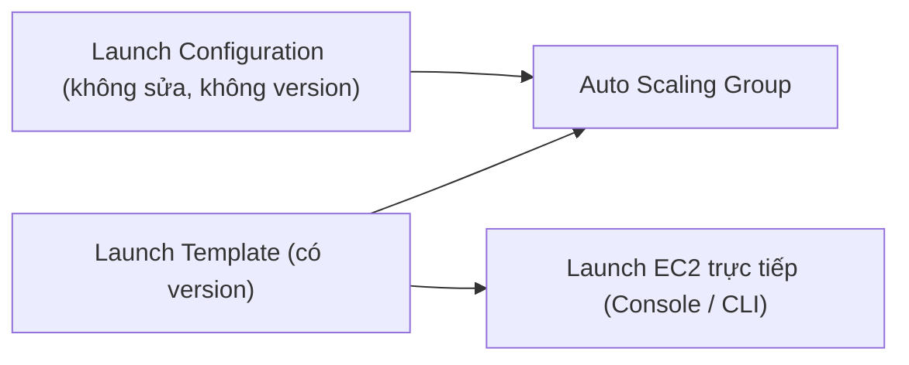

# Launch Templates

> **TL;DR:** Launch Template (LT) là tài liệu **định nghĩa trước cấu hình EC2 instance**: AMI, instance type, storage, key pair, network, Security Group, user data, IAM role. [[Auto Scaling Groups|ASG]] dùng nó để biết cần dựng **cái gì**, và cũng dùng được để launch EC2 trực tiếp. LT không sửa được, muốn đổi thì tạo **version mới**; ASG trỏ tới một version cụ thể, version **Default** hoặc **Latest**. Launch Configuration (LC) là bản cũ mà LT đã thay thế: chỉ nên dùng LT, **account mới không tạo được LC**.

## 🖼️ Sơ đồ
![[Launch Templates.excalidraw]]
*Mở bằng plugin Excalidraw để chỉnh sửa · ảnh tĩnh: [[Launch Templates.svg]]*

## Khái niệm cốt lõi
- Mọi thứ thường khai báo lúc launch instance đều đặt được trong LC/LT:
  - [[AMI]], instance type và size ([[EC2 Instance Types]]), cấu hình storage ([[EBS]]), key pair.
  - Networking và [[Security Groups]].
  - **User data** ([[EC2 User Data Bootstrapping]]) và **IAM role** qua instance profile ([[EC2 Instance Roles]]).
- **Cả hai đều không sửa được (immutable)**: định nghĩa một lần là cấu hình đó bị khóa.
  - **LC**: không có version. Muốn đổi thì tạo LC mới rồi gắn LC mới vào ASG.
  - **LT**: có **versions**. Muốn đổi cấu hình thì **bắt buộc tạo version mới**. ASG gắn với LT có thể trỏ tới:
    - một **version cụ thể** (ví dụ version 1), hoặc
    - version **Default** hoặc **Latest**: khi đó version mới tự có hiệu lực cho các instance được launch sau đó.
- LT thay thế LC và thêm tính năng: **versioning**, điều khiển tính năng của các instance type đời mới như **mixed instance types**, **[[EC2 Placement Groups|placement groups]]**, **capacity reservations**. (Bản khóa cũ nêu thêm **T2/T3 Unlimited** (CPU credit) và **Elastic Graphics**, bài mới không nói.)
- **LC là legacy**: account AWS mới **không tạo được** Launch Configuration. Nếu vẫn thấy LC trong account cũ thì hiểu đó là "bản cũ của LT".

## Cách hoạt động / Kiến trúc

- **LC chỉ có một công dụng**: cấp cấu hình EC2 cho ASG.
- **LT có hai công dụng**: cấp cấu hình cho ASG, và **launch EC2 trực tiếp** từ console/CLI để tiết kiệm thời gian, không phải nhập lại cấu hình.
- Phân vai: **ASG quyết định WHEN và WHERE** (khi nào, subnet nào); **LT/LC quyết định WHAT** (instance gì, cấu hình ra sao).

## Bảng so sánh / số liệu
| Tiêu chí | Launch Configuration | Launch Template |
|---|---|---|
| Editable | Không | Không (nhưng tạo được version mới) |
| Versioning | Không | Có |
| Dùng với ASG | Có | Có |
| Launch EC2 trực tiếp | Không | Có |
| Mixed instance types, placement group, capacity reservation (khóa cũ: thêm T2/T3 Unlimited, Elastic Graphics) | Không | Có |
| Tạo mới trong account mới | **Không** | Có |
| Khuyến nghị | Legacy | **Dùng cái này** |

> Bổ sung (bài không nói): AWS đã **deprecate** Launch Configuration; LC không hỗ trợ các instance type ra mắt sau cuối 2022, và mốc account mới không tạo được LC là 10/2024.

## 🎯 Mẹo thi SAA-C03
- Đáp án nào dùng **Launch Template** thường đúng hơn Launch Configuration (LC là legacy, account mới không tạo được), nhất là khi đề nhắc **versioning**, mixed instance types (Spot/On-Demand mix), placement group hay capacity reservation.
- Muốn ASG **tự dùng version mới** của LT cho các instance launch sau này → trỏ ASG tới version **Latest** (hoặc **Default**) thay vì một số version cố định.
- Cần **sửa cấu hình** của LC thì phải **tạo LC mới** rồi cập nhật ASG. Với LT thì tạo **version mới**.
- "ASG = when & where, LT = what": đề hỏi đổi AMI hoặc instance type cho ASG thì câu trả lời là sửa LT (version mới), không phải sửa ASG.
- Muốn instance trong ASG có quyền gọi AWS API thì gắn **IAM role (instance profile)** trong LT. Đừng nhúng access key vào user data.

## Liên kết
- Tiên quyết: [[EC2 Basics]], [[AMI]], [[EC2 User Data Bootstrapping]], [[EC2 Instance Roles]]
- Liên quan: [[Auto Scaling Groups]], [[ASG Scaling Policies]], [[Security Groups]], [[EC2 Placement Groups]], [[Lab - Architecture Evolution]]
- Phân biệt với: [[CloudFormation Basics]] (IaC cho toàn bộ stack, còn LT chỉ là cấu hình một instance)
