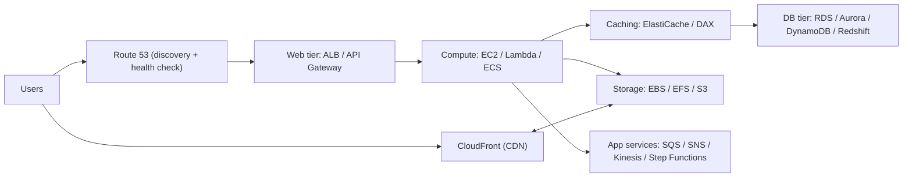

# Regional and Global Architecture

> **TL;DR:** Bài mở đầu section: tập nhìn một hệ thống lớn (ví dụ Netflix) thành **các khối regional độc lập** ghép lại, với một lớp **global** lo việc tìm dịch vụ, phân phối nội dung và failover giữa các region. Bên trong mỗi region, ứng dụng được dựng từ các **tier**: web, compute, storage, caching, database, application services.

## 🖼️ Sơ đồ
![[Regional and Global Architecture.excalidraw]]
*Mở bằng plugin Excalidraw để chỉnh sửa · ảnh tĩnh: [[Regional and Global Architecture.svg]]*

## Khái niệm cốt lõi
- Một ứng dụng "global" như Netflix thực chất là **nhiều ứng dụng regional** giống nhau, chạy độc lập và được nhân bản ở nhiều region. Nghĩ theo kiểu "tập hợp các region tạo nên tổng thể" giúp thiết kế nền tảng lớn dễ hơn, vì phần lớn dịch vụ AWS là **regional**, rất ít dịch vụ thật sự global (xem [[AWS Global Infrastructure]]).
- Ba kiểu kiến trúc thường gặp khi làm Solutions Architect:
  1. **Small scale, một region/quốc gia**: chỉ tồn tại ở một nơi.
  2. **Một region + yêu cầu DR**: region chính hỏng thì failover sang region phụ (xem [[HA vs FT vs DR]], [[RPO and RTO]]).
  3. **Multi-region, chạy xuyên lỗi**: hoạt động ở nhiều region và vẫn phục vụ được khi một hoặc nhiều region gặp sự cố.

### Thành phần global
| Thành phần | Câu hỏi nó trả lời | Dịch vụ AWS |
|---|---|---|
| Global service location & discovery | Gõ `netflix.com` thì máy client trỏ tới đâu? | [[Route 53 Fundamentals\|Route 53]] (DNS) |
| Content delivery (CDN) & optimisation | Nội dung đến người dùng toàn cầu thế nào: cache phân tán hay kéo từ trung tâm? | [[CloudFront Architecture\|CloudFront]] |
| Global health checks & failover | Phát hiện region không khỏe và chuyển khách sang nơi khác | [[R53 Health Checks]], [[R53 Failover Routing]] |

### Thành phần regional
- **Regional entry point** (web tier).
- **Regional scaling & resilience**.
- **Application services và components**.

## Cách hoạt động / Kiến trúc

### Góc nhìn global
- Client dùng **DNS** để service discovery ban đầu. Ví dụ: region chính ở `us-east-1`, region phụ ở Úc.
- Route 53 có **health check**: khi region Mỹ khỏe thì mọi session đi về Mỹ; nếu có vấn đề thì chuyển sang Úc. Một cấu hình khác hợp lệ là gửi khách tới **region gần nhất** (xem [[R53 Latency Routing]], [[R53 Geolocation Routing]]).
- Dù hạ tầng đặt ở đâu, CDN vẫn hoạt động ở tầng global: các edge location cache nội dung gần khách và kéo từ **origin** khi cần.
- Nhiệm vụ của tầng global: đưa khách tới một vị trí hạ tầng phù hợp, **cô lập lỗi regional**, chuyển session sang region khác khi cần, và tối ưu cache.

### Góc nhìn regional: các tier
Khi traffic đã vào một region (vào VPC hoặc vào dịch vụ public của AWS), ta "zoom in" và nghĩ theo tier, tức các nhóm chức năng ở mức cao:

| Tier | Vai trò | Dịch vụ ví dụ |
|---|---|---|
| **Web tier** | Điểm vào regional; che giấu hạ tầng phía sau, để hạ tầng có thể scale/hỏng/thay đổi mà khách không biết | ALB ([[Elastic Load Balancer]]), [[API Gateway]] |
| **Compute tier** | Cung cấp chức năng thực sự | [[EC2 Basics\|EC2]], [[Lambda]], container trên [[ECS]] |
| **Storage** | Lưu file/media | [[EBS]], [[EFS]], [[S3 Basics\|S3]] |
| **Caching** | Giảm đọc vào DB, rẻ và nhanh vì nằm trong memory | [[ElastiCache]], [[DAX]] (cho DynamoDB) |
| **DB tier** | Dữ liệu có cấu trúc | [[RDS Architecture\|RDS]], [[Aurora]], [[DynamoDB Architecture\|DynamoDB]], [[Redshift]] (data warehouse) |
| **App services** | Chức năng bổ trợ hoặc thay đổi kiến trúc (decouple) | [[Kinesis Data Streams\|Kinesis]], [[Step Functions]], [[SQS]], [[SNS]] |

- Các tier là thành phần riêng biệt và có thể dùng dịch vụ của nhau: CloudFront có thể dùng **S3 làm origin** để phân phối media (Netflix có thể lưu phim trên S3 và để CloudFront cache).
- **Caching pattern**: ứng dụng hỏi cache trước; chỉ khi cache miss mới đọc DB rồi cập nhật cache. DB đắt (theo dung lượng) hơn cache, nên offload read sang cache vừa tăng hiệu năng vừa giảm chi phí.

## 🎯 Mẹo thi SAA-C03
- Đọc đề, xác định ngay hệ thống thuộc loại nào: **một region**, **một region + DR**, hay **multi-region active**. Câu trả lời đúng thường khác nhau theo loại.
- Thành phần global nào cũng gắn với một dịch vụ cụ thể: discovery và failover dùng **Route 53 + health check**, content delivery dùng **CloudFront**.
- Web tier (ALB/API Gateway) tồn tại để **trừu tượng hóa** hạ tầng phía sau. Đây là nền cho mọi bài về [[Elastic Load Balancer]] và [[Auto Scaling Groups]] trong section.
- Đề nói "giảm tải đọc cho database" hoặc "giảm chi phí DB" thì nghĩ đến **caching layer** (ElastiCache, DAX) hoặc [[RDS Read Replicas]].

## Liên kết
- Tiên quyết: [[AWS Global Infrastructure]], [[HA vs FT vs DR]], [[Route 53 Fundamentals]]
- Liên quan: [[Elastic Load Balancer]], [[Auto Scaling Groups]], [[CloudFront Architecture]], [[R53 Failover Routing]], [[Lab - Architecture Evolution]]
- Mở rộng: [[Event-Driven Architecture]], [[Global Accelerator]], [[Aurora Global Database]]
