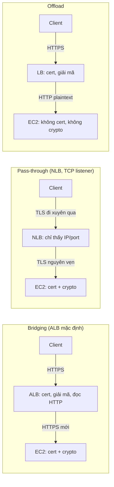
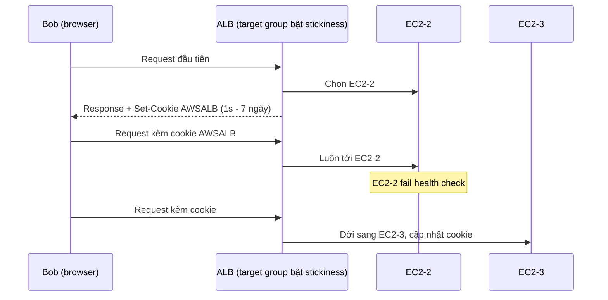

# SSL Offload and Session Stickiness

> **TL;DR:** Hai tính năng kiến trúc của [[Elastic Load Balancer|ELB]]. (1) Load balancer xử lý kết nối mã hóa theo 3 cách: **Bridging** (mặc định của ALB, giải mã rồi mã hóa lại), **Pass-through** (NLB chuyển nguyên kết nối mã hóa xuống instance) và **Offload** (giải mã ở LB, gửi HTTP thường xuống instance). (2) **Session stickiness** dùng cookie `AWSALB` để khóa một user vào một backend instance, cho ứng dụng lưu session ngay trên server. Cách tốt hơn là làm instance **stateless**. Đề chỉ hỏi kiến trúc, không hỏi chi tiết cấu hình.

## 🖼️ Sơ đồ
![[SSL Offload and Session Stickiness.excalidraw]]
*Mở bằng plugin Excalidraw để chỉnh sửa · ảnh tĩnh: [[SSL Offload and Session Stickiness.svg]]*

![[SSL Offload and Session Stickiness - stickiness.excalidraw]]
*Mở bằng plugin Excalidraw để chỉnh sửa · ảnh tĩnh: [[SSL Offload and Session Stickiness - stickiness.svg]]*

## Khái niệm cốt lõi
Nhắc lại: HTTPS chỉ là HTTP bọc trong lớp [[SSL and TLS|SSL/TLS]]. "Terminate" kết nối nghĩa là gỡ lớp bọc đó ra, để thiết bị đọc được HTTP bên trong.

### 1. SSL Bridging (mặc định của ALB)
- Listener của LB dùng **HTTPS**. Kết nối SSL của client bị **terminate trên LB**, nên LB cần một **SSL certificate khớp domain** của ứng dụng (thường lấy từ [[ACM]]).
- LB đọc được HTTP plaintext nên ra quyết định dựa trên nội dung HTTP được (path, host, header, cookie). Đây là lý do bridging là mặc định của ALB và vì sao ALB bắt buộc có cert.
- Sau đó LB mở **kết nối HTTPS mới** tới backend: mã hóa lại HTTP, gửi xuống EC2. Instance phải giải mã, nên **mỗi instance cũng cần cert** và tốn CPU cho các thao tác mật mã.
- (+) LB thấy HTTP nên route thông minh được, và dữ liệu được mã hóa trên cả hai chặng.
- (−) Cert nằm trên LB, nghĩa là về lý thuyết AWS có mức truy cập nào đó tới cert. Khung bảo mật nghiêm ngặt có thể không chấp nhận điều này.
- (−) Phải quản lý cert trên mọi instance (gánh nặng quản trị) và instance tốn compute cho crypto. Với ứng dụng lưu lượng lớn, chi phí này đáng kể.
- (Thực tế ALB không xác thực certificate của target, nên cert trên instance có thể là self-signed. Ý thi không đổi: instance vẫn phải có cert và làm crypto.)

### 2. SSL Pass-through (NLB)
- LB **không giải mã gì cả**. [[Compare - ALB vs NLB|NLB]] với **listener TCP** chỉ thấy IP/port nguồn-đích, đủ để chọn instance nào nhận kết nối.
- Một **đường hầm mã hóa liền mạch** đi từ client tới thẳng backend instance (end-to-end encryption).
- (+) **AWS không bao giờ thấy certificate**. Bạn quản lý cert hoàn toàn, có thể dùng thêm [[CloudHSM]] để tăng bảo mật.
- (−) Không load balancing theo nội dung HTTP được, vì HTTP không bao giờ bị lộ ra cho NLB.
- (−) Instance vẫn cần cert và vẫn tốn compute cho crypto.

### 3. SSL Offload
- Client → LB vẫn là **HTTPS** và terminate trên LB (LB cần cert). Nhưng LB → backend dùng **HTTP thường**, không mã hóa lại.
- Trên Internet công cộng dữ liệu luôn được mã hóa. Chặng LB → EC2 đi **plaintext** trong mạng AWS.
- (+) Instance **không cần cert**, không làm crypto, nên giảm overhead mỗi instance và có thể dùng **instance nhỏ hơn**.
- (−) Dữ liệu plaintext đi trong mạng AWS. Nếu yêu cầu tuân thủ không cấm điều này thì đây là giải pháp rất hiệu quả.

### Session stickiness
- **Không có stickiness:** mỗi request của user được phân phối tới mọi backend instance đang **in-service**, dựa trên cân bằng tải và health check, nên tải chia khá đều. Nếu ứng dụng lưu session trên instance thì mỗi lần user rơi sang instance khác là bắt đầu lại từ đầu: **bị logout, mất giỏ hàng**.
- Ứng dụng có **instance stateless**, session lưu ngoài (ví dụ [[DynamoDB Architecture|DynamoDB]], [[ElastiCache]]), thì chạy tốt mà không cần stickiness.
- **Bật stickiness** (với ALB, cấu hình trên **target group**, phần Attributes): ở request đầu, LB sinh cookie **`AWSALB`** có thời hạn do bạn chọn, **từ 1 giây tới 7 ngày**. Browser gửi kèm cookie ở mỗi request, và LB luôn chuyển user đó tới **cùng một backend instance**.
- User bị chuyển sang instance khác chỉ khi:
  1. Instance đó **fail** (unhealthy), khi đó user được dời sang instance khỏe khác và cookie được cập nhật.
  2. **Cookie hết hạn**: quy trình lặp lại, user nhận cookie mới và có thể được gán instance mới.
- (−) **Tải không đều**: một user tạo rất nhiều tải vẫn chỉ dùng một server, LB mất khả năng phân phối linh hoạt.
- (Hiện nay ALB có 2 kiểu stickiness: duration-based dùng cookie `AWSALB` do LB sinh ra, và application-based dùng cookie do ứng dụng đặt. NLB chỉ có stickiness theo **source IP**, không dùng cookie.)

## Bảng so sánh / số liệu
| | Bridging | Pass-through | Offload |
|---|---|---|---|
| LB điển hình | ALB (mặc định) | NLB, listener TCP | ALB/LB với backend HTTP |
| LB giải mã? | Có, rồi mã hóa lại | Không | Có, không mã hóa lại |
| Cert trên LB | Có | **Không** | Có |
| Cert trên EC2 | Có | Có | **Không** |
| Crypto trên EC2 | Có | Có | **Không** |
| LB đọc được HTTP (route L7) | Có | **Không** | Có |
| Mã hóa LB → EC2 | Có | Có (end-to-end) | **Không** (plaintext trong AWS) |
| AWS chạm vào cert | Có | **Không** | Có |

| Tham số stickiness | Giá trị |
|---|---|
| Tên cookie (ALB, LB sinh ra) | `AWSALB` |
| Thời hạn cookie | 1 giây → 7 ngày |
| Nơi cấu hình (ALB) | Target group attributes |

## Demo / Lab
- CloudFormation tạo VPC với 3 public subnet (3 AZ), một [[Auto Scaling Groups|ASG]] dùng [[Launch Templates|launch template]] chạy **6 instance (2/AZ)**, và một ALB trải trên các subnet. Mỗi instance hiển thị instance ID, màu nền và ảnh gif mèo riêng để dễ nhận biết.
- **Stickiness tắt:** refresh DNS name của ALB thì trang nhảy qua lại giữa các instance (mỗi instance có khoảng 1/6, tức 16,67% khả năng nhận request).
- **Bật stickiness:** Target group → Attributes → Edit → bật stickiness, chọn **load balancer generated cookie**, thời hạn **1 phút**. Refresh một lúc thì trang bị khóa vào một instance. Developer tools của browser cho thấy cookie `AWSALB`.
- **Stop instance đang bị khóa:** LB phát hiện target không còn hợp lệ và chuyển ngay sang instance khác, cookie cập nhật theo. Người dùng không nhận ra backend hỏng, ngoài việc instance ID đổi. Start lại instance cũ thì user **không** quay về nó vì đã bị khóa vào instance mới. Do ASG dùng **ELB health check**, instance bị stop có thể đã bị ASG terminate và thay thế (xem [[ASG Health Checks]]), và đó là hành vi đúng.
- Tắt stickiness thì request lại được phân phối đều. Cuối bài xóa stack.

## 🎯 Mẹo thi SAA-C03
- Đề nhấn **"end-to-end encryption"**, **"không được để certificate trên load balancer / AWS không được truy cập cert"**, hay **CloudHSM giữ key** → **SSL pass-through với NLB (TCP listener)**.
- **"Giảm tải CPU cho EC2 do xử lý SSL"**, **"instance không cần cert"**, **"dùng instance nhỏ hơn"** → **SSL offload** (cert trên ALB, thường từ [[ACM]]).
- Cần route theo nội dung HTTP (path, host, header) **và** vẫn mã hóa tới backend → **bridging** (ALB, listener HTTPS + target group HTTPS).
- Bridging là **mặc định của ALB**. ALB luôn terminate kết nối, nên không thể có mã hóa liền mạch từ client tới instance qua ALB.
- **"User bị logout / mất giỏ hàng khi đi qua load balancer"** và app lưu session trên instance → **bật session stickiness** trên ALB target group. Nếu đề hỏi giải pháp **scalable/tối ưu nhất** → đưa session ra ngoài ([[DynamoDB Architecture|DynamoDB]], [[ElastiCache]]) để instance stateless, **tắt stickiness**.
- Stickiness làm **tải phân phối không đều**. Thấy đề nói một instance quá tải trong khi các instance khác rảnh và stickiness đang bật → đó là nguyên nhân.
- Cookie stickiness chỉ có ở ALB (và CLB cũ), **không có ở NLB**.

## Liên kết
- Tiên quyết: [[Elastic Load Balancer]], [[SSL and TLS]], [[Compare - ALB vs NLB]]
- Liên quan: [[ACM]], [[CloudHSM]], [[Auto Scaling Groups]], [[ASG Health Checks]], [[DynamoDB Architecture]], [[ElastiCache]], [[Horizontal vs Vertical Scaling]], [[Lab - Architecture Evolution]]
- Phân biệt với: [[CloudFront and SSL]] (SSL ở edge, giữa viewer–CloudFront–origin)
