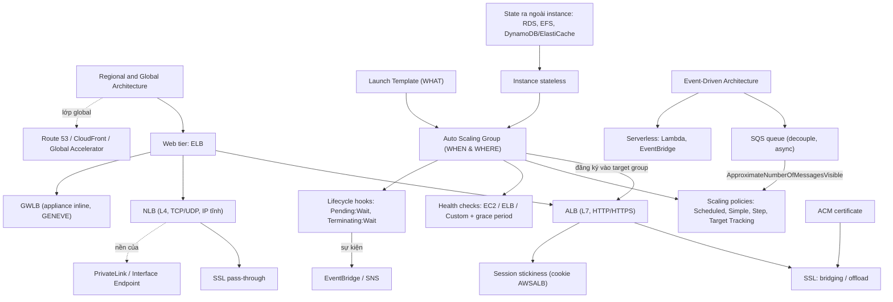

# 13 HA and Scaling

Section này chuyển từ "một EC2 instance chạy tất cả" sang kiến trúc **elastic, self-healing**: load balancer (ALB/NLB/GWLB) để trừu tượng hóa backend, Launch Template + Auto Scaling Group để tự scale và tự thay instance hỏng, rồi tới decoupling bằng queue và kiến trúc event-driven. Đây là bản lề của khóa học: nó dùng lại EC2, RDS, EFS ở các section trước và mở đường cho [[_MOC 14 Serverless and Application Services|Serverless]] ngay sau.

← [[00 Home]] · Trước: [[_MOC 12 Network Storage and Backup]] · Sau: [[_MOC 14 Serverless and Application Services]]

## Lộ trình học
1. [[Regional and Global Architecture]] — nhìn hệ thống lớn thành các khối regional ghép lại, lớp global lo discovery/CDN/failover; mỗi region chia tier web, compute, storage, caching, DB.
2. [[Elastic Load Balancer]] — ELB là một DNS name trỏ tới nhiều node (≥1 node mỗi AZ), cross-zone LB, internet-facing vs internal, subnet /27.
3. [[Compare - ALB vs NLB]] — ALB layer 7 (host/path routing, luôn terminate) vs NLB layer 4 (TCP/UDP, IP tĩnh, pass-through, nền của PrivateLink).
4. [[Launch Templates]] — định nghĩa trước cấu hình EC2 (AMI, type, SG, user data, role); LT có versioning, là superset của Launch Configuration.
5. [[Auto Scaling Groups]] — giữ số instance bằng desired trong khoảng min–max, trải nhiều AZ, self-healing; ASG = when & where, LT = what.
6. [[ASG Scaling Policies]] — manual, scheduled, Simple, Step, Target Tracking và scale theo độ dài SQS queue; policy chỉ đổi desired.
7. [[ASG Lifecycle Hooks]] — tạm dừng instance ở Pending:Wait / Terminating:Wait (mặc định 3600s) để chạy hành động tùy chỉnh, kết thúc bằng `CompleteLifecycleAction`.
8. [[ASG Health Checks]] — EC2 (mặc định), ELB, Custom; grace period mặc định 300s, đặt quá ngắn gây vòng launch/terminate.
9. [[SSL Offload and Session Stickiness]] — 3 cách xử lý TLS (bridging, pass-through, offload) và sticky session bằng cookie `AWSALB`.
10. [[Lab - Architecture Evolution]] — đưa WordPress từ một instance sang LT → RDS → EFS → ALB + ASG; bài học: instance phải stateless.
11. [[Gateway Load Balancer]] — chạy và scale security appliance bên thứ ba inline, transparent, qua GWLB Endpoint và đóng gói GENEVE.
12. [[Event-Driven Architecture]] — tiến hóa monolith → tiered → queue-based → microservices → event-driven với producer, consumer, event router.

## Bản đồ khái niệm

## Liên kết sang section khác
- Tiền đề: [[Horizontal vs Vertical Scaling]], [[HA vs FT vs DR]]
- State tách khỏi instance: [[RDS Architecture]], [[EFS]], [[ElastiCache]]
- Chứng chỉ cho ALB/NLB: [[ACM]]
- Decoupling và event-driven: [[SQS]], [[Lambda]], [[EventBridge]]
- Lớp global phía trước: [[Global Accelerator]]

## 🎯 Top mẹo thi của section
- **CLB** trong đáp án gần như luôn loại; nhiều domain HTTPS trên một LB → **ALB + SNI**. Tải lệch giữa các AZ → bật **cross-zone load balancing**. ([[Elastic Load Balancer]])
- Backend sau internet-facing LB vẫn có thể ở **private subnet**; subnet cho LB chọn **/27** (cần 8+ IP trống). ([[Elastic Load Balancer]])
- **NLB** khi đề nói: IP tĩnh/whitelist IP, UDP, end-to-end encryption không terminate trên LB, PrivateLink. Còn lại (path/host routing, cookie stickiness, xác thực Cognito/OIDC) → **ALB**. ([[Compare - ALB vs NLB]])
- "Không được để cert trên LB" / CloudHSM giữ key → **SSL pass-through với NLB**; "giảm tải CPU do SSL" → **SSL offload trên ALB**. ([[SSL Offload and Session Stickiness]])
- User mất session khi qua LB → bật **stickiness**; nhưng giải pháp scalable nhất là đưa session ra **DynamoDB/ElastiCache** và để instance stateless. ([[SSL Offload and Session Stickiness]])
- **Launch Template > Launch Configuration** (versioning, Spot/On-Demand mix); đổi AMI/instance type của ASG → tạo **LT version mới**. ([[Launch Templates]])
- Lịch tải biết trước → **Scheduled**; phản ứng theo mức vượt ngưỡng → **Step** (tốt hơn Simple); giữ metric ở mục tiêu → **Target Tracking**. ([[ASG Scaling Policies]])
- Scale theo **memory** cần **CloudWatch Agent**; worker queue scale theo **ApproximateNumberOfMessagesVisible**. ([[Auto Scaling Groups]])
- HA rẻ cho một instance → ASG **1/1/1** trải nhiều AZ. Bảo trì một instance → **Standby**. ([[Auto Scaling Groups]])
- ASG launch rồi terminate liên tục → **health check grace period quá ngắn** (mặc định 300s). App hỏng mà ASG không thay → bật **ELB health check** trên ASG. ([[ASG Health Checks]])
- Lấy log trước khi terminate / cấu hình xong mới nhận traffic → **lifecycle hook** (timeout mặc định 3600s, `CompleteLifecycleAction`). ([[ASG Lifecycle Hooks]])
- Muốn scale ngang hoặc self-heal thì phải tách state: DB → RDS/Aurora, file dùng chung → **EFS** (không phải EBS). ([[Lab - Architecture Evolution]])
- **Third-party firewall/IDS/IPS inline cần scale** hoặc thấy **GENEVE (UDP 6081)** → **Gateway Load Balancer**. ([[Gateway Load Balancer]])
- "Decouple", "xử lý bất đồng bộ", "chịu backlog" → **SQS** giữa hai tier; internal ALB cho HA nhưng **không** decouple. ([[Event-Driven Architecture]])
- Payload lớn để ở **S3**, message chỉ chứa con trỏ (SQS tối đa 1 MiB). ([[Event-Driven Architecture]])
