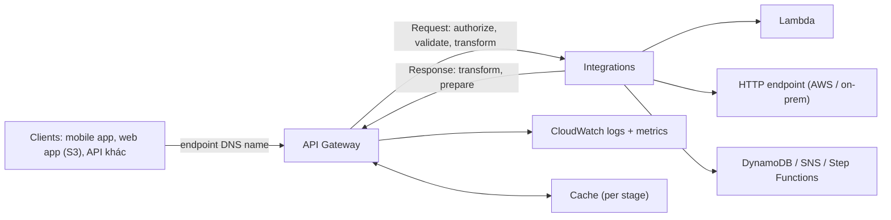

# API Gateway

> **TL;DR:** API Gateway là dịch vụ managed để **tạo và quản lý API**. Nó là **endpoint/cửa vào** cho ứng dụng, đứng giữa client và các **integration** (backend: Lambda, HTTP endpoint, dịch vụ AWS), lo luôn authorization, throttling, caching, CORS, transformation. Nó là mặt tiền chuẩn của [[Serverless Architecture]].

## 🖼️ Sơ đồ
![[API Gateway.excalidraw]]
*Mở bằng plugin Excalidraw để chỉnh sửa · ảnh tĩnh: [[API Gateway.svg]]*

![[API Gateway - errors.excalidraw]]
*Mở bằng plugin Excalidraw để chỉnh sửa · ảnh tĩnh: [[API Gateway - errors.svg]]*

## Khái niệm cốt lõi
- **API** (Application Programming Interface): cách các ứng dụng nói chuyện với nhau (vd. app Netflix trên TV gọi backend Netflix qua API).
- **Highly available và scalable**, managed hoàn toàn.
- Tính năng chính:
  - **Authorization**: ai được gọi API.
  - **Throttling**: giới hạn tần suất gọi.
  - **Caching**: giảm số lần gọi backend.
  - **CORS**: kiểm soát bảo mật cho lời gọi cross-domain từ trình duyệt.
  - **Transformation**: biến đổi request/response.
  - Hỗ trợ **OpenAPI spec**: import định nghĩa API dễ dàng.
  - **Tích hợp trực tiếp dịch vụ AWS** (ghi DynamoDB, start Step Functions, gửi SNS...) → đôi khi **không cần compute** ở giữa.
- **Public service**: làm frontend cho dịch vụ chạy trong AWS **hoặc on-premises**. Là công cụ **migration** tốt: giữ một frontend nhất quán trong khi backend được dời từ on-prem lên AWS hoặc tái kiến trúc từ monolith/EC2 sang Lambda.
- Loại API: **HTTP**, **REST**, **WebSocket**.

## Cách hoạt động / Kiến trúc

- Ba pha: **Request** (authorize, validate, transform request của client thành dạng integration hiểu) → **Integration** (backend xử lý) → **Response** (transform, chuẩn bị và trả về client).
- Tích hợp [[CloudWatch Basics|CloudWatch]] để lưu log và metric cho cả phía request lẫn response.

### Authentication / Authorization
| Cách | Luồng |
|---|---|
| **Open** | Không cần xác thực |
| **[[Cognito]] User Pools** | Client đăng nhập Cognito, nhận token → gửi token kèm request → API Gateway **tự validate native** |
| **Lambda authorizer** (trước gọi là *custom authorizer*) | Client gửi **bearer token** → API Gateway gọi Lambda authorizer → function kiểm tra (user store riêng hoặc IdP ngoài) → trả về **IAM policy + principal identifier** → API Gateway đánh giá policy: cho đi tiếp tới integration hoặc trả **403 Access Denied** |
| **IAM** | Gửi credentials (ký SigV4) trong header; chi tiết nằm ngoài phạm vi thi |

### Endpoint types
| Loại | Đặc điểm | Khi nào dùng |
|---|---|---|
| **Edge-optimized** | Request được định tuyến tới **CloudFront POP gần nhất** | Client phân tán toàn cầu |
| **Regional** | Không qua mạng CloudFront, overhead thấp | Client/dịch vụ **cùng region** |
| **Private** | Chỉ truy cập **trong VPC qua interface endpoint** | API hoàn toàn private ([[Interface VPC Endpoints]]) |

### Stages và canary deployment
- Mỗi lần **deploy** cấu hình API là deploy vào một **stage** (vd. `prod`, `dev`). Mỗi stage có **URL endpoint riêng** và **settings riêng**; phần lớn cấu hình gắn theo stage.
- Ví dụ: `prod` chạy API v1 với Lambda v1; `dev` chạy API v2 với Lambda v2 mới. Có thể **rollback** deployment trên stage.
- **Canary**: bật canary trên một stage → deployment mới đi vào **phần canary** của stage, không phải stage gốc. Điều chỉnh **tỉ lệ traffic** giữa base và canary; ổn thì **promote** canary thành base, có vấn đề thì **xóa** canary và quay về base.

### Mã lỗi (slide "Remember these")
| Mã | Ý nghĩa |
|---|---|
| **4XX** | Client error: request sai từ phía client (quyền, header sai...) |
| **5XX** | Server error: request hợp lệ nhưng **backend** có vấn đề |
| **400** | Bad Request, lỗi chung phía client, khó chẩn đoán |
| **403** | Access Denied: authorizer từ chối, hoặc bị **[[WAF]]** lọc |
| **429** | **Throttling**: vượt ngưỡng throttle đã cấu hình |
| **502** | Bad Gateway Exception: backend (vd. Lambda) trả về **output không hợp lệ** |
| **503** | Service Unavailable: backend offline / sự cố lớn (từng xuất hiện trong đề) |
| **504** | Integration Failure/**Timeout**: vượt giới hạn **29 giây** |

- **29 giây**: dù Lambda chạy được 15 phút, Lambda đứng sau API Gateway phải trả lời trong 29 s, không thì nhận 504. (Từ 2024, Regional/Private REST API có thể xin nâng quota này, đổi lại giảm throttle; với đề thi cứ nhớ **29 s**.)

### Caching
| Thông số | Giá trị |
|---|---|
| Phạm vi | **Định nghĩa theo stage** |
| Kích thước | **500 MB – 237 GB** |
| TTL mặc định | **300 giây** |
| TTL cấu hình | **0** (tắt) tới tối đa **3600 giây** |
| Mã hóa | **Có thể encrypt** cache |

- Chỉ gọi backend khi **cache miss** → giảm tải backend, giảm chi phí, tăng hiệu năng (latency thấp hơn).

## 🎯 Mẹo thi SAA-C03
- Cần một **API managed, serverless** trước Lambda/DynamoDB/Step Functions → **API Gateway**. Bộ ba kinh điển: **S3 + API Gateway + Lambda**.
- **Migration**: giữ API ổn định cho client trong khi backend dời từ on-prem sang AWS → API Gateway trước HTTP endpoint on-prem.
- Thuộc các mã lỗi: **403** (authorizer/WAF), **429** (throttling), **502** (Lambda trả output sai), **503** (backend unavailable), **504** (timeout **29 s**).
- Lambda đứng sau API Gateway: **giới hạn 29 s**, không phải 15 phút.
- **Cache theo stage**, 500 MB–237 GB, TTL mặc định 300 s, max 3600 s, có thể mã hóa → giảm tải backend và latency.
- Client toàn cầu → **edge-optimized**; cùng region → **regional**; chỉ trong VPC → **private** (interface endpoint).
- Xác thực người dùng ứng dụng → **Cognito User Pools**; token/IdP tùy biến → **Lambda authorizer**.
- Triển khai an toàn từng phần → **stage + canary**. Đồng thời có thể dùng [[Lambda]] alias/version phía sau.
- Muốn chặn tấn công lớp 7 → gắn [[WAF]] vào API Gateway (bị chặn → 403).

## Liên kết
- Tiên quyết: [[Lambda]], [[Serverless Architecture]]
- Dùng cùng: [[Cognito]], [[Step Functions]], [[SNS]], [[DynamoDB Architecture]], [[S3 Static Website Hosting]], [[WAF]], [[CloudWatch Basics]]
- Mạng/phân phối: [[CloudFront Architecture]], [[Interface VPC Endpoints]], [[ACM]]
- Thực hành: [[Lab - Serverless App Pet-Cuddle-o-Tron]]
- Phân biệt với: [[Elastic Load Balancer]], [[Compare - ALB vs NLB]]
