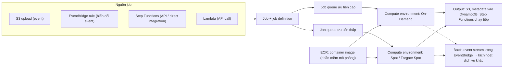

# AWS Batch

> **TL;DR:** AWS Batch là dịch vụ **batch processing được quản lý**: chia một khối việc lớn (mô phỏng khoa học, rendering, xử lý dữ liệu lớn) thành **rất nhiều job nhỏ chạy song song**, không cần người tương tác. Bạn chỉ định nghĩa **job**; Batch lo **queue, compute và orchestration**. Job chạy dưới dạng **container** (mọi runtime, CPU/memory lớn, GPU) trên **compute environment** scale về 0 khi không có việc: **managed** (EC2 On-Demand/Spot, ECS Managed Instances, Fargate) hoặc **unmanaged** (bạn tự lo ECS/EKS). **Batch không tính phí riêng**, chỉ trả tiền compute. Ranh giới hay thi: Lambda ≤ 15 phút cho việc ngắn; một job dài đơn lẻ → ECS task trên Fargate; **nhiều job song song** → **Batch**.

## 🖼️ Sơ đồ
![[AWS Batch.excalidraw]]
*Mở bằng plugin Excalidraw để chỉnh sửa · ảnh tĩnh: [[AWS Batch.svg]]*

## Khái niệm cốt lõi
### Vì sao cần Batch
- Kịch bản: nhà khoa học **Winnie** nghiên cứu **thuốc giải nọc drop bear**, có thư viện **hàng triệu hợp chất** cùng dữ liệu mô phỏng trên **S3**. Công ty dùng workflow **event-driven**: dữ liệu vào S3 sinh event, event đưa tới compute chạy test, kết quả ghi lại vào S3.
- Kiến trúc event-driven thì tốt (không có việc thì không tốn tài nguyên), nhưng chạy hàng triệu test **tuần tự trong một job** thì mất nhiều ngày. Cần **chia job lớn thành hàng nghìn job nhỏ**, mỗi job test một phần thư viện, rồi **chạy song song** để xong nhanh hơn.
- **Batch processing**: tách workload lớn (nghiên cứu, mô hình thời tiết, phân tích dữ liệu) thành nhiều job nhỏ, chạy song song trên compute sẵn có, **không cần người dùng tương tác**. Job **ngắn hay dài đều được**. Compute thường lớn và **dùng chung**; job nằm trong **queue** và có **độ ưu tiên**. Tự xây phần lập lịch và điều phối này thì phức tạp và tốn kém; Batch làm thay.
- **Vì sao không phải Lambda**: việc cần **hơn 15 phút** hoặc **nhiều tài nguyên hơn Lambda cho phép**, lại cần chia nhỏ và xếp hàng → cần queue + compute + orchestration của Batch (xem [[Lambda]]).

### Đặc điểm chính
- Job chạy dưới dạng **container** → hỗ trợ **mọi runtime**, job cần nhiều **CPU, memory hoặc GPU**.
- Compute bên dưới **scale về 0** khi không có gì để chạy.
- Gửi job qua **API**, từ **[[EventBridge]] rule**, hoặc trong workflow **[[Step Functions]]**.
- **Không tính phí cho bản thân Batch**: chỉ trả tiền compute mà job dùng.

### Thành phần
| Thành phần | Ý nghĩa |
|---|---|
| **Job** | Thứ cần chạy: script, executable hoặc Docker container; chạy trong container. Có thể là job đơn giản, job **phụ thuộc** job khác, **array job** (một lần submit tỏa ra hàng nghìn bản sao, mỗi bản làm một phần), hoặc job cần phần cứng riêng như **GPU** |
| **Job definition** | Job cần gì để chạy: cấu hình tài nguyên, **IAM permission** (nếu job gọi dịch vụ AWS khác), cấu hình compute và storage, **mount point** |
| **Job queue** | Job được submit vào queue và chờ tới khi có compute. Queue gắn với **một hoặc nhiều compute environment**, có **độ ưu tiên** (queue ưu tiên cao / thấp, theo business unit, theo chức năng); trong queue đặt **thứ tự ưu tiên** các compute environment |
| **Compute environment** | Tài nguyên compute làm việc thật. **Managed** hoặc **unmanaged** (bảng dưới) |

## Cách hoạt động / Kiến trúc

1. **Job vào từ nhiều nguồn**: Lambda hoặc Step Functions gọi API (Step Functions còn có **direct integration**), **EventBridge rule** nhận Batch làm **target** (có thể biến đổi event data thành tham số cho job), hoặc **S3 upload** làm event và job tự kéo object được tham chiếu.
2. Job được đưa vào **queue**; queue phân job sang **compute environment** gắn với nó (theo ưu tiên và chi phí: Spot hay On-Demand, loại và cỡ instance).
3. Để chạy, Batch lấy **container image** từ registry như **[[ECR]]**. Image do bạn chuẩn bị với công cụ, phần mềm cần thiết (với Winnie: phần mềm sàng lọc hợp chất và công cụ kéo dữ liệu từ S3).
4. Job tương tác với dịch vụ AWS khác khi cần; xong thì ghi **output** (S3), ghi **metadata** của lần chạy (ví dụ vào DynamoDB), hoặc báo hoàn tất để **state machine** Step Functions chạy tiếp.
5. **Batch event stream** có trong **EventBridge** → dùng để kích hoạt dịch vụ khác khi job kết thúc. Batch vì thế khớp với kiến trúc **event-driven** ([[Event-Driven Architecture]]).

## Bảng so sánh / số liệu

### Managed vs unmanaged compute environment
| | **Managed** | **Unmanaged** |
|---|---|---|
| Ai provision và scale compute | **Batch** (scale tới 0 khi không có job) | **Bạn** |
| Lựa chọn compute | **EC2** (On-Demand hoặc **Spot**, tự chọn loại/cỡ instance, vCPU), **ECS Managed Instances** (ECS provision và patch instance), **Fargate / Fargate Spot** (không có instance để quản lý) | **ECS** hoặc **EKS** do bạn quản lý; **không dùng được Fargate** |
| Batch còn làm gì | Lập lịch job + quản lý capacity end-to-end | Vẫn **lập lịch job** |
| Khi nào | Mặc định cho hầu hết trường hợp (gần như không tốn công quản trị) | Cần **kiểm soát trực tiếp** compute, ví dụ vì bảo mật hoặc compliance |

- **Spot**: đặt **giá tối đa theo % giá On-Demand**. Hợp với job **chịu được gián đoạn**; cấu hình **retry tự động** để job bị gián đoạn được xếp lại vào queue. Job dài **không được gián đoạn** → **On-Demand**. (Xem [[EC2 Purchase Options]].)
- **AWS khuyến nghị Fargate** cho đa số kịch bản; dùng **EC2** khi cần **GPU** hoặc job **rất lớn**.
- **Mạng**: compute environment chạy **trong VPC**, ở public hoặc private subnet. Đặt ở **private subnet** thì compute vẫn phải tới được **ECS service** và các dịch vụ public AWS mà job dùng → cấu hình **[[NAT Gateway]]** hoặc **VPC endpoint** ([[Gateway VPC Endpoints]], [[Interface VPC Endpoints]]) và kiểm soát traffic phù hợp.

### Chọn compute theo bài toán
| Bài toán | Chọn |
|---|---|
| Function ngắn, event-driven, tối đa 15 phút | [[Lambda]] |
| **Một** job chạy dài đơn lẻ | **ECS task trên Fargate** ([[ECS Launch Types EC2 vs Fargate]]) |
| Workload lớn **chia thành nhiều job chạy song song**, có queue và ưu tiên | **AWS Batch** |
| Workflow nhiều bước có trạng thái, điều phối dịch vụ | [[Step Functions]] (có thể gọi Batch trong Task state) |

## 🎯 Mẹo thi SAA-C03
- "Chạy **hàng nghìn job tính toán song song** (mô phỏng, rendering, phân tích dữ liệu lớn), **không cần người tương tác**, cần **queue và ưu tiên**" → **AWS Batch**.
- Job **> 15 phút** hoặc cần **nhiều CPU/memory/GPU** hơn Lambda → không phải Lambda. Một job dài duy nhất → **ECS/Fargate task**; nhiều job song song → **Batch**.
- **Batch không thu phí riêng**: chỉ trả tiền compute (EC2, Spot, Fargate).
- Tối ưu chi phí cho job chịu được gián đoạn → compute environment dùng **Spot** (giá tối đa theo % On-Demand) + retry; job không được gián đoạn → On-Demand.
- Muốn ít quản trị nhất → **managed compute environment** (thường **Fargate**); cần kiểm soát compute vì compliance → **unmanaged** (ECS/EKS, không có Fargate).
- Compute ở private subnet mà job không kéo được image / không gọi được dịch vụ → thiếu **NAT Gateway hoặc VPC endpoint**.
- Kích hoạt job theo sự kiện: **EventBridge rule → Batch**, hoặc **Step Functions** trong workflow; theo dõi job xong qua **Batch event stream** trong EventBridge.

## Liên kết
- Tiên quyết: [[Lambda]], [[Containers Fundamentals]], [[ECS]]
- Dùng cùng: [[ECR]], [[EventBridge]], [[Step Functions]], [[S3 Events]], [[DynamoDB Architecture]], [[IAM Roles]]
- Mạng và chi phí: [[NAT Gateway]], [[Gateway VPC Endpoints]], [[Interface VPC Endpoints]], [[EC2 Purchase Options]]
- Phân biệt với: [[ECS Launch Types EC2 vs Fargate]], [[EKS]], [[Lambda]]
- Section: [[_MOC 14 Serverless and Application Services]]
