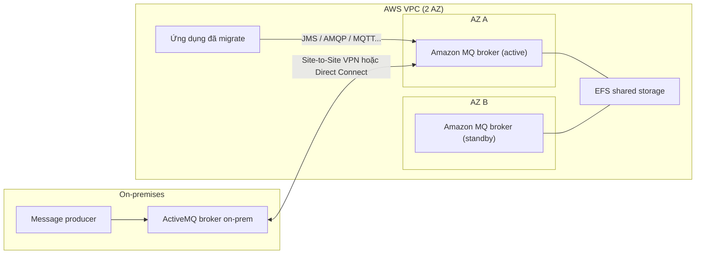

# Amazon MQ

> **TL;DR:** Amazon MQ là **message broker mã nguồn mở được AWS quản lý** (khóa học: Apache ActiveMQ), cung cấp cả **queue** lẫn **topic** qua các **chuẩn mở** (JMS, AMQP, MQTT, OpenWire, STOMP). Đây là đường để **đưa hệ thống messaging on-prem sẵn có lên AWS mà gần như không sửa ứng dụng**. Điều cần nhớ nhất: MQ **chạy trong VPC, không phải public service** như [[SNS]]/[[SQS]], nên cần **private networking**.

## 🖼️ Sơ đồ
![[Amazon MQ.excalidraw]]
*Mở bằng plugin Excalidraw để chỉnh sửa · ảnh tĩnh: [[Amazon MQ.svg]]*

## Khái niệm cốt lõi
- Hình dung như **SNS + SQS gộp lại nhưng dùng chuẩn mở**:
  - **Queue** → giao tiếp one-to-one (giống [[SQS]]).
  - **Topic** → giao tiếp one-to-many (giống [[SNS]]).
  - Cả hai có trong **cùng một sản phẩm**.
- **Vì sao cần MQ?** SNS và SQS dùng **AWS API riêng**. Doanh nghiệp lớn thường đã có hệ thống messaging/queuing on-prem tuân theo chuẩn công nghiệp. Chuyển sang SNS/SQS nghĩa là **phải sửa code**. Muốn migrate mà không sửa thì cần một broker **tuân chuẩn**: đó là Amazon MQ.
- **Engine**: khóa học chỉ nói **Apache ActiveMQ** (một trong những enterprise broker phổ biến nhất). (Hiện nay Amazon MQ hỗ trợ thêm **RabbitMQ**.)
- **API/giao thức nhận diện**: **JMS API**, **AMQP**, **MQTT**, **OpenWire**, **STOMP**.
- **"Managed" nhưng khác kiểu SNS/SQS**: bạn nhận về **broker server** chứ không phải một endpoint vô hình:
  - **Single-instance broker**: cho test/dev hoặc khi muốn tiết kiệm.
  - **Active/standby HA pair**: cho production, hai broker ở **hai AZ**, mặc định dùng [[EFS]] làm **shared storage** nên dữ liệu được replicate giữa các AZ và giữa hai broker.
- **Không phải public service**: broker nằm trong [[Custom VPC|VPC]]. Ai muốn dùng phải có đường mạng riêng vào VPC (hoặc mở firewall/[[Security Groups]] phù hợp). Xem [[AWS Public vs Private Services]].
- **Không có AWS native integration** như SNS/SQS: các dịch vụ AWS khác (CloudWatch alarm, S3 event, ASG notification...) được thiết kế để đẩy vào SNS/SQS, **không** đẩy vào MQ. Về bản chất bạn nhận một sản phẩm ActiveMQ và tự quản lý queue/topic bên trong nó.
  - (Ghi chú hiện tại: MQ vẫn có metrics CloudWatch, log, mã hóa [[KMS]], và [[Lambda]] có thể dùng MQ làm event source. Nhưng ý của bài, và của đề thi, là MQ không "cắm" sẵn vào hệ sinh thái AWS như SNS/SQS.)

## Cách hoạt động / Kiến trúc
Kịch bản điển hình: công ty có producer on-prem đang nói chuyện với một ActiveMQ broker on-prem, muốn **migrate** lên AWS hoặc **chạy song song (coexistence)** trong một giai đoạn.

1. Tạo **HA pair** Amazon MQ trong VPC trải trên 2 AZ (primary + standby, chung EFS).
2. Thiết lập **kết nối riêng** on-prem ↔ AWS: [[Site-to-Site VPN]] hoặc [[Direct Connect]].
3. Broker on-prem và cặp broker trên AWS giao tiếp qua kết nối đó. Ứng dụng nào đã chuyển lên AWS tiếp tục dùng **giao thức chuẩn** như cũ và vẫn hòa nhập với hệ thống on-prem.

## Bảng so sánh / số liệu

| | [[SNS]] / [[SQS]] | Amazon MQ |
|---|---|---|
| Giao diện | AWS API riêng | Chuẩn mở: JMS, AMQP, MQTT, OpenWire, STOMP |
| Mô hình | SNS = topic, SQS = queue (2 dịch vụ) | Queue **và** topic trong 1 broker |
| Vị trí mạng | **Public** AWS zone, truy cập từ mọi nơi có kết nối public endpoint | **Trong VPC**, cần private networking |
| Kiểu quản lý | Serverless, tự scale, HA trong region | Broker instance: single (dev/test) hoặc active/standby pair (prod) |
| Tích hợp AWS | Native (CloudWatch, S3, ASG, CFN... publish/consume trực tiếp) | Không native theo kiểu đó |
| Khi nào dùng | Ứng dụng **mới**, cần tích hợp AWS | **Migrate** hệ thống có sẵn, ít/không sửa code |

## 🎯 Mẹo thi SAA-C03
- **Mặc định** cho topic/queue trong thiết kế mới → **SNS hoặc SQS**.
- Cần **tích hợp AWS** (logging, permission, encryption, dịch vụ khác publish trực tiếp) → **SNS/SQS**.
- Đề nói **"migrate hệ thống messaging on-prem hiện có với ít/không thay đổi ứng dụng"** → **Amazon MQ**.
- Thấy từ khóa **JMS**, **AMQP**, **MQTT**, **OpenWire**, **STOMP**, **ActiveMQ** (hoặc RabbitMQ) → **Amazon MQ**.
- Bẫy hay gặp (Adrian nói đã thấy trong nhiều câu hỏi): chọn MQ thì **phải có private networking** (VPN/Direct Connect/đường vào VPC). Đáp án nào giả định MQ truy cập qua public endpoint như SQS là sai.
- Câu hỏi **hybrid**: hệ thống cũ on-prem, cần migrate hoặc **coexist** với AWS → MQ là lựa chọn rất hợp.
- Không cần biết sâu về MQ cho kỳ thi; chỉ cần nhận diện **khi nào** chọn nó.

## Liên kết
- Tiên quyết: [[AWS Public vs Private Services]], [[Event-Driven Architecture]]
- Phân biệt với: [[SNS]], [[SQS]], [[Compare - SQS vs SNS vs Kinesis]], [[EventBridge]]
- Hạ tầng liên quan: [[Site-to-Site VPN]], [[Direct Connect]], [[EFS]], [[Custom VPC]], [[Security Groups]]
- Section: [[_MOC 14 Serverless and Application Services]]
