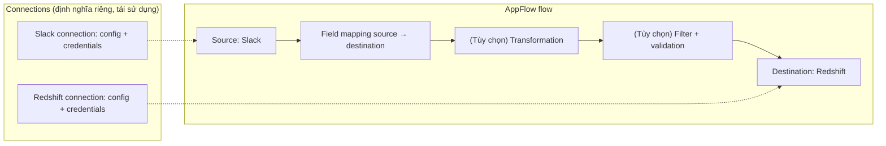

# AppFlow

> **TL;DR:** Amazon AppFlow là dịch vụ **tích hợp dữ liệu fully managed** (kiểu middleware) để **trao đổi dữ liệu giữa các ứng dụng**, đặc biệt giữa **SaaS** (Salesforce, Slack, Zendesk...) và dịch vụ AWS (S3, Redshift...), qua đơn vị cấu hình gọi là **flow**. Dùng để đồng bộ dữ liệu và **phá data silo** mà không phải tự viết code tích hợp.

## 🖼️ Sơ đồ
![[AppFlow.excalidraw]]
*Mở bằng plugin Excalidraw để chỉnh sửa · ảnh tĩnh: [[AppFlow.svg]]*

## Khái niệm cốt lõi
- **Flow** = đơn vị cấu hình chính. Một flow gồm:
  - **Source connector** và **destination connector** (bắt buộc).
  - **Field mapping** từ source sang destination.
  - Tùy chọn: **data transformation**, **filtering**, **validation**.
- **Connector**: cách AppFlow nói chuyện với một ứng dụng. Có sẵn connector cho nhiều ứng dụng phổ biến; nếu thiếu thì tự viết bằng **Custom Connector SDK**.
- **Connection**: lưu **cấu hình + credential** để truy cập một ứng dụng.
  - Định nghĩa **tách biệt** khỏi flow → **tái sử dụng** cho nhiều flow.
- **Mạng**:
  - Mặc định dùng **public endpoint** → nói chuyện được với các SaaS public.
  - Có thể dùng **PrivateLink** để truy cập nguồn private (xem [[Interface VPC Endpoints]]).
- **Ví dụ sử dụng** (theo bài):
  - Đồng bộ **contact record từ Salesforce sang [[Redshift]]** để phân tích.
  - Sao chép **support ticket từ Zendesk vào S3** để lưu trữ/phân tích.
  - Gom dữ liệu từ nhiều nguồn về một chỗ để tránh **data silo**.
- (Bổ sung theo AWS hiện tại, bài không nói: flow có thể chạy **on-demand**, **theo lịch (schedule)** hoặc **theo event** từ SaaS; dữ liệu được mã hóa in-transit và at rest bằng [[KMS]].)

## Cách hoạt động / Kiến trúc
Ví dụ trong slide: lấy dữ liệu từ **Slack** đổ vào **Redshift**.

1. Tạo (hoặc dùng lại) **connection** cho Slack và Redshift; nhờ đó AppFlow biết cách kết nối và dùng thông tin xác thực nào.
2. Trong flow, khai báo **field mapping**: lấy trường nào từ Slack, ghi vào cột nào trong Redshift.
3. Tùy chọn thêm **transformation**, **filter** (chỉ copy dữ liệu cần) và **validation** (kiểm tra dữ liệu trên đường đi).

## Bảng so sánh / số liệu

| Dịch vụ | Dùng khi | Khác AppFlow ở đâu |
|---|---|---|
| **AppFlow** | Đồng bộ dữ liệu **SaaS ↔ AWS** (Salesforce, Slack, Zendesk...) | No-code, connector có sẵn cho SaaS |
| [[Glue]] | ETL dữ liệu giữa các data store (S3, RDS, Redshift...) + Data Catalog | Hướng data lake/ETL, không chuyên SaaS |
| [[DataSync]] | Copy file/object khối lượng lớn từ storage on-prem (NFS/SMB...) lên AWS | Chuyển file, không phải record ứng dụng |
| [[DMS]] | Migrate/replicate **database** | Làm việc với DB engine, không phải SaaS app |
| [[Kinesis Data Firehose]] | Giao **dữ liệu streaming** tới S3/Redshift... | Stream liên tục, không đọc API của SaaS |

## 🎯 Mẹo thi SAA-C03
- Chỉ cần hiểu kiến trúc ở mức cơ bản (Adrian: một video này là đủ cho kỳ thi).
- Đề nói **"chuyển/đồng bộ dữ liệu từ ứng dụng SaaS (Salesforce, Zendesk, Slack, ServiceNow, SAP...) vào S3/Redshift"**, **ít/không viết code** → **AppFlow**.
- Từ khóa: **SaaS integration**, **data silo**, **sync records between applications**, **no-code integration**.
- SaaS nguồn cần đi đường riêng, không qua Internet công cộng → AppFlow + **PrivateLink**.
- Không có connector có sẵn → **Custom Connector SDK** (không cần đổi sang dịch vụ khác).
- Đừng nhầm: dữ liệu là **database** → [[DMS]]; dữ liệu là **file on-prem** → [[DataSync]]/[[Transfer Family]]; **ETL trong data lake** → [[Glue]].

## Liên kết
- Đích thường gặp: [[Redshift]], [[S3 Basics]], [[Athena]]
- Liên quan: [[Glue]], [[Interface VPC Endpoints]], [[KMS]]
- Phân biệt với: [[DataSync]], [[DMS]], [[Transfer Family]], [[Kinesis Data Firehose]]
- Section: [[_MOC 14 Serverless and Application Services]]
