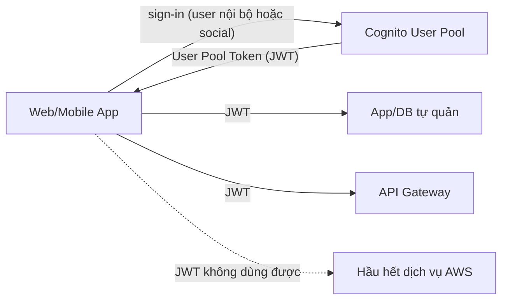
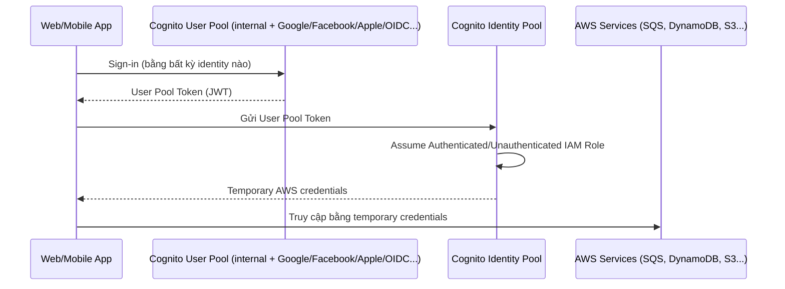

# Cognito

> **TL;DR:** Amazon Cognito cung cấp **authentication, authorization và user management** cho ứng dụng web/mobile. Nó gồm hai phần khác hẳn nhau mà tên gọi rất dễ nhầm: **User Pool** để đăng ký/đăng nhập và nhận **JWT**; **Identity Pool** để đổi một identity (bên ngoài, của user pool, hoặc guest) lấy **temporary AWS credentials** nhằm truy cập tài nguyên AWS.

## 🖼️ Sơ đồ
![[Cognito.excalidraw]]
*Mở bằng plugin Excalidraw để chỉnh sửa · ảnh tĩnh: [[Cognito.svg]]*

![[Cognito - compare.excalidraw]]
*Mở bằng plugin Excalidraw để chỉnh sửa · ảnh tĩnh: [[Cognito - compare.svg]]*

## Khái niệm cốt lõi
Ba chức năng tổng thể:
- **Authentication**: đăng nhập, xác minh credentials.
- **Authorization**: quản lý quyền truy cập vào dịch vụ.
- **User management**: tạo và quản lý một **user database serverless**.

Adrian nhấn mạnh tên gọi trong Cognito "rất tệ", và đây là lý do phần lớn người học bị rối. Cần tách bạch hai thành phần dưới đây.

### User Pools: sign-in và nhận JWT
- Mục tiêu cuối: user **đăng nhập** thành công và nhận về **JSON Web Token (JWT)**.
- Tính năng:
  - **User directory** và **profile**, **sign-up / sign-in**.
  - **Web UI dựng sẵn, tùy biến được** cho màn hình đăng nhập.
  - Bảo mật: **MFA**, kiểm tra **compromised credentials**, **account takeover protection**, xác minh **phone/email**.
  - Workflow tùy biến và **user migration** qua **[[Lambda]] triggers**.
- **Social sign-in và federation**: ngoài user nội bộ, cho phép đăng nhập bằng **Facebook, Google, Amazon, Apple**, OpenID Connect, và **SAML** IdP. Dù đăng nhập bằng cách nào, kết quả đều là **một user pool user** và **một loại token duy nhất** (user pool token).
- JWT dùng được cho:
  - Ứng dụng tự quản (app chạy trên server của bạn, database bạn tự quản).
  - **[[API Gateway]]**: chấp nhận user pool token (JWT) trực tiếp để xác thực.
- **Điểm quan trọng nhất**: user pool **không cấp quyền truy cập dịch vụ AWS**. Hầu hết dịch vụ AWS **không** dùng JWT; chúng cần **AWS credentials** thật. Hãy hình dung user pool là "một database user (có thể gồm cả identity bên ngoài), đăng nhập xong thì nhận JWT, hết".

### Identity Pools: đổi identity lấy AWS credentials
- Mục tiêu: **đổi (swap)** một loại identity lấy **temporary AWS credentials** để truy cập tài nguyên AWS (S3, DynamoDB, SQS...).
- Hai loại identity:
  - **Unauthenticated identities (guest)**: cho khách truy cập có giới hạn mà không cần đăng ký. Ví dụ: game mobile lưu **high score/leaderboard vào [[DynamoDB Architecture|DynamoDB]]** mà không bắt user tạo tài khoản.
  - **Authenticated / federated identities**: token từ **Google, Facebook, Twitter, Amazon, SAML 2.0** (đăng nhập doanh nghiệp), và cả **user pool identity**. Với identity pool, user pool chỉ là **thêm một loại identity provider**.
- Cơ chế: identity pool được cấu hình **ít nhất hai [[IAM Roles|IAM role]]**: một **Authenticated Role** và một **Unauthenticated Role**. Cognito **assume role thay mặt identity**, tạo **temporary credentials** và trả về app. Quyền app có được = quyền của role.
- Credentials hết hạn → app gọi lại Cognito để **làm mới**. App **không lưu credentials lâu dài** ở đâu cả.
- Mỗi external IdP muốn hỗ trợ cần **một cấu hình riêng** trong identity pool (5 IdP → 5 cấu hình, 5 loại token).
- Quá trình đổi token của external IdP lấy AWS credentials gọi là **Web Identity Federation** (thuật ngữ gặp cả trong đề thi lẫn thực tế).

## Cách hoạt động / Kiến trúc

### 1. Chỉ dùng User Pool

### 2. Chỉ dùng Identity Pool (với external IdP)
1. User bấm "Sign in with Google" trong app → được chuyển tới **trang đăng nhập của IdP** (app không bao giờ thấy mật khẩu Google).
2. App nhận **Google token**. Token này chứng minh user đã đăng nhập nhưng **không dùng trực tiếp để truy cập AWS**.
3. App gửi token cho **identity pool** (đã cấu hình hỗ trợ IdP đó).
4. Cognito assume **authenticated role**, trả về **temporary AWS credentials**.
5. App dùng credentials truy cập tài nguyên AWS; hết hạn thì xin lại.

Nhược điểm: app phải xử lý **nhiều loại token khác nhau** cho từng IdP.

### 3. Kết hợp User Pool + Identity Pool (kiến trúc khuyến nghị)

- User pool **chuẩn hóa về một loại token duy nhất** (user pool token), trừu tượng hóa toàn bộ cấu hình nhiều IdP; chỉ còn **một user store, một bộ profile**.
- Identity pool chỉ cần cấu hình **một IdP duy nhất là user pool** → ít công quản trị hơn, còn lại quy trình giống hệt dùng identity pool trực tiếp.

## Bảng so sánh

| | User Pool | Identity Pool |
|---|---|---|
| Mục đích | Sign-up / sign-in, quản lý user | Đổi identity lấy AWS credentials |
| Đầu ra | **JWT** (user pool token) | **Temporary AWS credentials** (qua IAM role) |
| Nguồn identity | User nội bộ + social + SAML/OIDC | External IdP token, user pool token, hoặc guest |
| Truy cập dịch vụ AWS trực tiếp | **Không** (trừ vài dịch vụ như API Gateway nhận JWT) | **Có**, theo quyền của role |
| Guest access | Không | Có (**unauthenticated role**) |
| Tính năng bảo mật | MFA, compromised credentials check, account takeover protection, verify phone/email | Phân quyền qua IAM role |
| Từ khóa | "sign-in", "user directory", "JWT" | "temporary credentials", "federation", "guest" |

## Quy mô
- Cách tiếp cận này cho phép số user **gần như không giới hạn**, vượt xa giới hạn **5.000 IAM user** mỗi account (xem [[IAM Users and ARNs]]) → phù hợp ứng dụng **web-scale**. Không bao giờ tạo IAM user cho người dùng cuối của app.

## 🎯 Mẹo thi SAA-C03
- **User Pool = sign-in → JWT**. **Identity Pool = swap identity → temporary AWS credentials**. Đây là ý "lớn nhất" cần nhớ về Cognito.
- Đáp án nói dùng **user pool token (JWT) để truy cập trực tiếp S3/DynamoDB** → sai; cần identity pool để đổi lấy AWS credentials.
- **[[API Gateway]]** có thể dùng **Cognito User Pool authorizer** để xác thực bằng JWT trực tiếp.
- App mobile/web có hàng triệu user cần truy cập tài nguyên AWS → **Cognito Identity Pool** (web identity federation), không tạo IAM user.
- Cho người chưa đăng nhập truy cập giới hạn (guest) → **unauthenticated identities** của identity pool.
- Hỗ trợ nhiều social IdP mà muốn đơn giản hóa → **user pool làm IdP trung gian + identity pool**.
- Đăng nhập social cho app với giao diện sẵn, MFA, xác minh email → **User Pool**.
- Thuật ngữ **Web Identity Federation** = đổi token IdP bên ngoài lấy AWS credentials.

## Liên kết
- Tiên quyết: [[IAM Roles]], [[IAM Users and ARNs]], [[JSON]]
- Dùng cùng: [[API Gateway]], [[Lambda]], [[DynamoDB Architecture]], [[S3 Basics]], [[SQS]], [[Serverless Architecture]]
- Liên quan: [[MFA]], [[Directory Service]], [[IAM Basics]]
- Section: [[_MOC 14 Serverless and Application Services]]
