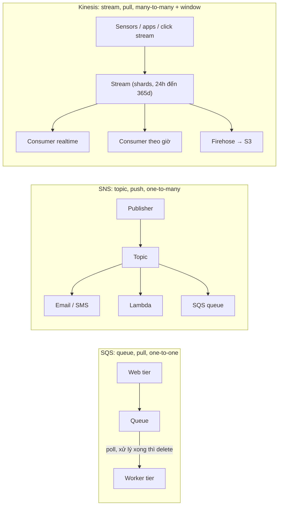
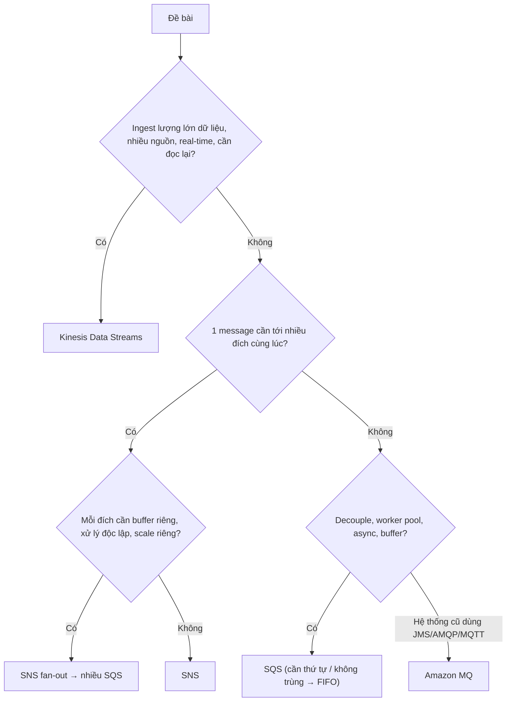

# Compare - SQS vs SNS vs Kinesis

> **TL;DR:** Ba dịch vụ đều "chuyển dữ liệu giữa các thành phần" nhưng giải ba bài toán khác nhau. [[SQS]] là **queue (pull)** để **decouple** và xếp việc cho worker. [[SNS]] là **pub/sub (push)** để phát **một message tới nhiều subscriber**. [[Kinesis Data Streams]] là **stream** để **ingest dữ liệu khối lượng lớn** từ nhiều nguồn, giữ trong **rolling window** cho **nhiều consumer** đọc và đọc lại.

## 🖼️ Sơ đồ
![[Compare - SQS vs SNS vs Kinesis.excalidraw]]
*Mở bằng plugin Excalidraw để chỉnh sửa · ảnh tĩnh: [[Compare - SQS vs SNS vs Kinesis.svg]]*

![[Compare - SQS vs SNS vs Kinesis - decision.excalidraw]]
*Mở bằng plugin Excalidraw để chỉnh sửa · ảnh tĩnh: [[Compare - SQS vs SNS vs Kinesis - decision.svg]]*

## Ba mô hình trong một hình

## Bảng so sánh nhiều chiều

| Tiêu chí | [[SQS]] | [[SNS]] | [[Kinesis Data Streams]] |
|---|---|---|---|
| Mô hình | **Message queue** | **Pub/sub topic** | **Data stream** |
| Cách nhận | **Pull** (consumer poll; short/long polling) | **Push** tới subscriber | **Pull** (consumer đọc từ shard, tự theo dõi vị trí) |
| Quan hệ gửi/nhận | 1 nhóm producer → 1 nhóm consumer (one-to-one về mặt khái niệm) | 1 publisher → **nhiều** subscriber, mỗi subscriber nhận bản sao | **Rất nhiều** producer → **nhiều** consumer, mỗi consumer đọc toàn bộ stream |
| Sau khi đọc | Consumer **xóa** message; không xóa thì hiện lại sau **visibility timeout** | Không lưu lại để đọc sau; giao xong là xong (có **retry**) | Dữ liệu **vẫn nằm trong window**, đọc lại/replay được |
| Persistence | Tạm thời: mặc định 4 ngày, tối đa **14 ngày**, **không có window** | Không persistence cho consumer | **Rolling window** mặc định **24 h**, tối đa **365 ngày** (thêm phí) |
| Thứ tự / delivery | Standard: **at-least-once**, best-effort order. FIFO: **exactly-once**, giữ thứ tự (300 msg/s, 3.000 với batching) | At-least-once (hiện nay có thêm SNS FIFO topic) | Giữ thứ tự **trong mỗi shard** |
| Kích thước | **256 KB**/message theo khóa học (SQS nay 1 MiB); lớn hơn → S3 + link | **256 KB**/message | **1 MB**/record |
| Scaling | Tự động; Standard gần như vô hạn | Tự động trong region | Theo **shard**: mỗi shard **1 MB/s in, 2 MB/s out** (hoặc on-demand mode) |
| Tính phí | Theo **request** (1 request = 0–10 message, tối đa 64 KB) | Theo publish + delivery | Theo **shard-giờ** + lượng dữ liệu đưa vào; window dài hơn đắt hơn |
| Mạng | Public AWS service | Public AWS service | Public AWS service |
| Resilience | HA trong region | HA, regionally resilient | HA trong region |
| Truy cập cross-account | **Queue policy** | **Topic policy** | IAM / resource policy |
| Mã hóa at rest | SSE ([[KMS]]) | SSE | SSE ([[KMS]]) |
| Use case kinh điển | Worker pool, buffer, decoupling, async | Thông báo, alert, **fan-out** | Ingest IoT/telemetry, click stream, log, analytics, dashboard real-time |

## Khi nào chọn cái nào

- **SQS**: một thành phần sinh việc, thành phần khác xử lý; hai bên không cần biết nhau, scale độc lập (ASG scale theo **độ dài queue**). Mỗi việc chỉ cần **một** worker làm.
- **SNS**: một sự kiện cần **đẩy** tới nhiều nơi (email admin, Lambda, HTTP endpoint, queue). Nhiều dịch vụ AWS (CloudWatch alarm, CloudFormation, ASG) gửi thông báo qua SNS.
- **Kinesis Data Streams**: hàng trăm/nghìn thiết bị đẩy dữ liệu liên tục, nhiều ứng dụng phân tích đọc cùng dữ liệu ở **độ chi tiết khác nhau** (mỗi giây, mỗi phút, mỗi giờ), cần giữ dữ liệu để đọc lại.
- **Kết hợp SNS + SQS (fan-out)**: S3 event notification chỉ gửi một event tới một đích; muốn một upload kích hoạt nhiều job (480p, 720p, 1080p) thì đẩy vào **một SNS topic** có **nhiều SQS queue** subscribe, mỗi queue có ASG riêng. Adrian "nháy mắt" rất mạnh: dạng này **chắc chắn có trong đề**.

### Các lựa chọn lân cận
| Nếu đề nói... | Chọn | Ghi chú |
|---|---|---|
| Migrate broker on-prem, giữ **JMS/AMQP/MQTT/OpenWire/STOMP**, ít sửa code | [[Amazon MQ]] | Chạy trong VPC, cần private networking |
| Định tuyến **event** từ dịch vụ AWS/SaaS theo rule, lịch cron | [[EventBridge]] | Event bus + rule → target |
| Đưa dữ liệu stream vào S3/Redshift/OpenSearch, **near real-time**, không quản lý consumer | [[Kinesis Data Firehose]] | Không phải real-time |
| Phân tích SQL trên stream real-time | [[Kinesis Data Analytics]] | Đọc từ KDS/Firehose |
| Điều phối nhiều bước có trạng thái | [[Step Functions]] | Workflow, không phải messaging |

## 🎯 Mẹo thi SAA-C03
- Lăng kính của Adrian khi đọc câu hỏi SQS vs Kinesis: **"ingestion of data"** → **Kinesis**. **Worker pool / decoupling / asynchronous** → mặc định **SQS**, chỉ đổi khi có lý do mạnh. Đề luôn có 1–2 câu về hai dịch vụ này, thường có một câu bắt chọn giữa chúng.
- **Nhiều consumer cùng đọc một dữ liệu** + **replay** → Kinesis (SQS: một message chỉ một consumer xử lý rồi xóa).
- **Gửi tới nhiều subscriber** (email/SMS/HTTP/Lambda) → SNS; **nhiều job độc lập từ một event** → **SNS fan-out → SQS**.
- **Giữ thứ tự + không trùng lặp** trong queue → **SQS FIFO** (nhớ giới hạn 300/3.000 msg/s). Throughput rất cao không cần thứ tự → SQS Standard.
- Cần **lưu dữ liệu stream lâu dài** sau window → Kinesis + **Firehose → S3**.
- Payload lớn (video, file) → **không** đẩy qua SQS/SNS; lưu S3 rồi gửi link.
- Giảm chi phí poll SQS / bớt response rỗng → **long polling** (`WaitTimeSeconds` tới 20 s).
- Cả ba đều là **public service**; dịch vụ messaging nằm **trong VPC** cần private networking là [[Amazon MQ]], đừng nhầm.
- Cross-account: SQS → **queue policy**, SNS → **topic policy**.

## Liên kết
- Chi tiết từng dịch vụ: [[SQS]], [[SNS]], [[Kinesis Data Streams]]
- Mở rộng SQS: [[SQS Standard vs FIFO]], [[SQS Delay Queues]], [[SQS Dead Letter Queues]]
- Họ Kinesis: [[Kinesis Data Firehose]], [[Kinesis Data Analytics]], [[Kinesis Video Streams]]
- Phân biệt thêm: [[Amazon MQ]], [[EventBridge]], [[Step Functions]]
- Bối cảnh: [[Event-Driven Architecture]], [[Serverless Architecture]], [[Auto Scaling Groups]], [[S3 Events]], [[Lambda]]
- Section: [[_MOC 14 Serverless and Application Services]]
