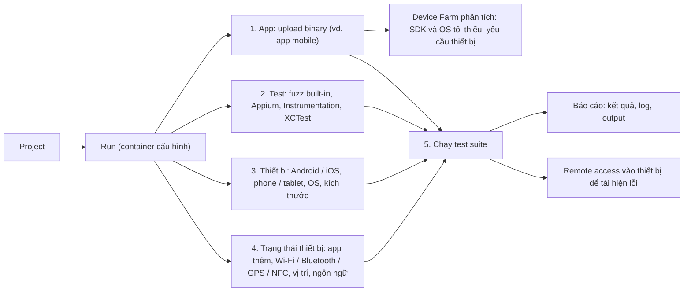

# Device Farm

> **TL;DR:** AWS Device Farm là dịch vụ **kiểm thử ứng dụng web và mobile được quản lý**: chạy test trên **trình duyệt thật và thiết bị thật** (điện thoại, tablet với nhiều hệ điều hành, kích thước, ngôn ngữ), **không phải giả lập**. Bạn tạo một **run** (nằm trong **project**): đưa app lên, chọn test (fuzz có sẵn, Appium, Instrumentation, XCTest...), chọn thiết bị và trạng thái thiết bị, rồi nhận **báo cáo chi tiết** (kết quả, log); khi cần còn **kết nối từ xa vào thiết bị vật lý** để tái hiện lỗi. Cho đề thi chỉ cần biết nó là gì và khi nào dùng.

## 🖼️ Sơ đồ
![[Device Farm.excalidraw]]
*Mở bằng plugin Excalidraw để chỉnh sửa · ảnh tĩnh: [[Device Farm.svg]]*

## Khái niệm cốt lõi
- **Managed web and mobile application testing**: muốn thử app trên "mọi thiết bị có thể" mà không tự mua thiết bị và cài đủ loại hệ điều hành thì dùng Device Farm. "Device Farm có sẵn mọi thiết bị để bạn khỏi phải có."
- **Thiết bị thật, không phải giả lập**: fleet trình duyệt thật và thiết bị thật (phone, tablet), nhiều **ngôn ngữ**, **kích thước**, **hệ điều hành**.
- **Test tự động** bằng framework **có sẵn (built-in)** hoặc framework **được hỗ trợ** mà bạn cấu hình; kết quả là **báo cáo chi tiết** cho từng thiết bị.
- **Remote access**: khi cần điều tra lỗi bằng tay, có thể **kết nối từ xa vào thiết bị vật lý** để xem và tái hiện lỗi.
- **Run** = nền tảng của Device Farm, là "container" chứa cấu hình của một lần test. Mỗi run nằm trong một **project** để gom các run liên quan.

## Cách hoạt động / Kiến trúc

1. **Tạo run** và cung cấp **ứng dụng cần test** (ví dụ binary của app mobile). Device Farm **phân tích binary** để xác định **SDK tối thiểu, phiên bản hệ điều hành** và yêu cầu thiết bị, để chỉ chạy trên thiết bị thật sự hỗ trợ app.
2. **Chọn test**: framework built-in như **fuzz test** (Android và iOS), hoặc framework được hỗ trợ như **Appium**, **Instrumentation** (Android), **XCTest** (iOS).
3. **Chọn thiết bị**: rất nhiều lựa chọn Android, iOS, phone, tablet, hệ điều hành, form factor, kích thước.
4. **Đặt trạng thái thiết bị**: app phụ cần cài thêm, các setting, **radio state** (Wi-Fi, Bluetooth, GPS, NFC bật hay tắt), **vị trí thiết bị** (cho app dùng vị trí), **ngôn ngữ** của hệ điều hành.
5. **Chạy**: test suite chạy xong trả về **báo cáo** gồm kết quả, log và output khác. Developer có thể **kết nối vào thiết bị** để tái hiện và thử cách sửa.

- Kết quả: test **hàng trăm cấu hình**, **ở quy mô lớn**, **lặp lại** theo quy trình của bạn, mọi thứ do AWS cung cấp dạng dịch vụ.

## Bảng so sánh / số liệu
| Thành phần | Vai trò |
|---|---|
| **Project** | Gom các run liên quan |
| **Run** | Cấu hình một lần test: app + test + thiết bị + trạng thái thiết bị |
| **Test** | Fuzz built-in (Android, iOS), Appium, Instrumentation (Android), XCTest (iOS) |
| **Thiết bị** | Thiết bị **thật**: phone, tablet, nhiều OS, kích thước, ngôn ngữ; cả trình duyệt thật cho web app |
| **Trạng thái thiết bị** | App cài thêm, setting, Wi-Fi / Bluetooth / GPS / NFC, vị trí, ngôn ngữ |
| **Kết quả** | Báo cáo chi tiết, log; remote access để tái hiện lỗi |

## 🎯 Mẹo thi SAA-C03
- Đề nói **test app mobile / web trên nhiều thiết bị thật, nhiều hệ điều hành, kích thước màn hình** mà **không muốn tự mua và quản lý thiết bị** → **AWS Device Farm**.
- Từ khóa: **real devices** (không phải emulator), **automated testing** (Appium, XCTest, Instrumentation, fuzz), **remote access to devices**, **test reports**.
- Chỉ cần biết ở mức nhận diện: sản phẩm làm gì, tính năng chính, khi nào dùng.

## Liên kết
- Bối cảnh: ứng dụng web/mobile dùng [[Cognito]], [[API Gateway]]
- Cùng nhóm dịch vụ cho developer: [[X-Ray]]
- Section: [[_MOC 14 Serverless and Application Services]]
