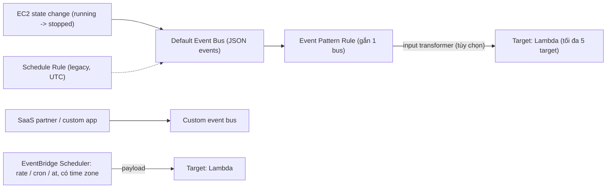

# EventBridge

> **TL;DR:** EventBridge (tiền thân là **CloudWatch Events**) là **router của system event**, định tuyến **gần real-time** event từ dịch vụ AWS, ứng dụng custom và SaaS partner. Event đi qua **event bus**; **rule** (gắn với một bus) khớp **event pattern** rồi chuyển event tới **tối đa 5 target** như [[Lambda]], có thể **biến đổi event** (input transformer) trước khi gửi. Việc chạy theo lịch nay dùng **EventBridge Scheduler** (rate / cron / at, có time zone); **schedule rule** trên bus là tùy chọn **legacy** (chỉ UTC). Mô hình: *"nếu X xảy ra, hoặc tới thời điểm Y, thì làm Z"*.

## 🖼️ Sơ đồ
![[EventBridge.excalidraw]]
*Mở bằng plugin Excalidraw để chỉnh sửa · ảnh tĩnh: [[EventBridge.svg]]*

## Khái niệm cốt lõi
- **Event**: mô tả một thay đổi trong dịch vụ AWS, vd. EC2 instance start/stop/terminate, object được tạo trong S3, job Bedrock thất bại. Event là **JSON**.
- **Nguồn event**: dịch vụ AWS, **ứng dụng custom / third-party**, và **SaaS của AWS partner**.
- **CloudWatch Events vs EventBridge** (bản khóa cũ nêu, bài mới không so sánh nữa):
  - EventBridge là "CloudWatch Events v2": cùng API nền tảng, cùng kiến trúc, nhưng là **superset** về tính năng.
  - Thêm: nhận event từ **third-party (SaaS partner)** và **custom application**, tạo được **nhiều event bus**.
  - AWS khuyến nghị dùng **EventBridge cho mọi triển khai mới**. Thứ tạo ở bên này thấy được ở bên kia (khóa học nói "hiện tại"; nay CloudWatch Events trong console đã chuyển hẳn sang EventBridge).
- Công thức **X → Y → Z**:
  - **X**: dịch vụ được hỗ trợ sinh ra event (*producer*), vd. upload object lên S3.
  - **Y**: thời điểm/khoảng thời gian, vd. mỗi 30 phút hoặc 1 giờ sáng mỗi ngày.
  - **Z**: chuyển event tới một dịch vụ được hỗ trợ (**target**), vd. Lambda.
- **Event bus**: "router" cho event của mọi dịch vụ được hỗ trợ trong account.
  - Mỗi account có một **default event bus**. Tạo được **thêm bus** cho ứng dụng của bạn hoặc sản phẩm third-party; với SaaS partner thì tạo bus theo hướng dẫn của partner.
  - **Dịch vụ AWS** phần lớn **tự gửi event vào default bus**, không cần cấu hình, và **không chuyển hướng sang bus khác được**. Một số dịch vụ phải **bật tích hợp EventBridge** mới gửi, ví dụ **S3**. Dù vậy dịch vụ AWS luôn gửi vào **default bus**.
  - **Ứng dụng custom**: gửi vào default bus hoặc bus custom tự tạo.
  - **SaaS / partner**: **chỉ gửi được vào bus bạn tạo**, không vào default bus.
  - (Bản khóa cũ nêu: CloudWatch Events chỉ có một bus ngầm định, không hiện trong UI.)

## Cách hoạt động / Kiến trúc

- **Rule** gắn với **một event bus cụ thể** (không áp cho mọi bus). Hai loại:
  - **Event pattern rule**: so khớp mẫu của event đi qua bus (vd. `source = aws.ec2`, `detail-type = EC2 Instance State-change Notification`, `state = stopped`, instance ID cụ thể).
  - **Schedule rule (legacy)**: khớp ngày giờ (vd. ngày 3 trong tháng, phút thứ 30), giống cron của Unix, **chỉ theo UTC**. Về kỹ thuật nó **phát một event có detail rỗng lên bus** rồi chuyển tới target. Vẫn gặp trong môi trường cũ; AWS thay bằng **EventBridge Scheduler**.
- Mỗi rule có **target list**: **một hoặc nhiều target, tối đa 5**. Khi rule khớp, event được chuyển tới các target đó (vd. Lambda, SNS). (Bản khóa cũ nêu thêm: các target nhận **song song, không có thứ tự**.)
- Target **nhận nguyên event JSON**, vd. Lambda biết instance ID nào đổi trạng thái, đổi sang trạng thái gì, thời điểm.
- **Biến đổi event trong rule** (**input transformer**): bỏ bớt field của event gốc, hoặc dựng lại event thành định dạng hợp với target, kể cả **thêm dữ liệu** (demo thêm `"action": "start"`).

### EventBridge Scheduler
- Dùng khi chỉ cần **kích hoạt target theo lịch**, không dựa vào event data: **không gắn với event bus nào**, **không truyền event data** cho target (có thể truyền **payload** cố định).
- Ba kiểu biểu thức: **rate** (khoảng đơn giản, vd. mỗi 30 phút), **cron** (thời điểm lặp chính xác, vd. thứ cụ thể trong tuần, giờ cụ thể), **at** (**chạy một lần**).
- **Có time zone** (schedule rule legacy chỉ có UTC) → quản trị đơn giản hơn. Có **flexible time window** (tắt nếu cần chạy đúng giờ); chạy một lần thì có thể tự xóa sau khi hoàn tất.
- Mọi event có chung các trường cấp cao: `id`, `detail-type`, `source`, `account`, `time`, `region`, `resources`; phần `detail` thì tùy dịch vụ và loại event.

### Cron expression trong EventBridge
- 6 trường: **minutes, hours, day-of-month, month, day-of-week, year**. Ví dụ `50 8 * * ? *` = 08:50 mỗi ngày. Console của Scheduler hiện **10 lần kích hoạt kế tiếp** để kiểm tra.
- Schedule rule legacy tính theo **UTC**; Scheduler cho chọn **time zone**.

## Demo / Lab: tự động hóa EC2 bằng Lambda + EventBridge
Kịch bản Aus-E-Mart: 2 EC2 instance tạo bằng CloudFormation one-click (us-east-1): **AEM Web Store** (quan trọng, phải luôn chạy) và **AEM Reports Worker** (chạy báo cáo nặng, làm chậm web store nếu chạy giờ hành chính). Demo gọi Lambda theo 3 cách: **thủ công**, **theo lịch**, **theo event**. Gồm 2 Lambda function, 1 schedule (Scheduler) và 1 rule.

1. **Execution role** (`demo-EC2-Lambda-start-stop`): trust Lambda; **inline policy** cho CloudWatch Logs + start/stop EC2 (function nào cũng cần quyền ghi CloudWatch Logs).
2. **`demo-aem-reports-controller`**: danh sách instance lấy từ environment variable `EC2_INSTANCES`; function đọc `action` (`start`/`stop`) trong **event data** rồi start/stop tất cả instance trong danh sách. Test trong console bằng test event JSON `action: stop` → reports worker dừng (gọi **thủ công**).
3. **EventBridge Scheduler** → *Schedules* → tạo schedule (one-time hoặc recurring; rate hoặc cron, có xem trước 10 lần chạy kế tiếp; tắt flexible time window), target là function trên, **payload** `action: start` → reports worker tự chạy đúng giờ (thực tế: một schedule tối start, một schedule sáng stop).
4. **`demo-aem-webprotect`** (event-driven): không dùng environment variable, chỉ dựa vào event data để biết instance nào cần start.
5. **Rule** trên **default event bus**, kiểu **event pattern** (console còn hiện các tùy chọn schedule **legacy**): source AWS service EC2, loại *EC2 Instance State-change Notification*, state = `stopped`, chỉ instance ID của web store → target `demo-aem-webprotect`; rule có **execution role riêng** để gọi target.
6. **Input transformer** (Additional settings → Configure target input): input path lấy `instance-id` từ event gốc, template dựng **JSON mới** có `action: start` + instance ID → làm giàu event cho function.
7. Rule **không xử lý lại quá khứ**: instance đã stopped trước khi tạo rule thì không được start. Start rồi stop web store → nó chỉ "stopped" thoáng qua rồi pending → running. Log group của function trong CloudWatch Logs cho thấy event đã được biến đổi.
8. Dọn dẹp: xóa rule, schedule, 2 function, 2 role (1 tự tạo, 1 do EventBridge tạo), 2 log group, CloudFormation stack.

Điều rút ra: event pattern rule cho phép phản ứng với thay đổi trạng thái (self-healing, enforcement), **Scheduler** thay cho cron job trên EC2, input transformer chỉnh event cho vừa target.

## 🎯 Mẹo thi SAA-C03
- "Phản ứng khi có thay đổi trong account" (instance đổi trạng thái, API call...) hoặc "chạy tác vụ theo lịch mà không cần server" → **EventBridge rule + Lambda**.
- **Scheduled/cron serverless** → **EventBridge Scheduler** (rate / cron / **at** cho chạy một lần, **có time zone**), thay cho cron trên EC2. Schedule rule trên event bus là **legacy**, chỉ UTC.
- EventBridge = superset của CloudWatch Events; cần event từ **SaaS/third-party hoặc ứng dụng custom** hoặc **nhiều event bus** → EventBridge.
- Event là JSON; target nhận nguyên event để xử lý.
- Mỗi rule gắn với **một event bus**, tối đa **5 target**. Cần đổi định dạng hoặc thêm dữ liệu vào event trước khi tới target → **input transformer** của rule.
- Event từ dịch vụ AWS luôn vào **default bus**; event của SaaS partner chỉ vào **bus bạn tạo**. S3 phải **bật tích hợp EventBridge** mới gửi event.
- Đừng nhầm: [[CloudWatch Basics|CloudWatch]] = metrics/alarm, [[CloudWatch Logs]] = log, EventBridge = event/automation, [[CloudTrail]] = ghi lại API call.

## Liên kết
- Tiên quyết: [[Event-Driven Architecture]], [[JSON]], [[CloudWatch Basics]]
- Dùng cùng: [[Lambda]], [[SNS]], [[SQS]], [[Step Functions]], [[EC2 Basics]]
- Liên quan: [[Serverless Architecture]], [[CloudWatch Logs]], [[CloudTrail]], [[AWS Config]]
- Phân biệt với: [[SNS]] (pub/sub thông báo), [[Compare - SQS vs SNS vs Kinesis]]
