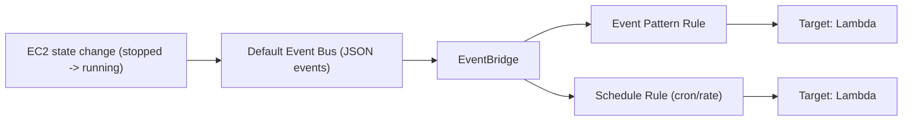

# EventBridge

> **TL;DR:** EventBridge (tiền thân là **CloudWatch Events**) nhận luồng **event gần real-time** mô tả thay đổi trong các dịch vụ AWS, rồi dùng **rule** để khớp event (hoặc khớp lịch kiểu cron) và chuyển chúng tới **target** như [[Lambda]]. Mô hình: *"nếu X xảy ra, hoặc tới thời điểm Y, thì làm Z"*.

## 🖼️ Sơ đồ
![[EventBridge.excalidraw]]
*Mở bằng plugin Excalidraw để chỉnh sửa · ảnh tĩnh: [[EventBridge.svg]]*

## Khái niệm cốt lõi
- **Event**: mô tả một thay đổi trong dịch vụ AWS, vd. EC2 instance start/stop/terminate. Event là **JSON**.
- **CloudWatch Events vs EventBridge**:
  - EventBridge là "CloudWatch Events v2": cùng API nền tảng, cùng kiến trúc, nhưng là **superset** về tính năng.
  - Thêm: nhận event từ **third-party (SaaS partner)** và **custom application**, tạo được **nhiều event bus**.
  - AWS khuyến nghị dùng **EventBridge cho mọi triển khai mới**. Thứ tạo ở bên này thấy được ở bên kia (khóa học nói "hiện tại"; nay CloudWatch Events trong console đã chuyển hẳn sang EventBridge).
- Công thức **X → Y → Z**:
  - **X**: dịch vụ được hỗ trợ sinh ra event (*producer*).
  - **Y**: thời điểm/khoảng thời gian, viết bằng **cron format** kiểu Unix.
  - **Z**: **target** nhận event.
- **Event bus**: luồng event của mọi dịch vụ được hỗ trợ trong account.
  - Mỗi account có một **default event bus**.
  - CloudWatch Events chỉ có **một** bus, ngầm định, không hiện trong UI.
  - EventBridge cho phép tạo **thêm bus** (cho ứng dụng của bạn hoặc partner) và dùng chúng y như default bus.

## Cách hoạt động / Kiến trúc

- **Rule** gắn với một event bus (mặc định là default bus). Hai loại:
  - **Event pattern rule**: so khớp mẫu của event đi qua bus (vd. `source = aws.ec2`, `detail-type = EC2 Instance State-change Notification`, `state = stopped`, instance ID cụ thể).
  - **Schedule rule**: khớp ngày giờ theo **cron expression** hoặc **rate** (mỗi N phút/giờ/ngày) → "serverless cron".
- Khi rule khớp, event được chuyển tới **một hoặc nhiều target**. Nhiều target nhận **song song, không có thứ tự**.
- Target đọc được dữ liệu trong event JSON, vd. Lambda nhận instance ID nào đổi trạng thái, đổi sang trạng thái gì, thời điểm.
- Mọi event có chung các trường cấp cao: `id`, `detail-type`, `source`, `account`, `time`, `region`, `resources`; phần `detail` thì tùy dịch vụ và loại event.

### Cron expression trong EventBridge
- 6 trường: **minutes, hours, day-of-month, month, day-of-week, year**. Ví dụ `50 8 * * ? *` = 08:50 mỗi ngày.
- Lịch của rule tính theo **UTC** (giờ 24h). Cần quy đổi giờ địa phương sang UTC.

## Demo / Lab: tự động hóa EC2 bằng Lambda + EventBridge
Kiến trúc: 2 EC2 instance (tạo bằng CloudFormation one-click), 3 Lambda function, 2 rule.

1. **Execution role** `EC2StartStopLambdaRole`: trust Lambda; managed policy cho phép ghi CloudWatch Logs + start/stop EC2.
2. **`EC2Stop`** và **`EC2Start`**: đọc danh sách instance từ environment variable `EC2_INSTANCES` (ID cách nhau bằng dấu phẩy), gọi `StopInstances`/`StartInstances`. Test thủ công trong console là **invoke thủ công** (event không dùng tới).
3. **`EC2Protect`** (event-driven): đọc `detail.instance-id` trong event và start lại ngay instance đó.
4. **Rule `EC2Protect`** (event pattern): source EC2, loại *EC2 Instance State-change Notification*, state = `stopped`, chỉ instance 1 → target `EC2Protect`. Kết quả: stop instance 2 thì nó dừng hẳn; stop instance 1 thì nó tự chạy lại.
5. **Rule `EC2Stop`** (schedule, cron UTC vài phút sau) → target `EC2Stop`. Khi chạy: cả hai instance bị stop → instance 1 sinh event `stopped` → rule protect bắt được → instance 1 tự bật lại. **Hai rule tự động nối tiếp nhau.**
6. Kiểm tra log ở CloudWatch Logs `/aws/lambda/EC2Protect`: function in ra event JSON nhận được.
7. Dọn dẹp: xóa 3 function, 2 rule, policy, role, CloudFormation stack.

Điều rút ra: event pattern rule cho phép phản ứng với thay đổi trạng thái (self-healing, enforcement), schedule rule thay cho cron job trên EC2, và nhiều rule có thể tương tác dây chuyền qua event bus.

## 🎯 Mẹo thi SAA-C03
- "Phản ứng khi có thay đổi trong account" (instance đổi trạng thái, API call...) hoặc "chạy tác vụ theo lịch mà không cần server" → **EventBridge rule + Lambda**.
- **Scheduled/cron serverless** → EventBridge schedule rule (thay cho cron trên EC2). (Hiện AWS còn có **EventBridge Scheduler**, hỗ trợ time zone và one-time schedule; khóa học không đề cập.)
- EventBridge = superset của CloudWatch Events; cần event từ **SaaS/third-party hoặc ứng dụng custom** hoặc **nhiều event bus** → EventBridge.
- Event là JSON; target nhận nguyên event để xử lý.
- Nhiều target của một rule nhận event **song song, không thứ tự**.
- Đừng nhầm: [[CloudWatch Basics|CloudWatch]] = metrics/alarm, [[CloudWatch Logs]] = log, EventBridge = event/automation, [[CloudTrail]] = ghi lại API call.

## Liên kết
- Tiên quyết: [[Event-Driven Architecture]], [[JSON]], [[CloudWatch Basics]]
- Dùng cùng: [[Lambda]], [[SNS]], [[SQS]], [[Step Functions]], [[EC2 Basics]]
- Liên quan: [[Serverless Architecture]], [[CloudWatch Logs]], [[CloudTrail]], [[AWS Config]]
- Phân biệt với: [[SNS]] (pub/sub thông báo), [[Compare - SQS vs SNS vs Kinesis]]
