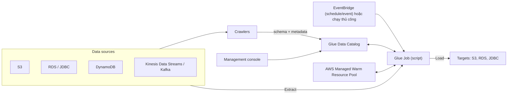

# Glue

> **TL;DR:** AWS Glue là dịch vụ **ETL (Extract, Transform, Load) serverless** kèm **Glue Data Catalog**: crawler quét các nguồn dữ liệu để sinh metadata vào catalog, còn Glue job chuyển và biến đổi dữ liệu giữa nguồn và đích mà bạn không phải quản lý compute. Ví dụ bài học: CSV đơn hàng trên S3 → Glue job lọc đơn hủy, đổi sang **Parquet** ở bucket khác → crawler đăng ký bảng trong catalog → team finance truy vấn bằng **Athena**. (Bản khóa cũ còn so với Data Pipeline: thấy ETL + "serverless / ad hoc / cost effective" thì chọn Glue.)

## 🖼️ Sơ đồ
![[Glue.excalidraw]]
*Mở bằng plugin Excalidraw để chỉnh sửa · ảnh tĩnh: [[Glue.svg]]*

## Khái niệm cốt lõi
- **Serverless ETL**: AWS cung cấp và quản lý toàn bộ tài nguyên tính toán; chỉ trả tiền cho tài nguyên **thực sự dùng**.
- So với **AWS Data Pipeline** (bản khóa cũ nêu, bài mới không nói): cũng làm ETL nhưng chạy compute **trong account của bạn** (tạo **EMR cluster** để chạy task). Glue thì không.
- Glue dùng để **di chuyển và biến đổi** dữ liệu giữa source và destination (database, stream, S3...), ví dụ tái cấu trúc hoặc **làm giàu (enrich)** dữ liệu.
- Glue cũng **crawl** các nguồn dữ liệu để tạo **AWS Glue Data Catalog**.

### Nguồn và đích được hỗ trợ (theo slide)
| Loại | Ví dụ |
|---|---|
| Source datastores | [[S3 Basics\|S3]], [[RDS Architecture\|RDS]], cơ sở dữ liệu **JDBC-compatible** (ví dụ [[Redshift]]), [[DynamoDB Architecture\|DynamoDB]] |
| Source streams | [[Kinesis Data Streams]], **Apache Kafka** |
| Data targets | S3, RDS, cơ sở dữ liệu JDBC-compatible, **DynamoDB** |

### Glue Data Catalog
- **Data catalog** = tập hợp **metadata** + công cụ quản lý và tìm kiếm dữ liệu; tức là metadata **bền vững** về các nguồn dữ liệu trong một region.
- **Một data catalog duy nhất cho mỗi region của mỗi account**.
- Chống **data silo**: thay vì dữ liệu bị một team giấu riêng, cấu trúc dữ liệu được công khai để duyệt và đưa vào hệ thống khác bằng ETL của Glue. Ví dụ team finance dùng được dữ liệu do team khác thu thập.
- Nhiều dịch vụ dữ liệu dùng catalog này: **[[Athena]]**, **Redshift Spectrum** (xem [[Redshift]]), **EMR**, **AWS Lake Formation**.
- Dữ liệu được phát hiện bằng **crawler**: cấu hình crawler, cấp credentials, trỏ vào nguồn và để nó chạy. Crawler **kết nối nguồn, xác định schema, tạo metadata** trong catalog.
  - Crawler dùng **IAM role** để truy cập **S3 và DynamoDB**, dùng **Glue connection** cho **cơ sở dữ liệu JDBC**.
  - Crawler **không hỗ trợ stream** như Kinesis hay Kafka (stream chỉ là nguồn cho Glue job).

## Cách hoạt động / Kiến trúc

- **Glue Job** = một job ETL: **extract** dữ liệu từ source, **transform** (tùy chọn) bằng **script do bạn viết hoặc do Glue sinh ra**, rồi **load** vào destination. Job cũng dùng Data Catalog.
- **Ví dụ (Aus-E-Mart)**: file **CSV đơn hàng** hằng ngày đổ vào S3; CSV không hợp để truy vấn quy mô lớn → Glue job đọc CSV, **bỏ đơn đã hủy**, đổi cấu trúc và **chuyển sang Parquet** (columnar, nén) ghi vào **bucket S3 thứ hai** → **crawler đăng ký dữ liệu thành bảng** trong Data Catalog → team finance truy vấn bằng **[[Athena]]** (SQL chuẩn).
- Compute lấy từ **warm resource pool do AWS quản lý**: khi cần thì Glue cấp phát tài nguyên từ pool, xong thì trả lại; bạn chỉ trả cho phần đã dùng.
- Khởi chạy job: **thủ công**, hoặc **event-driven** theo event từ nguồn khác, hoặc **theo lịch** qua **[[EventBridge]] / EventBridge Scheduler**.
- Console cho phép truy cập Data Catalog và điều khiển job.

## Bảng so sánh: Glue vs Data Pipeline
(Bản khóa cũ nêu, bài mới không còn so sánh này.)

| | Glue | Data Pipeline |
|---|---|---|
| Mô hình compute | **Serverless**, AWS quản lý warm pool | Tạo **EMR cluster trong account** của bạn |
| Chi phí | Chỉ trả cho tài nguyên dùng | Trả cho cluster chạy |
| Data Catalog | Có (Glue Data Catalog + crawler) | Không |
| Từ khóa trong đề | serverless, ad hoc, cost effective | ETL "kiểu cũ", cần tính năng riêng của Data Pipeline |

(Khóa học dự đoán Glue sẽ dần thay Data Pipeline. Hiện nay AWS Data Pipeline đã ở chế độ **maintenance mode**, không nhận khách hàng mới từ 2024; AWS khuyến nghị chuyển sang Glue, Step Functions hoặc MWAA.)

## 🎯 Mẹo thi SAA-C03
- Glue = **ETL serverless + Data Catalog**, thuộc nhóm dịch vụ data/analytics.
- Đề thường chỉ đưa **một trong hai**: Glue hoặc Data Pipeline. Nếu có cả hai, tìm từ khóa **serverless**, **ad hoc**, **cost effective** → chọn **Glue**. (Mẹo của bản khóa cũ.)
- Chuyển CSV thô trên S3 sang **Parquet** để phân tích bằng Athena, không quản lý compute → **Glue job** + **crawler**.
- Crawler **không crawl stream** (Kinesis, Kafka); crawler cần **IAM role** cho S3/DynamoDB và **Glue connection** cho JDBC.
- Cần khám phá schema của dữ liệu trên S3 để truy vấn bằng [[Athena]] hoặc Redshift Spectrum → **Glue crawler + Data Catalog**.
- Muốn phá **data silo**, cho các team khác thấy dữ liệu của tổ chức → **Glue Data Catalog**.
- Chạy ETL theo lịch hoặc theo sự kiện → Glue job kích hoạt từ **EventBridge** (hoặc **EventBridge Scheduler**).
- Phân biệt: [[Kinesis Data Firehose]] chỉ biến đổi nhẹ (qua Lambda) rồi **deliver**; [[Kinesis Data Analytics]] xử lý **real-time** bằng SQL; Glue là **ETL batch/ad hoc** và catalog.

## Liên kết
- Liên quan: [[Athena]], [[Redshift]], [[S3 Basics]], [[RDS Architecture]], [[DynamoDB Architecture]], [[Kinesis Data Streams]], [[EventBridge]]
- Phân biệt với: [[Kinesis Data Firehose]], [[Kinesis Data Analytics]], [[DMS]], [[AppFlow]]
- Bối cảnh: [[Serverless Architecture]]
- Section: [[_MOC 14 Serverless and Application Services]]
