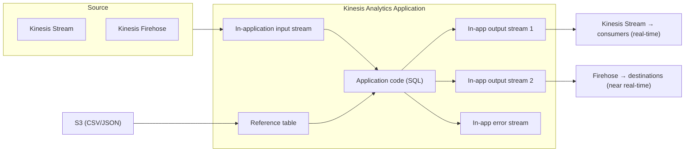

# Kinesis Data Analytics

> **TL;DR:** Kinesis Data Analytics xử lý dữ liệu streaming **real-time bằng SQL**: đọc từ Kinesis Data Streams hoặc Firehose, có thể làm giàu bằng **reference data trên S3**, chạy truy vấn SQL liên tục, rồi ghi ra stream/Firehose/Lambda. Chọn nó khi đề cần **biến đổi/phân tích phức tạp theo thời gian thực**.

## 🖼️ Sơ đồ
![[Kinesis Data Analytics.excalidraw]]
*Mở bằng plugin Excalidraw để chỉnh sửa · ảnh tĩnh: [[Kinesis Data Analytics.svg]]*

> (Khóa học nói KDA dùng SQL. Hiện nay dịch vụ đã đổi tên thành **Amazon Managed Service for Apache Flink**, và các ứng dụng SQL kiểu cũ đang bị AWS ngừng dần. Về khái niệm đề thi vẫn hỏi như dưới đây.)

## Định vị trong họ Kinesis
- [[Kinesis Data Streams]]: **ingest** quy mô lớn + cho consumer đọc (real-time).
- [[Kinesis Data Firehose]]: **delivery** tới đích được hỗ trợ (near real-time), transform đơn giản bằng Lambda.
- **Kinesis Data Analytics**: **xử lý real-time bằng SQL** giữa input stream và output stream.

## Khái niệm cốt lõi
- **Input (source)**: Kinesis Data Streams **hoặc** Kinesis Firehose.
- **Reference data** (tùy chọn): dữ liệu tĩnh trên **S3** (CSV/JSON) để **làm giàu** dữ liệu stream.
- **Output (destination)**:
  - **Kinesis Data Streams**, **Lambda** → **giữ real-time**.
  - **Firehose** (và gián tiếp mọi đích của Firehose: S3, Redshift, OpenSearch, Splunk...) → thành **near real-time**.
- Source/destination đều nằm **ngoài** KDA; KDA **không sửa** nguồn.
- **Chi phí**: trả theo dữ liệu xử lý, nhưng **không rẻ**, chỉ dùng khi thật sự cần.

## Cách hoạt động / Kiến trúc

- **In-application input stream**: giống một bảng database nhưng **liên tục cập nhật**, phản chiếu dữ liệu từ stream/Firehose bên ngoài.
- **Reference table**: bảng ánh xạ dữ liệu S3. Ví dụ game online: stream chỉ có điểm và hành động của người chơi; reference table bổ sung tên người chơi, vật phẩm, giải thưởng.
- **Application code (SQL)**: đọc input stream + reference table, ghi kết quả vào **in-application output stream**; các bảng này được **map** sang Kinesis stream/Firehose bên ngoài.
- **In-application error stream**: chứa lỗi phát sinh khi chạy SQL.
- Tất cả diễn ra **real-time**.

## Use case (theo slide "When and Where")
- Streaming data cần **xử lý SQL real-time**.
- **Time-series analytics**: kết quả **bầu cử**, **e-sports**.
- **Real-time dashboard**: **leaderboard / high-score** cho game.
- **Real-time metrics** cho đội **security & incident response**.

## 🎯 Mẹo thi SAA-C03
- Đề cần **phân tích/biến đổi phức tạp dữ liệu stream theo thời gian thực bằng SQL** → **Kinesis Data Analytics**.
- So với Firehose + Lambda: Firehose là **near real-time** và Lambda chỉ hợp **biến đổi đơn giản**; KDA là **real-time** và cho phép **SQL phức tạp**.
- Muốn giữ **real-time end-to-end** → output ra **Kinesis Data Streams** hoặc **Lambda**, không qua Firehose.
- Leaderboard game / dashboard bầu cử real-time → từ khóa KDA.

## Liên kết
- Tiên quyết: [[Kinesis Data Streams]], [[Kinesis Data Firehose]]
- Liên quan: [[Lambda]], [[S3 Basics]], [[Athena]] (SQL trên dữ liệu ở S3, không real-time), [[Redshift]]
- Phân biệt với: [[Glue]], [[Kinesis Video Streams]], [[Compare - SQS vs SNS vs Kinesis]]
- Section: [[_MOC 14 Serverless and Application Services]]
