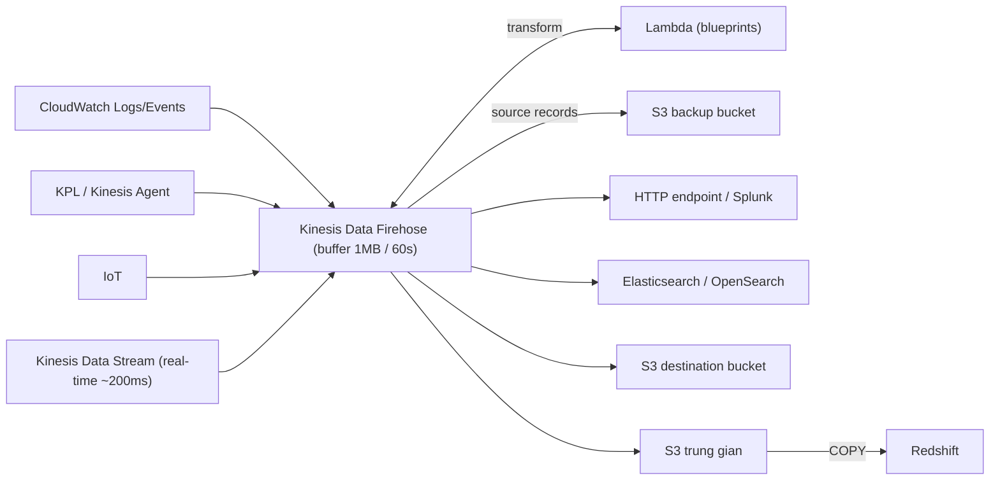

# Kinesis Data Firehose

> **TL;DR:** Firehose (nay đổi tên thành **Amazon Data Firehose**) là dịch vụ **fully managed, serverless** để **giao (deliver)** dữ liệu streaming tới các đích như **S3, Redshift, OpenSearch/Elasticsearch, Splunk, HTTP endpoint**, có thể transform bằng Lambda trên đường đi. Điểm sống còn khi đi thi: Firehose là **NEAR real-time** (~60 s), **không phải real-time**.

## 🖼️ Sơ đồ
![[Kinesis Data Firehose.excalidraw]]
*Mở bằng plugin Excalidraw để chỉnh sửa · ảnh tĩnh: [[Kinesis Data Firehose.svg]]*

## Khái niệm cốt lõi
- [[Kinesis Data Streams]] cho ingest + đọc real-time nhưng **không tự persist** dữ liệu sau rolling window và không tự giao tới dịch vụ khác. Firehose lấp chỗ trống đó.
- **Fully managed, serverless, tự scale, resilient**. Không có shard, không có consumer để quản lý.
- **Billing**: pay-as-you-go theo **khối lượng dữ liệu** đi qua.
- Dùng để load dữ liệu vào **data lake, data store, analytics service** của AWS.

### Nguồn dữ liệu (producer)
- Producer gửi **trực tiếp** vào Firehose (Kinesis Agent, KPL, IoT, CloudWatch Logs/Events...), **hoặc**
- Firehose đọc từ một **Kinesis Data Stream** (đóng vai consumer của stream). Hữu ích khi đã có hệ thống producer ghi vào stream.

### Near real-time & buffering
- Firehose **nhận** dữ liệu real-time nhưng **giao** dữ liệu theo **buffer**: khi đủ **1 MB** **hoặc** sau **60 giây**, tùy điều kiện nào tới trước (khóa học gọi đây là mức tối thiểu chung; hiện nay buffer cấu hình được rộng hơn, kể cả gần 0).
  - Producer ít dữ liệu → thường chờ đủ **60 s**.
  - Producer nhiều dữ liệu → giao mỗi **1 MB**.
- Theo cách AWS phân loại: ~**200 ms** là real-time (Kinesis Data Streams), ~**60 s** là near real-time (Firehose).

### Transformation bằng Lambda
- Source record được gửi tới **Lambda** (có **blueprint** cho tác vụ phổ biến), trả về **transformed record** để giao tiếp.
- Transform có thể **tăng latency** tùy độ phức tạp.
- Có thể lưu **dữ liệu gốc chưa transform** vào một **backup S3 bucket**.

### Đích (destinations): phải nhớ cho đề
- **HTTP endpoint** (kể cả bên thứ ba), **Splunk**, **[[Redshift]]**, **Elasticsearch** (nay là **Amazon OpenSearch Service**), **S3**.
- **Redshift là ngoại lệ**: Firehose ghi vào **S3 trung gian** rồi chạy lệnh **Redshift `COPY`**, tất cả do Firehose lo end-to-end.
- (Hiện nay danh sách đích còn mở rộng thêm: Snowflake, Apache Iceberg tables, nhiều partner HTTP như Datadog, New Relic...)

## Cách hoạt động / Kiến trúc

## Use case điển hình
- **Persist** dữ liệu vào từ Kinesis stream để không mất khi ra khỏi rolling window.
- Lưu dữ liệu sang **định dạng khác** (transform bằng Lambda).
- Giao dữ liệu (trực tiếp hoặc qua stream) tới một trong các đích được hỗ trợ **mà không phải tự viết code**.
- Đánh đổi: không phải tự xây, nhưng **mất tính real-time**. Cần real-time → dùng Kinesis Data Streams + Lambda tự giao tới đích (ví dụ Elasticsearch).

## 🎯 Mẹo thi SAA-C03
- Đề yêu cầu **real-time** → đáp án có Firehose là **sai**. Firehose = **near real-time**.
- Đề muốn **đẩy streaming data vào S3/Redshift/OpenSearch/Splunk** với **ít vận hành nhất** → **Firehose**.
- Nhớ danh sách đích để loại đáp án: Firehose **không** giao trực tiếp vào DynamoDB hay RDS.
- Redshift qua Firehose = **S3 trung gian + COPY**.
- Transform đơn giản trên đường đi → **Lambda trong Firehose**; truy vấn SQL phức tạp real-time → [[Kinesis Data Analytics]].

## Liên kết
- Tiên quyết: [[Kinesis Data Streams]]
- Liên quan: [[Kinesis Data Analytics]], [[Lambda]], [[S3 Basics]], [[Redshift]], [[CloudWatch Logs]], [[Athena]]
- Phân biệt với: [[Glue]] (ETL batch/catalog), [[AppFlow]] (SaaS integration), [[Compare - SQS vs SNS vs Kinesis]]
- Section: [[_MOC 14 Serverless and Application Services]]
