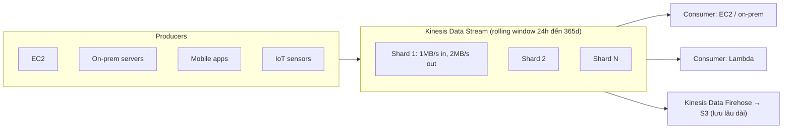

# Kinesis Data Streams

> **TL;DR:** Kinesis Data Streams là dịch vụ **streaming** scale lớn để **ingest** khối lượng dữ liệu khổng lồ từ rất nhiều producer (sensor, app, click stream), lưu trong một **rolling window** (mặc định 24 h, tối đa 365 ngày) để **nhiều consumer** đọc **real-time** ở tốc độ khác nhau. Không phải message queue: đừng nhầm với [[SQS]].

## 🖼️ Sơ đồ
![[Kinesis Data Streams.excalidraw]]
*Mở bằng plugin Excalidraw để chỉnh sửa · ảnh tĩnh: [[Kinesis Data Streams.svg]]*

## Khái niệm cốt lõi
- **Stream** là thực thể cơ bản. **Producer** gửi dữ liệu vào stream, **consumer** đọc ra.
- **Public service**, HA trong region sẵn, không phải lo replication hay network access.
- **Rolling window (persistence)**:
  - Mặc định **24 giờ**: dữ liệu cũ hơn 24 h 0 phút 1 giây bị bỏ.
  - Tăng được tới **365 ngày** (tốn thêm tiền). Dung lượng lưu trữ trong window **đã bao gồm** trong giá.
- **Nhiều producer + nhiều consumer** trên cùng stream; consumer đọc **bất kỳ đâu trong window**, mỗi consumer có thể đọc ở độ chi tiết khác nhau (mỗi giây, mỗi phút, mỗi giờ). Rất hợp cho **analytics và dashboard**.
- **Producer**: EC2, server on-prem, mobile app, IoT sensor... **Consumer**: EC2, server on-prem, [[Lambda]] (invoke khi có dữ liệu mới).

### Shard architecture
- Stream bắt đầu với **1 shard**, cần scale thì **thêm shard**.
- Mỗi shard: **1 MB/s ingest** (thêm giới hạn 1.000 record/s) và **2 MB/s consume**.
- Càng nhiều shard → càng nhiều throughput → càng đắt. Window dài hơn cũng tăng giá.
- Dữ liệu lưu dưới dạng **Kinesis data record**, tối đa **1 MB** mỗi record, phân bổ qua các shard ⇒ hiệu năng scale **tuyến tính** theo số shard.
- (Hiện nay có thêm **on-demand capacity mode** tự quản lý shard, và **enhanced fan-out** cho mỗi consumer 2 MB/s/shard riêng. Khóa học chỉ nói provisioned shard.)

## Cách hoạt động / Kiến trúc

- **[[Kinesis Data Firehose]]** nối vào stream để đẩy dữ liệu **hàng loạt** sang dịch vụ khác (ví dụ S3), giúp dữ liệu tồn tại **sau** rolling window, rồi phân tích bằng EMR/[[Athena]]/[[Redshift]].

## Bảng so sánh / số liệu

| Thông số | Giá trị |
|---|---|
| Retention mặc định | 24 h |
| Retention tối đa | 365 ngày (thêm phí) |
| Ingest / shard | 1 MB/s (1.000 record/s) |
| Consume / shard | 2 MB/s |
| Record size | tối đa 1 MB |
| Độ trễ | real-time (~200 ms) |

### SQS vs Kinesis (Adrian nhấn mạnh, đề luôn có 1–2 câu)
| | SQS | Kinesis Data Streams |
|---|---|---|
| Mục đích | **Decoupling**, **asynchronous** communication, worker pool | **Ingest dữ liệu quy mô lớn**, analytics, monitoring, click stream |
| Producer/consumer | Thường 1 nhóm gửi, 1 nhóm nhận (ví dụ web tier → worker tier) | Rất nhiều producer, **nhiều consumer** đọc độc lập |
| Persistence | **Không** có window; xử lý xong là xóa | **Rolling window**, đọc lại được trong window |
| Tốc độ đọc | Mỗi message được một consumer xử lý | Mỗi consumer đọc toàn bộ stream ở tốc độ riêng |

## 🎯 Mẹo thi SAA-C03
- Lăng kính đọc đề của Adrian: câu hỏi về **ingestion of data** → **Kinesis**. Câu hỏi về **worker pool, decoupling, asynchronous** → mặc định **SQS**, chỉ đổi khi có lý do mạnh.
- Từ khóa Kinesis: **real-time**, **streaming**, **hàng nghìn sensor/IoT**, **click stream**, **nhiều consumer**, **đọc lại / replay**, **dashboard / analytics**.
- Cần **lưu dữ liệu stream lâu dài** (sau window) → thêm **Kinesis Data Firehose → S3**.
- Cần **real-time** xử lý → Kinesis Data Streams + Lambda/consumer, **không** phải Firehose (near real-time).
- Throughput không đủ → **thêm shard** (hoặc on-demand mode).

## Liên kết
- Liên quan: [[Kinesis Data Firehose]], [[Kinesis Data Analytics]], [[Kinesis Video Streams]], [[Lambda]], [[Glue]]
- Đích phân tích: [[Athena]], [[Redshift]]
- Phân biệt với: [[SQS]], [[SNS]], [[Compare - SQS vs SNS vs Kinesis]]
- Section: [[_MOC 14 Serverless and Application Services]]
