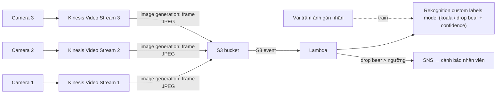

# Kinesis Video Streams

> **TL;DR:** Kinesis Video Streams (KVS) là thành viên của họ Kinesis chuyên **ingest video live** (và dữ liệu time-serialized khác như audio, thermal, depth, radar) từ camera, điện thoại, xe, drone vào AWS. Dữ liệu được lưu, mã hóa và lập chỉ mục bên trong dịch vụ để consumer đọc theo từng frame hoặc theo nhu cầu; có thể **trích frame thành ảnh JPEG vào S3** (image generation) rồi phân tích bằng [[Rekognition]] (deep learning, kể cả **custom labels**).

## 🖼️ Sơ đồ
![[Kinesis Video Streams.excalidraw]]
*Mở bằng plugin Excalidraw để chỉnh sửa · ảnh tĩnh: [[Kinesis Video Streams.svg]]*

## Khái niệm cốt lõi
- **Producer**: security camera, smartphone, ô tô, drone... Ngoài video còn nhận được **dữ liệu không phải video nhưng có tính chuỗi thời gian**: audio, ảnh nhiệt (thermal), depth, radar.
- **Consumer**: truy cập dữ liệu **frame-by-frame** hoặc khi cần để phân tích tiếp.
- **Managed service**: tự **persist** dữ liệu và **mã hóa cả in transit lẫn at rest**.
- **Không truy cập trực tiếp được dữ liệu gốc** (ý quan trọng nhất cho đề thi):
  - Dữ liệu không được lưu ở định dạng gốc mà đã được **index và lưu có cấu trúc bên trong KVS**.
  - Không có chuyện mở file video trên [[EBS]], [[S3 Basics|S3]] hay [[EFS]]. Mọi truy cập phải đi **qua chính sản phẩm KVS**.
  - KVS **trích được ảnh (frame) từ stream và copy vào S3 bucket** (image generation). Đó là ảnh được xuất ra, không phải truy cập trực tiếp dữ liệu video đã lưu.
- **Tích hợp dịch vụ AWS** (hai ví dụ điển hình):
  - **Rekognition**: phân tích bằng deep learning **trên ảnh trích từ video stream**, ví dụ nhận diện khuôn mặt hoặc **phát hiện đối tượng tùy biến** (custom labels).
  - **Amazon Connect**: voicemail và các luồng audio khác.
- Giao thức/thư viện hay gắn với KVS: **GStreamer**, **RTSP** (camera IP).

## Cách hoạt động / Kiến trúc
Ví dụ trong bài: **trạm giám sát drop bear** cạnh một vườn quốc gia, cần theo dõi liên tục để bảo vệ du khách. Trạm có **3 camera**; mục tiêu là phát hiện drop bear và cảnh báo khi có.

1. Mỗi camera đẩy video feed vào **một Kinesis Video Stream riêng** (1 stream / camera).
   - Lợi ích: tại trạm **không cần phần cứng xử lý** video phức tạp, và video được lưu **an toàn ngoài trạm**.
2. Bật **image generation** trên 3 stream: KVS **trích frame thành ảnh JPEG** và giao vào một **S3 bucket**.
3. Mỗi ảnh mới tạo **[[S3 Events|S3 event]]**, invoke **[[Lambda]]**.
4. Lambda đưa ảnh cho **Rekognition**. Rekognition mặc định không biết drop bear trông thế nào, nên được **train một custom labels model** bằng **vài trăm ảnh gán nhãn** koala và drop bear. Model trả về **label** (koala hay drop bear) kèm **confidence score**.
5. Lambda quyết định đó là drop bear hay koala; nếu là drop bear **trên ngưỡng tin cậy** thì dùng **[[SNS]]** gửi cảnh báo cho nhân viên.

- Lambda có thể gọi **model bất kỳ**, kể cả model bạn tự train và host trên **[[SageMaker|SageMaker AI]]**; Rekognition chỉ là một ví dụ.
- Đây là một mẫu [[Event-Driven Architecture|event-driven]] video analytics hoàn toàn serverless. KVS còn làm được nhiều hơn, nhưng đề thi chỉ cần mức này.
- (Bản khóa cũ dùng ví dụ nhà thông minh: Rekognition Video so khuôn mặt với **face collection**, ghi kết quả detected/matched faces vào **[[Kinesis Data Streams|Kinesis Data Stream]]**, rồi Lambda đọc và gửi SNS khi có người lạ. Bài mới không còn luồng này.)

## Phân biệt trong họ Kinesis

| Dịch vụ | Dữ liệu | Vai trò chính |
|---|---|---|
| [[Kinesis Data Streams]] | Records (log, click stream, sensor) | Ingest + nhiều consumer đọc real-time trong rolling window |
| [[Kinesis Data Firehose]] | Records | Delivery tới đích (S3, Redshift, OpenSearch...), near real-time |
| [[Kinesis Data Analytics]] | Records từ KDS/Firehose | Xử lý real-time bằng SQL |
| **Kinesis Video Streams** | Video, audio, time-serialized media | Ingest, lưu, index media live; phân tích với Rekognition |

## 🎯 Mẹo thi SAA-C03
- Đề nhắc **live video streaming** cần **analytics** trên luồng video → mặc định nghĩ tới **Kinesis Video Streams**.
- Thấy từ khóa **GStreamer** hoặc **RTSP** → Kinesis Video Streams.
- **Bẫy**: đáp án nói truy cập trực tiếp dữ liệu video mà KVS đã ingest trên **S3/EBS/EFS** → **sai**. Dữ liệu chỉ truy cập được qua chính dịch vụ KVS.
- Phát hiện đối tượng trên camera live (ví dụ drop bear) → **KVS** trích ảnh ra **S3** → **S3 event → Lambda → Rekognition** (custom labels, có confidence) → **SNS** cảnh báo.
- Giảng viên không kỳ vọng KVS xuất hiện chi tiết trong đề; nắm các ý trên là đủ.

## Liên kết
- Tiên quyết: [[Kinesis Data Streams]]
- Dùng cùng: [[Rekognition]], [[Lambda]], [[SNS]], [[Event-Driven Architecture]]
- Phân biệt với: [[Kinesis Data Firehose]], [[Kinesis Data Analytics]], [[Compare - SQS vs SNS vs Kinesis]]
- Section: [[_MOC 14 Serverless and Application Services]]
