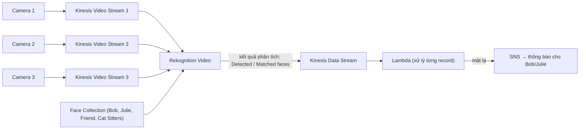

# Kinesis Video Streams

> **TL;DR:** Kinesis Video Streams (KVS) là thành viên của họ Kinesis chuyên **ingest video live** (và dữ liệu time-serialized khác như audio, thermal, depth, radar) từ camera, điện thoại, xe, drone vào AWS. Dữ liệu được lưu, mã hóa và lập chỉ mục bên trong dịch vụ để consumer đọc theo từng frame hoặc theo nhu cầu, thường kết hợp với [[Rekognition]] để phân tích video bằng deep learning.

## 🖼️ Sơ đồ
![[Kinesis Video Streams.excalidraw]]
*Mở bằng plugin Excalidraw để chỉnh sửa · ảnh tĩnh: [[Kinesis Video Streams.svg]]*

## Khái niệm cốt lõi
- **Producer**: security camera, smartphone, ô tô, drone... Ngoài video còn nhận được **dữ liệu không phải video nhưng có tính chuỗi thời gian**: audio, ảnh nhiệt (thermal), depth, radar.
- **Consumer**: truy cập dữ liệu **frame-by-frame** hoặc khi cần để phân tích tiếp.
- **Managed service**: tự **persist** dữ liệu và **mã hóa cả in transit lẫn at rest**.
- **Không truy cập trực tiếp được dữ liệu gốc** (ý quan trọng nhất cho đề thi):
  - Dữ liệu không được lưu ở định dạng gốc mà đã được **index và lưu có cấu trúc bên trong KVS**.
  - Không có chuyện mở file video trên [[EBS]], [[S3 Basics|S3]] hay [[EFS]]. Mọi truy cập phải đi **qua API của KVS**.
- **Tích hợp dịch vụ AWS** (hai ví dụ điển hình):
  - **Rekognition Video**: phân tích live stream bằng deep learning, ví dụ nhận diện khuôn mặt.
  - **Amazon Connect**: voicemail và các luồng audio khác.
- Giao thức/thư viện hay gắn với KVS: **GStreamer**, **RTSP** (camera IP).

## Cách hoạt động / Kiến trúc
Ví dụ của Adrian: một ngôi nhà thông minh có mèo, chó và **3 camera**. Mục tiêu là phát hiện khuôn mặt quen hoặc lạ và cảnh báo khi có gì đáng lo.

1. Mỗi camera đẩy video feed vào **một Kinesis Video Stream riêng** (1 stream / camera).
   - Lợi ích: trong nhà **không cần phần cứng xử lý** video phức tạp, và video được lưu **ngoài nhà** (an toàn nếu thiết bị tại chỗ bị phá).
2. Các video stream được tích hợp với **Rekognition Video**, kèm một **face collection** gồm khuôn mặt đã biết.
3. Rekognition phân tích và ghi kết quả vào một **[[Kinesis Data Streams|Kinesis Data Stream]]**: danh sách khuôn mặt **phát hiện được** (detected), và những khuôn mặt **khớp** (matched) với face collection ở một mức độ tin cậy nhất định.
4. **[[Lambda]]** được invoke từ records trong Kinesis Data Stream, phân tích từng record và quyết định theo logic (mặt quen hay lạ).
5. Nếu có người lạ, Lambda dùng **[[SNS]]** gửi thông báo.

Đây là một mẫu [[Event-Driven Architecture|event-driven]] video analytics hoàn toàn serverless.

## Phân biệt trong họ Kinesis

| Dịch vụ | Dữ liệu | Vai trò chính |
|---|---|---|
| [[Kinesis Data Streams]] | Records (log, click stream, sensor) | Ingest + nhiều consumer đọc real-time trong rolling window |
| [[Kinesis Data Firehose]] | Records | Delivery tới đích (S3, Redshift, OpenSearch...), near real-time |
| [[Kinesis Data Analytics]] | Records từ KDS/Firehose | Xử lý real-time bằng SQL |
| **Kinesis Video Streams** | Video, audio, time-serialized media | Ingest, lưu, index media live; phân tích với Rekognition |

## 🎯 Mẹo thi SAA-C03
- Đề nhắc **live video streaming** cần **analytics** trên luồng video → mặc định nghĩ tới **Kinesis Video Streams**.
- Thấy từ khóa **GStreamer** hoặc **RTSP** → Kinesis Video Streams.
- **Bẫy**: đáp án nói truy cập trực tiếp dữ liệu video mà KVS đã ingest trên **S3/EBS/EFS** → **sai**. Dữ liệu chỉ truy cập được qua chính dịch vụ KVS.
- Nhận diện khuôn mặt trên camera live → **KVS + Rekognition Video** (kết quả ra Kinesis Data Stream → Lambda → SNS).
- Adrian không kỳ vọng KVS xuất hiện chi tiết trong đề; nắm các ý trên là đủ.

## Liên kết
- Tiên quyết: [[Kinesis Data Streams]]
- Dùng cùng: [[Rekognition]], [[Lambda]], [[SNS]], [[Event-Driven Architecture]]
- Phân biệt với: [[Kinesis Data Firehose]], [[Kinesis Data Analytics]], [[Compare - SQS vs SNS vs Kinesis]]
- Section: [[_MOC 14 Serverless and Application Services]]
