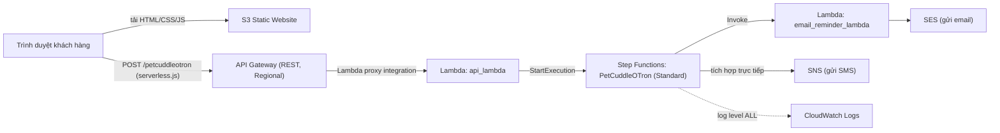
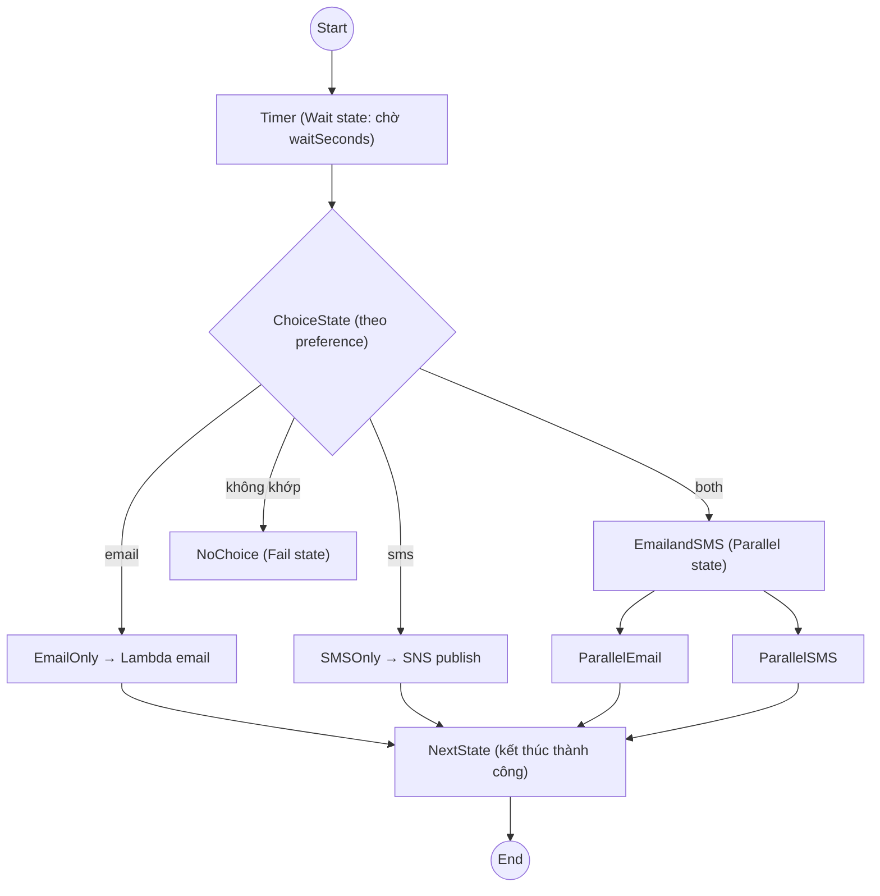

# Lab - Serverless App Pet-Cuddle-o-Tron

> **TL;DR:** Advanced demo 6 phần dựng một ứng dụng **hoàn toàn serverless**: front-end tĩnh trên S3 → API Gateway → Lambda → Step Functions state machine → gửi email (Lambda + SES) và/hoặc SMS (SNS gọi trực tiếp). Ứng dụng nhắc chủ nuôi "về ôm thú cưng" sau N giây. Toàn bộ chỉ tính tiền khi có request, không có server nào để quản lý.

## 🖼️ Sơ đồ
![[Lab - Serverless App Pet-Cuddle-o-Tron.excalidraw]]
*Mở bằng plugin Excalidraw để chỉnh sửa · ảnh tĩnh: [[Lab - Serverless App Pet-Cuddle-o-Tron.svg]]*

## Kiến trúc tổng thể

Toàn bộ dựng ở **us-east-1**. Hai IAM role được tạo bằng CloudFormation one-click (stack `LambdaRole` và `StateMachineRole`).

## Các stage của lab

### Stage 1 – SES và SNS SMS sandbox
- **SES** (Simple Email Service) là dịch vụ gửi/nhận email managed. Tài khoản mới ở **sandbox mode**: chỉ gửi được giữa các địa chỉ đã **verify** (bấm link xác nhận trong email).
- Verify 2 identity: địa chỉ **gửi** (from, ứng dụng dùng) và địa chỉ **nhận** (customer). Có thể dùng mẹo `user+tag@gmail` để có nhiều địa chỉ.
- **SNS SMS** cũng có sandbox cho tài khoản mới: phải thêm và verify số điện thoại đích (OTP), hoặc xin ra khỏi sandbox.
  - Một số nước (ví dụ Úc) thêm số là xong. Nước như **Mỹ** cần **origination number**: xin số toll-free qua Amazon Pinpoint (nay là AWS End User Messaging SMS), loại message *Transactional*, tốn khoảng 2 USD/tháng.

### Stage 2 – Lambda gửi email
- Role `LambdaRole`: trust policy cho `lambda.amazonaws.com`; quyền SES, SNS, `states` (Step Functions) và CloudWatch Logs.
- Hàm `email_reminder_lambda` (Python, boto3): nhận `event` từ state machine (địa chỉ đích + message) rồi gọi SES gửi email. Phải thay placeholder bằng địa chỉ **from** đã verify.
- Ghi lại **ARN** của hàm, cần cho stage 3.

### Stage 3 – State machine (trái tim ứng dụng)
- Role `StateMachineRole`: trust `states.amazonaws.com`; quyền ghi CloudWatch Logs, **invoke Lambda** và **publish SNS trực tiếp** (không cần Lambda trung gian cho SMS).
- Tạo state machine bằng **ASL** (Amazon States Language, JSON) dán sẵn, chọn kiểu **Standard** (chạy tối đa 1 năm; Express dành cho workload ngắn, tần suất cao).
- Luồng các state:

- Các kiểu state gặp trong lab: **Wait**, **Choice**, **Parallel**, **Task** (gọi Lambda/SNS), **Fail**, cùng một state cuối `NextState` để kết thúc execution thành công.
- Thay 2 placeholder `EMAIL_LAMBDA_ARN` (trong EmailOnly và ParallelEmail). Bật logging level **ALL** để có log execution trong CloudWatch Logs. Ghi lại ARN state machine.

### Stage 4 – API Gateway + Lambda backend
- Hàm `api_lambda`: nhận dữ liệu từ client, **validate** (waitSeconds, message, preference luôn bắt buộc; email chỉ bắt buộc khi chọn email, phone chỉ khi chọn SMS). Lỗi thì trả **400**; hợp lệ thì gọi `start_execution` với ARN state machine và truyền toàn bộ input.
- API Gateway: tạo **REST API** (không phải REST private, HTTP hay WebSocket), endpoint type **Regional**.
  - Resource `petcuddleotron`: **bật CORS**, **không** chọn "proxy resource" (hai lỗi học viên hay mắc).
  - Method **POST**, integration type Lambda, **bật Lambda proxy integration** và default timeout. Console tự thêm resource policy cho phép API Gateway invoke Lambda.
  - **Deploy** ra stage `prod` để có **invoke URL**.

### Stage 5 – Front-end trên S3 và test
- Tạo bucket (us-east-1), tắt Block Public Access, gắn **bucket policy** cho phép public read, bật **static website hosting** (index và error document đều là `index.html`).
- 4 file: `index.html`, `main.css`, `whiskers.png`, `serverless.js`. Sửa `serverless.js`: thay placeholder bằng invoke URL + `/petcuddleotron`.
- Test: nhập 120 giây, message, email, số điện thoại; ba nút: *email only*, *SMS only*, *both* (chạy nhánh Parallel). Xem execution trực quan trong Step Functions (state đang chạy tô xanh), tab *execution input* cho thấy dữ liệu đã đi từ ô text → JS → API Gateway → Lambda → state machine.

### Stage 6 – Dọn dẹp
Xóa theo thứ tự: S3 bucket (empty rồi delete) → API → 2 Lambda → state machine → 2 CloudFormation stack (role). Origination number Pinpoint (nếu có) cũng nên release để hết tính phí.

## Bài học rút ra
- **Không có server nào**: compute (Lambda, Step Functions) chỉ chạy và tính tiền khi có sự kiện, đúng tinh thần [[Serverless Architecture]] và [[Event-Driven Architecture]].
- **Step Functions** giải quyết các giới hạn của Lambda: Lambda chỉ chạy tối đa 15 phút, còn state machine Standard có thể *chờ* hàng ngày, hàng tháng (Wait state) mà không tốn compute.
- **Service integration trực tiếp**: state machine gọi SNS không cần Lambda "keo dán", nên ít code và ít chi phí hơn.
- **Quyền qua IAM role**: mỗi thành phần (Lambda, state machine) assume một role riêng với trust policy đúng service principal; API Gateway được phép gọi Lambda qua resource policy của Lambda.
- Front-end tĩnh trên S3 gọi API qua JavaScript nên cần **CORS**.

## 🎯 Mẹo thi SAA-C03
- Mẫu "S3 static website + API Gateway + Lambda (+ DynamoDB/Step Functions)" là kiến trúc serverless web app chuẩn mà đề hay đưa ra.
- Workflow dài, có chờ, rẽ nhánh, chạy song song, retry → **Step Functions**, không phải Lambda nối Lambda.
- Lambda giới hạn **15 phút**; Step Functions Standard tối đa **1 năm**, Express tối đa **5 phút** cho workload event/stream tần suất cao.
- Gửi email ứng dụng → **SES**; gửi SMS/push/fan-out → **SNS**.
- API Gateway endpoint types: Edge-optimized, Regional, Private.

## Liên kết
- Tiên quyết: [[Lambda]], [[Step Functions]], [[API Gateway]], [[SNS]], [[S3 Static Website Hosting]]
- Liên quan: [[Serverless Architecture]], [[Event-Driven Architecture]], [[IAM Roles]], [[CloudFormation Basics]], [[CloudWatch Logs]], [[Cognito]]
- Section: [[_MOC 14 Serverless and Application Services]]
