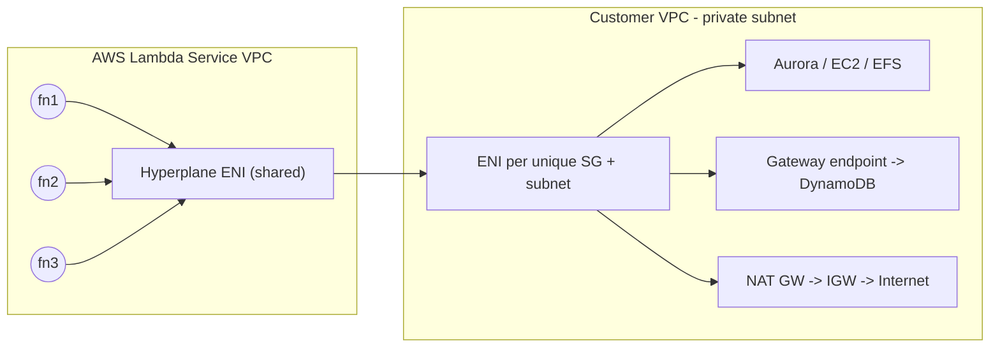
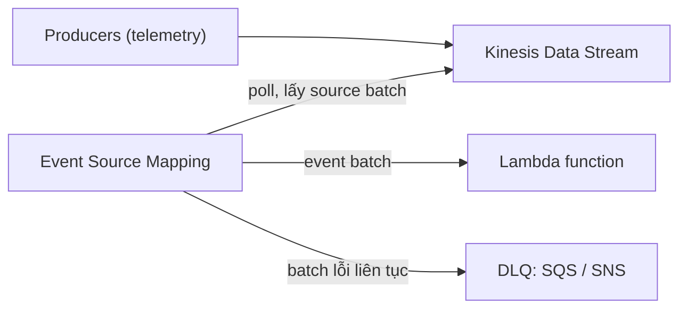

# Lambda

> **TL;DR:** Lambda là dịch vụ **Function as a Service (FaaS)**. Bạn đưa vào một đoạn code nhỏ, chạy ngắn và chỉ làm một việc; Lambda lo việc chạy nó và **chỉ tính tiền theo thời gian thực thi** (resource cấp × duration × số lần invoke). Đây là mảnh ghép compute trung tâm của [[Serverless Architecture]] và [[Event-Driven Architecture]] trên AWS.

## 🖼️ Sơ đồ
![[Lambda.excalidraw]]
*Mở bằng plugin Excalidraw để chỉnh sửa · ảnh tĩnh: [[Lambda.svg]]*

![[Lambda - invoke.excalidraw]]
*Mở bằng plugin Excalidraw để chỉnh sửa · ảnh tĩnh: [[Lambda - invoke.svg]]*

## Khái niệm cốt lõi

### Function, runtime và runtime environment
- **Lambda function** nên hiểu là một *đơn vị cấu hình*: code (deployment package) + runtime + resource + các cấu hình khác (environment variables, role, networking...).
- Khi tạo function phải chọn **runtime** (ngôn ngữ + phiên bản), ví dụ Python, Node.js, Java, Go, Ruby, C#/.NET. Khóa học dùng ví dụ Python 3.8 (runtime này nay đã hết hỗ trợ; hiện dùng Python 3.12/3.13).
- Mỗi lần **invoke**, deployment package được tải về và chạy trong một **runtime environment** (còn gọi là **execution context**) được dựng riêng cho runtime đó (Python thì có sẵn Python + các module cần thiết).
- **Custom runtime** (ví dụ Rust) có thể làm qua **Lambda layers**, nhiều cái do cộng đồng xây dựng.
- **Stateless**: về mặt kiến trúc phải **giả định mỗi lần invoke là một môi trường mới tinh**, không có dữ liệu sót lại từ lần trước. Code phải chạy đúng 100% trong môi trường sạch (môi trường có thể được tái sử dụng, xem phần cold/warm start bên dưới, nhưng không được trông vào điều đó).

### Docker và Lambda: bẫy thi
- Trong đề thi, nghe thấy **"Docker"** thì hiểu là **không phải Lambda**: Docker = containerized computing truyền thống (ví dụ [[ECS]], [[EKS]]). Docker là *anti-pattern* cho Lambda.
- Lambda **có hỗ trợ container image**, nhưng đó là image được build riêng để chạy trong môi trường Lambda; điểm chung duy nhất là tận dụng được quy trình build image sẵn có. Đừng nhầm "Docker image cho ECS" với "container image cho Lambda". Xem [[Containers Fundamentals]].

### Resource và giới hạn
| Thông số | Giá trị |
|---|---|
| Memory | **128 MB – 10,240 MB**, bước 1 MB (cấu hình trực tiếp) |
| vCPU | **Không chọn trực tiếp**, tăng tuyến tính theo memory: **1,769 MB ≈ 1 vCPU** (tối đa 6 vCPU ở 10 GB) |
| Ephemeral storage `/tmp` | Mặc định **512 MB**, có thể tăng tới **10,240 MB**. Chỉ là chỗ tạm, coi như trống mỗi lần invoke |
| Timeout tối đa | **900 giây = 15 phút** |

- **15 phút** là con số *phải nhớ*. Việc cần chạy lâu hơn thì không dùng Lambda trực tiếp; dùng [[Step Functions]] để ghép workflow dài, hoặc dùng compute khác (ECS/Fargate, EC2, Batch).
- Billing: theo memory cấp phát × thời gian chạy của từng invocation.

### Use case điển hình (slide)
| Use case | Bộ dịch vụ |
|---|---|
| Serverless application | S3 + [[API Gateway]] + Lambda |
| File processing (vd. watermark ảnh) | S3 + [[S3 Events]] + Lambda |
| Database trigger | DynamoDB + Streams + Lambda ([[DynamoDB Streams and Triggers]]) |
| Serverless cron | [[EventBridge]] / CloudWatch Events + Lambda |
| Real-time stream processing | [[Kinesis Data Streams]] + Lambda |

## Networking: Public vs VPC
Lambda có **2 chế độ mạng** và đề thi hỏi cả hai.

### Public (mặc định)
- Function chạy trong mạng public của AWS → truy cập được **public AWS services** (SQS, DynamoDB...) và **Internet** (vd. gọi API IMDb), miễn có quyền.
- **Hiệu năng tốt nhất**: không cần networking riêng cho từng khách hàng, chạy trên phần cứng/mạng dùng chung.
- **Giới hạn lớn**: **không truy cập được tài nguyên trong VPC** (Aurora, EC2, EFS ở private subnet) trừ khi chúng có địa chỉ public và security cho phép truy cập từ ngoài.

### VPC (private) Lambda
- Function được gắn vào subnet (thường là private subnet) của VPC → **tuân theo mọi luật mạng của VPC** như bất kỳ tài nguyên nào khác trong đó.
- Truy cập tự do tài nguyên trong VPC (nếu [[Security Groups]]/[[NACL]] cho phép), nhưng **mặc định không ra được public AWS services hay Internet**.
- Muốn ra ngoài thì cấu hình như mọi thứ khác trong VPC:
  - DynamoDB/S3 → [[Gateway VPC Endpoints]] (hoặc [[Interface VPC Endpoints]] cho dịch vụ khác).
  - Internet/public AWS services → [[NAT Gateway]] ở public subnet + Internet Gateway ([[VPC Routing and Internet Gateway]]).
- Execution role cần **quyền EC2 networking** (tạo/quản lý ENI) vì Lambda service phải tạo network interface trong VPC của bạn.

- **Kiến trúc cũ**: mỗi function (mỗi lần invoke/mỗi concurrency) tạo một ENI trong VPC khách hàng → invoke chậm, scale kém, tốn IP trong subnet. Đây là lý do ngày xưa "đặt Lambda trong VPC là ý tồi".
- **Kiến trúc mới** (giống Fargate): AWS gom các function trong account/region, mỗi **tổ hợp duy nhất security group + subnet** chỉ cần **một ENI**. ENI được tạo **khi cấu hình** function (~**90 giây**, chỉ một lần khi tạo hoặc đổi network config), **không gây trễ mỗi lần invoke**. Ví dụ: mọi function dùng cùng SG nhưng nhiều subnet → 1 ENI/subnet; cùng subnet + cùng SG → 1 ENI cho tất cả.

## Bảo mật: hai lớp permission
| Lớp | Bản chất | Kiểm soát điều gì |
|---|---|---|
| **Execution role** | [[IAM Roles\|IAM role]] có trust policy tin Lambda; Lambda assume role để lấy temporary credentials | Function **được làm gì** với dịch vụ khác (đọc DynamoDB, ghi S3...). Tương tự [[EC2 Instance Roles]] |
| **Resource policy** | Resource-based policy gắn vào function (giống bucket policy của S3) | **Ai được invoke/tương tác** với function: account khác, hoặc dịch vụ như SNS, S3 |

- Resource policy được tự động sửa khi bạn tích hợp dịch vụ khác với Lambda; khóa học nói chỉ chỉnh được qua CLI/API (hiện nay console cũng cho xem và thêm permission statement trong mục Configuration → Permissions).

## Logging và monitoring
- **[[CloudWatch Logs]]**: output của function, log message, lỗi, thông tin duration. Mặc định log group tên `/aws/lambda/<tên function>`.
- **CloudWatch (metrics)**: số invocation, success/failure, retry, latency... (xem [[CloudWatch Basics]]).
- **X-Ray**: **distributed tracing**, lần theo đường đi của user/session qua ứng dụng serverless. Chỉ cần nhớ từ khóa "X-Ray = distributed tracing".
- **Muốn ghi được CloudWatch Logs, execution role phải có quyền** (có sẵn managed policy kiểu `AWSLambdaBasicExecutionRole`). Kịch bản thi kinh điển: "Lambda không chạy, CloudWatch Logs trống trơn" → thiếu quyền logging trong execution role.

## Ba kiểu invocation
| Kiểu | Ai dùng | Ai chờ kết quả | Ai xử lý lỗi/retry |
|---|---|---|---|
| **Synchronous** | CLI/API gọi trực tiếp; [[API Gateway]] → Lambda | Client chờ đến khi xong | **Client** tự retry |
| **Asynchronous** | Dịch vụ AWS đẩy event: S3 events, SNS, EventBridge... | Không ai chờ, nguồn "gửi rồi quên" | **Lambda** tự retry (cấu hình **0–2 lần**) |
| **Event source mapping** | Stream/queue không tự sinh event: SQS, Kinesis, DynamoDB Streams, Amazon MSK (Kafka) | Lambda poll nguồn | Batch lỗi → DLQ (SQS/SNS) |

### Synchronous
- Client gửi request và đợi; kết quả (thành công hay lỗi) trả về ngay trong request đó.
- Thường dùng khi **con người** gọi (trực tiếp hoặc qua API Gateway).

### Asynchronous
- Ví dụ: upload ảnh lên S3 → S3 event → Lambda tạo thumbnail, ghi DynamoDB. S3 không đợi gì.
- Code phải **idempotent**: chạy lại bao nhiêu lần kết quả vẫn như nhau. Ví dụ ngân hàng: "đặt số dư = 20$" là idempotent; "cộng thêm 10$" thì không (retry có thể thành 30$). Function nên kết thúc bằng việc *làm cho một trạng thái trở thành đúng*, không cộng dồn/trừ dồn.
- Event không xử lý được sau các lần retry → **Dead Letter Queue** để chẩn đoán (xem [[SQS Dead Letter Queues]]).
- **Destinations**: gửi kết quả xử lý tới SQS, SNS, Lambda khác hoặc EventBridge; cấu hình destination **riêng cho success và failure**.

### Event source mapping

- Thành phần ẩn **event source mapping** poll nguồn, lấy **source batch**, chia theo **batch size** thành **event batch** gửi cho function. Một invocation có thể nhận hàng trăm record → phải chỉnh batch size để không vượt timeout 15 phút.
- **Điểm hay thi về permission**:
  - Async: nguồn *đẩy* event tới Lambda → function **không cần quyền với nguồn** (trừ khi muốn đọc thêm dữ liệu, ví dụ tải object S3 thật sự).
  - Event source mapping: mapping *đọc* từ nguồn **bằng quyền của execution role** → execution role **phải có quyền Kinesis/SQS/DynamoDB Streams**, dù code function không trực tiếp gọi nguồn.

## Versions và aliases
- **Version** = code + configuration (resource, environment variables...). Khi **publish** thì version **immutable**, có **ARN riêng**.
- **`$LATEST`** trỏ tới bản mới nhất, thay đổi được → không immutable.
- **Alias** (DEV, STAGE, PROD) trỏ tới một version cụ thể và **đổi được**. Triển khai lớn: publish version cho mỗi thay đổi lớn, các thành phần ứng dụng trỏ vào alias.

## Cold start, warm start, provisioned concurrency
| Tình huống | Điều gì xảy ra | Thời gian (slide) |
|---|---|---|
| **Cold start** | Tạo execution context mới: cấp phần cứng, cài runtime, tải và cài deployment package rồi mới chạy code | **~100 ms trở lên** |
| **Warm start** | Invoke lại sau không lâu → dùng lại context cũ, chỉ nhận event mới | **~1–2 ms** |

- Context lâu không dùng sẽ bị xóa → lần sau lại cold start.
- **Một context chỉ chạy một invocation tại một thời điểm**: 20 invocation đồng thời có thể = 20 cold start.
- **Provisioned concurrency**: AWS tạo sẵn và giữ ấm X context → giảm cold start; dùng cho giai đoạn tải cao đã biết trước hoặc trước một đợt release production.
- Tối ưu:
  - Tải sẵn tài nguyên vào `/tmp` để lần sau dùng lại trong cùng context.
  - Khởi tạo thứ dùng lại được (vd. **database connection**) **bên ngoài function handler**; thứ khai báo trong handler chỉ sống trong một lần invoke.
  - Nhưng code vẫn phải chạy đúng nếu môi trường hoàn toàn mới: **không bao giờ giả định** dữ liệu đã có sẵn.

## Demo / Lab
Demo tự động hóa EC2 với Lambda + EventBridge: xem chi tiết ở [[EventBridge]]. Điểm rút ra cho Lambda: tạo execution role (trust Lambda, quyền CloudWatch Logs + `ec2:StartInstances/StopInstances`), truyền danh sách instance qua **environment variable** (`EC2_INSTANCES`), test function bằng test event (event chỉ là JSON), xem output trong log group `/aws/lambda/<function>`.

## 🎯 Mẹo thi SAA-C03
- **Timeout tối đa 15 phút (900 s)**. Đề nói job chạy lâu hơn → không phải Lambda; nghĩ tới [[Step Functions]], ECS/Fargate, EC2, Batch.
- **"Docker" trong đề ≈ ECS/EKS, không phải Lambda.**
- Memory 128 MB–10 GB, vCPU tỉ lệ theo memory (không chọn trực tiếp); `/tmp` 512 MB–10 GB.
- Lambda **public (mặc định) không vào được VPC**; Lambda **trong VPC không ra được Internet/AWS public** nếu không có [[NAT Gateway]] / VPC endpoint. "Hãy đối xử với Lambda trong VPC như mọi tài nguyên khác trong VPC".
- VPC Lambda cần quyền EC2 networking trong execution role để tạo ENI.
- **Execution role** = function làm được gì; **resource policy** = ai được gọi function (cross-account, SNS, S3).
- Logs trống → kiểm tra quyền CloudWatch Logs của execution role. "Distributed tracing" → **X-Ray**.
- Async invocation → Lambda retry (0–2) → code phải **idempotent**; dùng DLQ/destinations cho event lỗi.
- **Event source mapping** (SQS, Kinesis, DynamoDB Streams, MSK) dùng **quyền của execution role** để đọc nguồn.
- Version immutable + có ARN riêng; alias đổi được; `$LATEST` không immutable.
- Cold start → **provisioned concurrency**; tái sử dụng connection bằng cách khai báo ngoài handler.
- Lambda đứng sau [[API Gateway]] phải trả lời trong **29 giây**, không phải 15 phút (quá → 504).

## Liên kết
- Tiên quyết: [[Event-Driven Architecture]], [[IAM Roles]], [[Containers Fundamentals]]
- Dùng cùng: [[API Gateway]], [[EventBridge]], [[SNS]], [[SQS]], [[Kinesis Data Streams]], [[S3 Events]], [[DynamoDB Streams and Triggers]], [[CloudWatch Logs]]
- Kiến trúc: [[Serverless Architecture]], [[Step Functions]], [[Lab - Serverless App Pet-Cuddle-o-Tron]]
- Mạng: [[NAT Gateway]], [[Gateway VPC Endpoints]], [[Security Groups]]
- Phân biệt với: [[ECS Launch Types EC2 vs Fargate]], [[EC2 Basics]], [[Lambda@Edge]]
