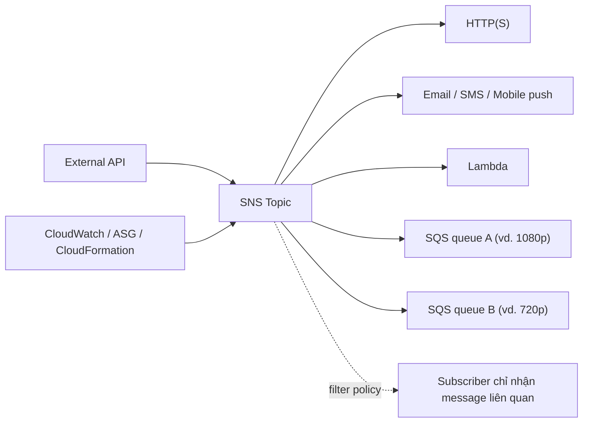

# SNS

> **TL;DR:** Simple Notification Service (SNS) là dịch vụ **pub/sub messaging** highly available, durable, bảo mật. **Publisher** gửi message vào **topic**, và mọi **subscriber** của topic nhận message đó. SNS là nền tảng để decouple ứng dụng và là kênh thông báo mà rất nhiều dịch vụ AWS dùng.

## 🖼️ Sơ đồ
![[SNS.excalidraw]]
*Mở bằng plugin Excalidraw để chỉnh sửa · ảnh tĩnh: [[SNS.svg]]*

## Khái niệm cốt lõi
- **Public AWS service**: chạy ở AWS public zone. Truy cập được từ Internet (nếu có quyền) và từ VPC (nếu VPC ra được public AWS endpoint). Xem [[AWS Public vs Private Services]].
- Điều phối việc gửi và phân phối **message tối đa 256 KB**. Không cần thuộc con số chính xác; ý chính là SNS **không dành cho file nhị phân lớn**.
- **Topic** là thực thể gốc: phần lớn cấu hình và **permission** đặt trên topic.
- **Publisher**: thứ gửi message vào topic.
- **Subscriber**: mặc định nhận **tất cả** message gửi vào topic. Các loại subscriber:
  - HTTP/HTTPS endpoint
  - Email
  - [[SQS]] queue (mỗi message được thêm vào queue)
  - Mobile push notification, SMS
  - [[Lambda]] function (mỗi message invoke function)
- Một thực thể có thể vừa là publisher vừa là subscriber (vd. một API bên ngoài).
- **Dịch vụ AWS publish vào SNS**: [[CloudWatch Basics|CloudWatch]] alarm khi đổi trạng thái, [[CloudFormation Basics|CloudFormation]] stack khi đổi trạng thái, [[Auto Scaling Groups]] khi có scaling event, EC2 và nhiều dịch vụ khác.

## Cách hoạt động / Kiến trúc

- **Subscription filter**: gắn filter lên subscriber để nó chỉ nhận message liên quan tới chức năng của nó, thay vì nhận tất cả.
- **Fan-out**: **một SNS topic, nhiều [[SQS]] queue subscribe**. Một message (vd. "có job xử lý video mới") được nhân ra nhiều queue; mỗi queue xử lý cùng workload theo **biến thể khác nhau và tách biệt** (bitrate/kích thước khác nhau trong ví dụ PetTube).

### Tính năng (slide)
| Tính năng | Ý nghĩa |
|---|---|
| **Delivery status** | Xác nhận trạng thái gửi tới subscriber; hỗ trợ HTTP/HTTPS, Lambda, SQS... |
| **Delivery retries** | Thử gửi lại → **reliable delivery** |
| **HA và scalable (Region)** | **Regionally resilient**: dữ liệu replicate trong region, chịu được mất AZ, scale từ 0 tới tải rất lớn |
| **Server-side encryption (SSE)** | Dữ liệu lưu trên đĩa được mã hóa (qua [[KMS]]) khi có yêu cầu compliance |
| **Cross-account qua topic policy** | **Topic policy** là resource policy (giống [[S3 Security\|bucket policy]]) quy định identity nào được truy cập topic |

## 🎯 Mẹo thi SAA-C03
- "Gửi **một** message tới **nhiều** consumer/hệ thống cùng lúc" → **SNS**. "Mỗi consumer xử lý độc lập với buffer riêng" → **fan-out SNS → nhiều SQS**.
- SNS là **push** (đẩy tới subscriber); [[SQS]] là **pull** (consumer poll). So sánh đầy đủ: [[Compare - SQS vs SNS vs Kinesis]].
- Thông báo cho admin khi alarm CloudWatch/ASG scaling/CloudFormation đổi trạng thái → **SNS topic** (email/SMS).
- Account khác cần publish/subscribe → **topic policy** (resource policy).
- Cần mã hóa at rest → SNS **SSE**.
- Message lớn (file, video) → **không** đẩy qua SNS; lưu ở S3 và gửi tham chiếu.
- Subscriber chỉ muốn một phần message → **subscription filter policy** chứ không cần tạo nhiều topic.

## Liên kết
- Tiên quyết: [[Event-Driven Architecture]], [[AWS Public vs Private Services]]
- Dùng cùng: [[SQS]], [[Lambda]], [[CloudWatch Basics]], [[Auto Scaling Groups]], [[EventBridge]]
- Ví dụ: [[Lab - Serverless App Pet-Cuddle-o-Tron]], [[Serverless Architecture]]
- Phân biệt với: [[SQS]], [[Kinesis Data Streams]], [[EventBridge]], [[Compare - SQS vs SNS vs Kinesis]]
