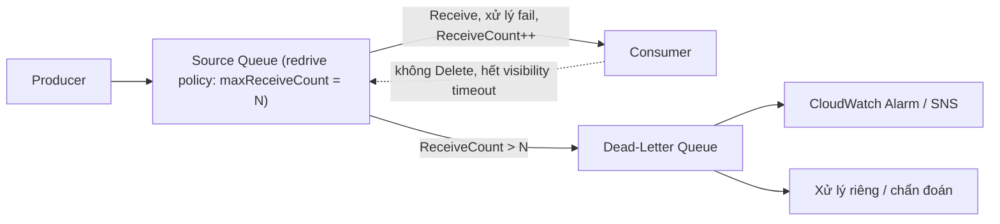

# SQS Dead Letter Queues

> **TL;DR:** Dead-letter queue (DLQ) là queue phụ chứa các **message "có vấn đề"**: bị nhận nhiều lần mà không bao giờ được xử lý thành công. Nhờ đó message lỗi không quay vòng mãi trong queue chính, và có chỗ riêng để cảnh báo, chẩn đoán, xử lý lại.

## 🖼️ Sơ đồ
![[SQS Dead Letter Queues.excalidraw]]
*Mở bằng plugin Excalidraw để chỉnh sửa · ảnh tĩnh: [[SQS Dead Letter Queues.svg]]*

## Khái niệm cốt lõi
- Vấn đề: message lỗi (corrupt, đặc thù...) → nhận → xử lý fail → hết [[SQS Delay Queues|visibility timeout]] → hiện lại → lặp **vô hạn**.
- Mỗi lần message được nhận, thuộc tính **`ReceiveCount`** tăng 1 (1, 2, 3, ...).
- **Redrive policy** (cấu hình trên source queue) chỉ định: **source queue**, **DLQ**, và điều kiện chuyển, cụ thể là **`maxReceiveCount`**.
- Khi **`ReceiveCount` > `maxReceiveCount`** và message **vẫn chưa bị xóa** → message được **chuyển sang DLQ**.
- **Một DLQ có thể phục vụ nhiều source queue.**
- DLQ phải cùng loại với source: queue FIFO dùng DLQ FIFO, Standard dùng DLQ Standard.

## Cách hoạt động / Kiến trúc

### Lợi ích
- **Alarm** khi có message vào DLQ, nên biết sớm có message lỗi (CloudWatch alarm theo độ dài DLQ).
- Khu vực **cô lập** để **chẩn đoán**: xem log, phân tích nội dung message lỗi.
- **Xử lý riêng** cho message khó: workload khác, logic khác, hoặc redrive về source queue sau khi sửa lỗi.

### ⚠️ Retention và enqueue timestamp
- Queue có **retention period**: message quá hạn mà chưa xử lý thì bị bỏ. Mỗi message có **enqueue timestamp** (thời điểm được gửi vào queue).
- Khi chuyển sang DLQ:
  - **Standard queue**: timestamp **giữ nguyên**, không reset.
  - **FIFO queue**: timestamp được **reset** về thời điểm message được chuyển sang DLQ.
- Ví dụ (Standard): message đã ở source queue **1 ngày**, DLQ có retention **2 ngày** → message chỉ còn sống thêm **1 ngày** trong DLQ.
- ⇒ **Retention của DLQ nên dài hơn retention của source queue** Standard (tối đa 14 ngày), nếu bằng nhau message có thể hết hạn trước khi kịp sửa lỗi.

### DLQ redrive: đưa message về xử lý lại
- Sửa xong nguyên nhân (vá consumer, thêm xử lý...) thì dùng **dead-letter queue redrive** để chuyển message từ DLQ **về source queue** (mặc định), hoặc sang **một queue khác cùng loại** (FIFO hoặc Standard).
- Đây là **thao tác thủ công**, không tự chạy.
- Redrive **reset enqueue timestamp** cho cả Standard lẫn FIFO.

## 🎯 Mẹo thi SAA-C03
- Đề: "message lỗi cứ bị xử lý lại liên tục, làm nghẽn/tốn tài nguyên" → cấu hình **DLQ + redrive policy (`maxReceiveCount`)**.
- Đề: "cần cô lập và phân tích message xử lý thất bại" → **DLQ**.
- Đặt **retention DLQ > retention source queue**, vì với queue Standard enqueue timestamp không đổi khi sang DLQ (FIFO thì reset).
- Sửa lỗi xong muốn xử lý lại message trong DLQ → **DLQ redrive** (thủ công) về source queue hoặc queue khác cùng loại.
- DLQ cũng xuất hiện ở các dịch vụ khác (Lambda async invocation, SNS subscription) với ý tương tự: nơi đổ sự kiện thất bại.

## Liên kết
- Tiên quyết: [[SQS]], [[SQS Delay Queues]] (ôn visibility timeout)
- Liên quan: [[SQS Standard vs FIFO]], [[CloudWatch Basics]], [[SNS]], [[Lambda]]
- Section: [[_MOC 14 Serverless and Application Services]]
