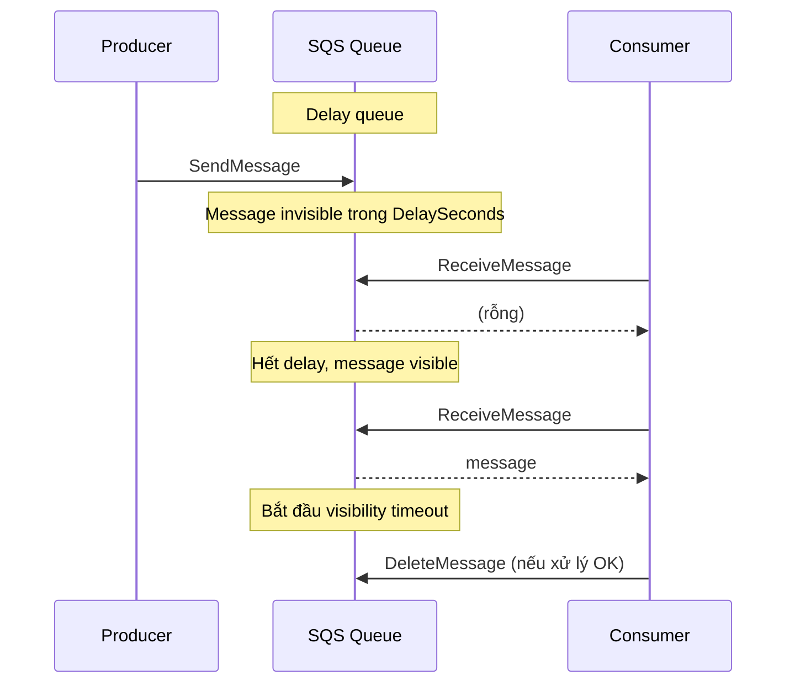

# SQS Delay Queues

> **TL;DR:** Delay queue **hoãn việc giao message** cho consumer: message mới vào queue sẽ **vô hình** trong `DelaySeconds` (tối đa 15 phút). Khác hẳn **visibility timeout** (ẩn message *sau khi* đã được nhận, phục vụ retry tự động).

## 🖼️ Sơ đồ
![[SQS Delay Queues.excalidraw]]
*Mở bằng plugin Excalidraw để chỉnh sửa · ảnh tĩnh: [[SQS Delay Queues.svg]]*

## Khái niệm cốt lõi

### Ôn lại Visibility Timeout
- `SendMessage` → message có trong queue → consumer `ReceiveMessage` → message bị **ẩn** trong visibility timeout; các `ReceiveMessage` khác không thấy nó.
- Xử lý xong thì `DeleteMessage`. Không xóa (lỗi/crash) thì message **xuất hiện lại** để xử lý lại.
- Mặc định **30 s**, khoảng **0 s – 12 h**, đặt ở mức queue hoặc từng message bằng `ChangeMessageVisibility`.
- Mục đích: **error correction & automatic reprocessing**.

### Delay Queue
- Queue được cấu hình **`DelaySeconds`** khác 0. Mặc định là 0; phải đặt giá trị khác 0 thì mới gọi là delay queue.
- Message vừa được thêm vào **bắt đầu ở trạng thái invisible** trong `DelaySeconds`; mọi `ReceiveMessage` trong khoảng đó đều trả về rỗng. Hết thời gian thì message mới hiện ra.
- Giới hạn: **min 0, max 15 phút**.
- **Message timers**: đặt delay **cho từng message**, ghi đè setting của queue. Cũng **0 – 15 phút**. **Không hỗ trợ trên FIFO queue** (FIFO chỉ dùng delay ở mức queue).

## Cách hoạt động / Kiến trúc

## Bảng so sánh / số liệu

| | Visibility Timeout | Delay Queue / Message Timer |
|---|---|---|
| Ẩn message khi nào | **Sau khi** consumer nhận | **Ngay khi** message được thêm vào |
| Mục đích | Retry tự động khi xử lý lỗi | Cố ý trì hoãn xử lý |
| Mặc định | 30 s | 0 s |
| Khoảng giá trị | 0 s – 12 h | 0 – 15 phút |
| Per-message | `ChangeMessageVisibility` | Message timer (không có trên FIFO) |

## 🎯 Mẹo thi SAA-C03
- Đề yêu cầu **"chờ X phút rồi mới xử lý"** (≤ 15 phút) → **delay queue / message timer**.
- Đề nói message bị **xử lý lặp** hoặc cần **retry tự động** khi worker crash → **visibility timeout**, không phải delay queue.
- Delay > 15 phút hoặc workflow có chờ dài → không dùng được delay queue; nghĩ tới [[Step Functions]] (Wait state) hoặc [[EventBridge]] scheduling.
- Per-message delay **không chạy trên FIFO**.

## Liên kết
- Tiên quyết: [[SQS]]
- Liên quan: [[SQS Dead Letter Queues]], [[SQS Standard vs FIFO]], [[Step Functions]]
- Section: [[_MOC 14 Serverless and Application Services]]
