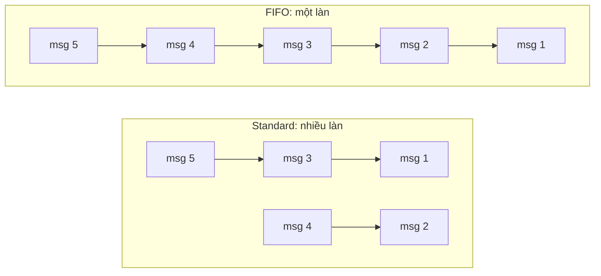

# SQS Standard vs FIFO

> **TL;DR:** [[SQS]] có hai loại queue. **Standard** là "đường cao tốc nhiều làn": gần như không giới hạn throughput nhưng chỉ **at-least-once** và thứ tự best-effort. **FIFO** là "đường một làn không được vượt": **giữ thứ tự tuyệt đối**, **exactly-once**, nhưng throughput giới hạn và tên phải có hậu tố `.fifo`.

## 🖼️ Sơ đồ
![[SQS Standard vs FIFO.excalidraw]]
*Mở bằng plugin Excalidraw để chỉnh sửa · ảnh tĩnh: [[SQS Standard vs FIFO.svg]]*

## Khái niệm cốt lõi

### Standard queue (multi-lane highway)
- **Scale gần như vô hạn** (near-unlimited TPS): cứ thêm "làn" là chạy nhanh hơn.
- **Best-effort ordering**: không cam kết thứ tự, message có thể đến lệch thứ tự.
- **At-least-once delivery**: thỉnh thoảng có thể nhận **hơn một bản** của cùng message, nên ứng dụng phải chịu được trùng (**idempotent**).
- Dùng cho: **decoupling** các thành phần, **worker pool**, gom item để **batch xử lý sau**.

### FIFO queue (single-lane highway)
- **Thứ tự được giữ nghiêm ngặt**: vào trước ra trước.
- **Exactly-once processing**: duplicate bị loại bỏ.
- **Throughput giới hạn**: **300 TPS** không batching, **3.000 message/s** với batching. Thực chất là 300 transaction/giây tới SQS API; mỗi batch chứa tối đa 10 message.
- **Tên queue bắt buộc có hậu tố `.fifo`**. Adrian nói đã thấy ý này **xuất hiện trong đề nhiều lần**.
- Dùng cho: workflow cần thứ tự (đơn hàng), **command ordering** (lệnh admin phải chạy đúng thứ tự), tính toán **điều chỉnh giá** tuần tự.
- (Khóa học nói high-throughput mode cho FIFO đang preview; hiện nay đã GA và cho throughput cao hơn nhiều, tùy region.)

## Bảng so sánh / số liệu

| Tiêu chí | Standard | FIFO |
|---|---|---|
| Ví von | Đường cao tốc nhiều làn | Đường một làn, không vượt |
| Throughput | Gần như không giới hạn | 300 TPS, 3.000 msg/s có batching (chuẩn) |
| Thứ tự | Best-effort | Đảm bảo nghiêm ngặt (FIFO) |
| Delivery | At-least-once (có thể trùng) | Exactly-once (loại bỏ trùng) |
| Tên | Tùy ý | Bắt buộc hậu tố `.fifo` |
| Message timer per-message (delay) | Có | **Không** hỗ trợ (xem [[SQS Delay Queues]]) |
| DLQ | DLQ phải là Standard | DLQ phải là FIFO |
| Use case | Decoupling, worker pool, batch | Đơn hàng, lệnh tuần tự, cập nhật giá |

## 🎯 Mẹo thi SAA-C03
- Đề nhấn **"thứ tự", "không được trùng", "exactly-once"** → **FIFO**.
- Đề nhấn **throughput cực lớn, không quan tâm thứ tự** → **Standard** (và ứng dụng phải idempotent).
- Đáp án đổi Standard queue thành FIFO bằng "đổi setting": sai, không chuyển loại queue tại chỗ được; phải **tạo queue mới** có tên đuôi **`.fifo`**.
- Câu hỏi có số liệu cần > 3.000 msg/s mà vẫn chọn FIFO chuẩn → cân nhắc lại (Standard, hoặc high-throughput FIFO).

## Liên kết
- Tiên quyết: [[SQS]]
- Liên quan: [[SQS Delay Queues]], [[SQS Dead Letter Queues]], [[SNS]]
- Phân biệt với: [[Kinesis Data Streams]] (giữ thứ tự theo shard, nhiều consumer đọc lại), [[Compare - SQS vs SNS vs Kinesis]]
- Section: [[_MOC 14 Serverless and Application Services]]
