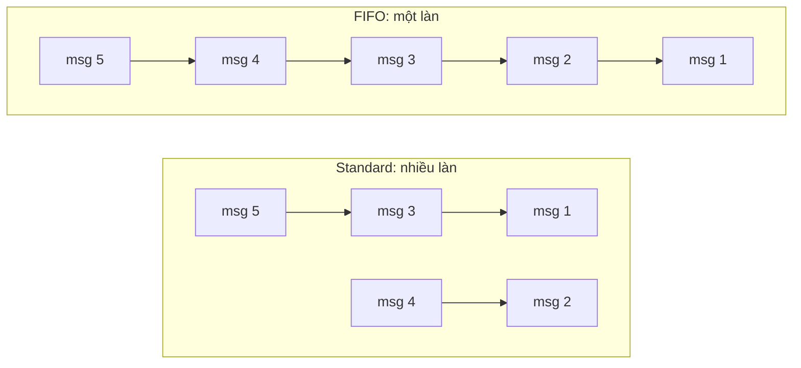

# SQS Standard vs FIFO

> **TL;DR:** [[SQS]] có hai loại queue. **Standard** là "đường cao tốc nhiều làn": gần như không giới hạn throughput nhưng chỉ **at-least-once** và thứ tự best-effort. **FIFO** là "đường một làn không được vượt": **giữ thứ tự** (theo **message group ID**), **exactly-once** (nhờ **deduplication ID**), nhưng throughput giới hạn (300 TPS, 3.000 với batching; **high-throughput mode** nâng lên nhiều lần) và tên phải có hậu tố `.fifo`.

## 🖼️ Sơ đồ
![[SQS Standard vs FIFO.excalidraw]]
*Mở bằng plugin Excalidraw để chỉnh sửa · ảnh tĩnh: [[SQS Standard vs FIFO.svg]]*

## Khái niệm cốt lõi

### Standard queue (multi-lane highway)
- **Scale gần như vô hạn** (near-unlimited TPS): cứ thêm "làn" là chạy nhanh hơn.
- **Best-effort ordering**: không cam kết thứ tự, message có thể đến lệch thứ tự.
- **At-least-once delivery**: thỉnh thoảng có thể nhận **hơn một bản** của cùng message, nên ứng dụng phải chịu được trùng (**idempotent**).
- Dùng cho: **decoupling** các thành phần, **worker pool**, gom item để **batch xử lý sau**.

### FIFO queue (single-lane highway)
- **Thứ tự được giữ nghiêm ngặt**: vào trước ra trước. Chính xác hơn, thứ tự được đảm bảo **trong cùng một message group ID**: các message nhóm "cam" ra theo FIFO của nhóm cam, nhóm "xanh" theo FIFO của nhóm xanh.
- **Exactly-once processing**: duplicate bị loại bỏ nhờ **deduplication ID** (do app tự đặt, hoặc tính bằng **hash của message body**). Queue xét các message trong **cửa sổ 5 phút**; trùng deduplication ID thì bị bỏ. Hữu ích cho nghiệp vụ như ngân hàng, nơi message trùng gây hậu quả xấu.
- **Throughput mặc định**: **300 TPS** không batching, **3.000 message/s** với batching. Thực chất là 300 transaction/giây tới SQS API (gửi một message, nhận hoặc xóa một message = một transaction); mỗi batch chứa tối đa 10 message action.
- **High-throughput mode** cho FIFO: TPS cao hơn nhiều, **tùy region**: mọi region hỗ trợ **ít nhất 2.400 TPS**, region lớn tới **70.000 TPS**. Batching vẫn nhân **10 lần** → khoảng **24.000** msg/s ở region thường, tới **700.000** msg/s ở region lớn.
- **Tên queue bắt buộc có hậu tố `.fifo`**, và chỉ đặt được **lúc tạo queue**, không đổi sau. Giảng viên nói đã thấy ý này **xuất hiện trong đề**.
- Dùng cho: workflow cần thứ tự (đơn hàng), **command ordering** (lệnh admin phải chạy đúng thứ tự), tính toán **điều chỉnh giá** tuần tự.

## Bảng so sánh / số liệu

| Tiêu chí | Standard | FIFO |
|---|---|---|
| Ví von | Đường cao tốc nhiều làn | Đường một làn, không vượt |
| Throughput | Gần như không giới hạn | 300 TPS, 3.000 msg/s có batching (mặc định); high-throughput: ≥ 2.400 TPS, tới 70.000 TPS tùy region (×10 với batching) |
| Thứ tự | Best-effort | Đảm bảo nghiêm ngặt trong mỗi **message group ID** |
| Delivery | At-least-once (có thể trùng) | Exactly-once (deduplication ID, cửa sổ 5 phút) |
| Tên | Tùy ý | Bắt buộc hậu tố `.fifo` |
| Message timer per-message (delay) | Có | **Không** hỗ trợ (xem [[SQS Delay Queues]]) |
| DLQ | DLQ phải là Standard | DLQ phải là FIFO |
| Use case | Decoupling, worker pool, batch | Đơn hàng, lệnh tuần tự, cập nhật giá |

## 🎯 Mẹo thi SAA-C03
- Đề nhấn **"thứ tự", "không được trùng", "exactly-once"** → **FIFO**.
- Đề nhấn **throughput cực lớn, không quan tâm thứ tự** → **Standard** (và ứng dụng phải idempotent).
- Đáp án đổi Standard queue thành FIFO bằng "đổi setting": sai, không chuyển loại queue tại chỗ được; phải **tạo queue mới** có tên đuôi **`.fifo`**.
- Câu hỏi có số liệu cần > 3.000 msg/s mà vẫn cần thứ tự → **FIFO high-throughput mode** (ít nhất 2.400 TPS, tới 70.000 TPS tùy region); không cần thứ tự → Standard.
- Thứ tự chỉ cần giữ **trong từng nhóm** (từng khách hàng, từng đơn) → dùng **message group ID**; chống gửi trùng trong 5 phút → **deduplication ID** (hoặc content-based dedup bằng hash body).

## Liên kết
- Tiên quyết: [[SQS]]
- Liên quan: [[SQS Delay Queues]], [[SQS Dead Letter Queues]], [[SNS]]
- Phân biệt với: [[Kinesis Data Streams]] (giữ thứ tự theo shard, nhiều consumer đọc lại), [[Compare - SQS vs SNS vs Kinesis]]
- Section: [[_MOC 14 Serverless and Application Services]]
