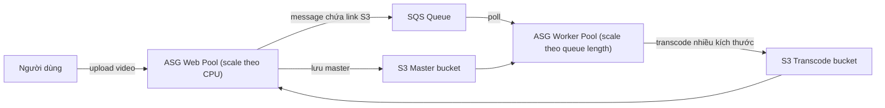
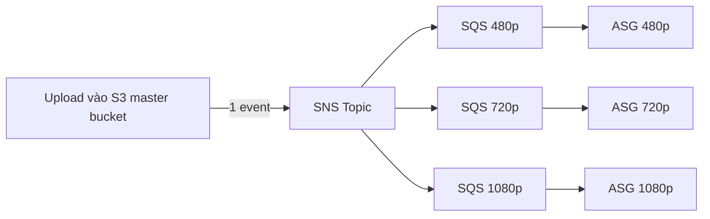

# SQS

> **TL;DR:** Simple Queue Service là dịch vụ **message queue** public, fully managed, HA sẵn trong region. Một thành phần gửi message vào queue, thành phần khác poll để xử lý: hai bên **decoupled**, giao tiếp **asynchronous**, và mỗi bên scale độc lập. Đây là mảnh ghép cốt lõi của kiến trúc worker pool và fan-out.

## 🖼️ Sơ đồ
![[SQS.excalidraw]]
*Mở bằng plugin Excalidraw để chỉnh sửa · ảnh tĩnh: [[SQS.svg]]*

![[SQS - lifecycle.excalidraw]]
*Mở bằng plugin Excalidraw để chỉnh sửa · ảnh tĩnh: [[SQS - lifecycle.svg]]*

## Khái niệm cốt lõi
- **Public service**: truy cập qua public endpoint của AWS, từ bất kỳ đâu có kết nối tới AWS public zone (kể cả VPC private nếu có đường ra public endpoint, ví dụ NAT hay [[Interface VPC Endpoints|VPC endpoint]]).
- **Fully managed, HA và replicate trong region** mặc định, không cần tự lo resilience.
- Hai loại queue: **Standard** và **FIFO**, chi tiết ở [[SQS Standard vs FIFO]].
- **Kích thước message**: khóa học nói tối đa **256 KB** (hiện nay AWS đã nâng lên 1 MiB). Dữ liệu lớn hơn thì lưu vào S3 và đặt **link** (S3 location) trong message. Về kiến trúc, message nhỏ thì dễ xử lý và quản lý ở quy mô lớn.
- **Retention**: message sống tối đa **14 ngày** (mặc định 4 ngày, tối thiểu 1 phút). Khác Kinesis, SQS không có "window" để đọc lại: xử lý xong là xóa.

### Vòng đời message & Visibility Timeout
1. Producer `SendMessage` vào queue.
2. Consumer **poll** (`ReceiveMessage`) và nhận message. Message **không bị xóa**, chỉ bị **ẩn** trong khoảng **VisibilityTimeout**.
3. Xử lý xong thì consumer **chủ động xóa** (`DeleteMessage`), message mất vĩnh viễn.
4. Không xóa (consumer lỗi, crash) thì hết timeout message **xuất hiện lại** để client khác xử lý (retry tự động). Đây là cơ chế **fault tolerance** có sẵn.
- Visibility timeout mặc định **30 giây**, khoảng **0 giây – 12 giờ**, đặt theo queue hoặc theo message (`ChangeMessageVisibility`). Chi tiết so với delay ở [[SQS Delay Queues]].
- Adrian nhấn mạnh: *visibility timeout xuất hiện thường xuyên trong đề thi*.

### Dead-Letter Queue
- Message nhận nhiều lần (ví dụ ≥ 5) mà không bao giờ được xóa → chuyển sang **dead-letter queue** để xử lý/chẩn đoán riêng. Xem [[SQS Dead Letter Queues]].

### Scaling theo độ dài queue
- [[Auto Scaling Groups|ASG]] có thể scale theo **số message trong queue** (queue length).
- [[Lambda]] có thể được invoke khi có message (event source mapping).

## Cách hoạt động / Kiến trúc

### Worker pool (web tier + worker tier)

- Web pool chỉ lưu video gốc + đẩy message, xong là hết trách nhiệm. Không cần biết worker pool khỏe hay không.
- Worker pool scale **out** khi queue dài, scale **in** khi queue ngắn, có thể về **0** instance khi không có việc.
- Instance lỗi giữa chừng → ASG thay instance, message tự quay lại queue sau visibility timeout.
- Kết quả: hai tier **decoupled**, **scale độc lập**.

### SNS + SQS Fan-out (Adrian "nháy mắt" mạnh cho đề thi)

- [[S3 Events|S3 event notification]] với một event chỉ gửi tới **một** đích. Muốn **một sự kiện kích hoạt nhiều job độc lập** thì gửi vào **một SNS topic** có **nhiều SQS queue subscribe**.
- Mỗi queue có ASG riêng, scale theo độ dài queue của mình và có thể dùng loại instance khác nhau.

## Bảng so sánh / số liệu

| Thuộc tính | Giá trị |
|---|---|
| Message size | 256 KB theo khóa học (nay 1 MiB); lớn hơn → S3 + link |
| Retention | mặc định 4 ngày, tối đa 14 ngày |
| Visibility timeout | mặc định 30 s, 0 s – 12 h |
| Standard | at-least-once, best-effort ordering, gần như không giới hạn TPS |
| FIFO | exactly-once, giữ thứ tự, 300 TPS (3.000 msg/s với batching) |
| 1 request | 0–10 message, tối đa 64 KB tính phí cho mỗi lần |
| Long polling | `WaitTimeSeconds` tối đa 20 s |

### Billing & Polling
- Tính tiền theo **request**, không theo message. Một request nhận **1–10 message**, tối đa **64 KB** tổng. Request trả về 0 message vẫn bị tính tiền.
- **Short polling**: trả về **ngay lập tức**, kể cả khi queue rỗng. Muốn giữ queue gần 0 thì phải poll liên tục → tốn nhiều request.
- **Long polling**: đặt `WaitTimeSeconds` (tối đa **20 s**); nếu chưa có message thì request **chờ** tới khi có message hoặc hết thời gian. Ít request hơn, rẻ hơn, nên là cách poll mặc định.

### Bảo mật
- **Encryption at rest**: SSE bằng [[KMS]] (hoặc SSE-SQS key do SQS quản lý, nay bật mặc định cho queue mới). Cần vì message có thể nằm trong queue tới 14 ngày.
- **Encryption in transit**: mặc định giữa SQS và client (HTTPS). Hai khái niệm khác nhau, đừng lẫn.
- **Access control**: [[IAM Identity Policies|identity policy]] hoặc **queue policy** (resource policy, giống bucket policy của S3 hay topic policy của SNS). Truy cập **cross-account** thì **chỉ queue policy** làm được.

## 🎯 Mẹo thi SAA-C03
- Đề nói **decouple**, **asynchronous**, **worker pool**, **buffer** giữa các tier → **SQS**.
- Đề nói **"một upload/sự kiện cần nhiều loại xử lý song song, độc lập"** → **SNS fan-out tới nhiều SQS queue**.
- Đề hỏi **giảm chi phí/giảm số request rỗng** → **long polling** (`WaitTimeSeconds` > 0, tối đa 20 s).
- Message bị xử lý trùng hoặc xuất hiện lại → nghĩ tới **visibility timeout** quá ngắn so với thời gian xử lý; tăng timeout (hoặc `ChangeMessageVisibility`).
- Scale EC2 worker theo backlog → ASG scaling theo **ApproximateNumberOfMessagesVisible** (queue length).
- Payload lớn → lưu S3, message chỉ chứa **con trỏ**.
- Cross-account access vào queue → **queue policy**.
- SQS **không** phải dịch vụ ingest streaming dữ liệu lớn nhiều consumer: đó là [[Kinesis Data Streams]]. Xem [[Compare - SQS vs SNS vs Kinesis]].

## Liên kết
- Tiên quyết: [[Event-Driven Architecture]], [[Serverless Architecture]]
- Chi tiết: [[SQS Standard vs FIFO]], [[SQS Delay Queues]], [[SQS Dead Letter Queues]]
- Dùng cùng: [[SNS]], [[Auto Scaling Groups]], [[Lambda]], [[S3 Events]], [[KMS]]
- Phân biệt với: [[Kinesis Data Streams]], [[Amazon MQ]], [[EventBridge]], [[Compare - SQS vs SNS vs Kinesis]]
- Section: [[_MOC 14 Serverless and Application Services]]
