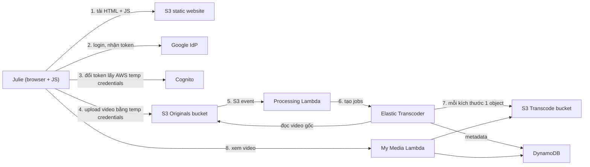

# Serverless Architecture

> **TL;DR:** Serverless là một **kiến trúc phần mềm**, không phải một sản phẩm: mục tiêu là quản lý **càng ít server càng tốt** (lý tưởng là không có server nào). Ứng dụng được chia thành nhiều **function** nhỏ, stateless, **event-driven**, chạy trên FaaS ([[Lambda]]) và ghép với **managed service**, nên khi không có ai dùng thì chi phí gần bằng 0.

## 🖼️ Sơ đồ
![[Serverless Architecture.excalidraw]]
*Mở bằng plugin Excalidraw để chỉnh sửa · ảnh tĩnh: [[Serverless Architecture.svg]]*

## Khái niệm cốt lõi
- Vẫn có server ở phía sau, nhưng **bạn không quản lý chúng**. Server mang theo chi phí, công quản trị và rủi ro; serverless cố loại bỏ những thứ này.
- Lấy phần tốt nhất của **microservices** và **[[Event-Driven Architecture]]**:
  - Chia ứng dụng thành các mảnh **nhỏ hơn cả microservice**: tập hợp function nhỏ, chuyên biệt, khởi động, làm tốt một việc rồi dừng.
  - Trên AWS dùng [[Lambda]] (Azure có Azure Functions). Công nghệ cụ thể ít quan trọng hơn cách tiếp cận.
- **Stateless và ephemeral**: function giả định môi trường trống và sạch → chạy được ở bất kỳ đâu. Mỗi lần chạy: lấy dữ liệu cần thiết → xử lý → lưu kết quả bền vững hoặc chuyển output đi nơi khác. Môi trường giống hệt nhau nên dễ cấp phát, scale tốt và rẻ.
- **Event-driven**: không có gì chạy cho tới khi cần. Code chỉ chiếm phần cứng khi đang xử lý một event (tương tác của hệ thống hoặc khách hàng) → **không có compute chạy thường trực**, chi phí lúc rảnh gần 0.
- **FaaS cho compute đa dụng**: Lambda tính tiền theo thời gian thực thi.
- **Dùng managed service thay vì tự xây ("don't reinvent the wheel")**:
  - Lưu object: [[S3 Basics|S3]]; lưu dữ liệu bền vững: DynamoDB ([[DynamoDB Architecture]]).
  - Danh tính: **third-party IdP** (Google, Twitter, Facebook) hoặc danh tính doanh nghiệp (Active Directory) thay vì tự quản user.
  - Xử lý media: Elastic Transcoder (khóa học dùng; dịch vụ này đã ngừng từ 11/2025, thay bằng AWS Elemental MediaConvert).
  - Nguyên tắc: **tiêu thụ dạng dịch vụ mọi thứ có thể, viết ít code nhất có thể**, FaaS cho phần compute còn lại.

## Cách hoạt động / Kiến trúc: ví dụ PetTube
Mặc định: **không có compute tự quản** (không EC2) trừ khi được nói khác.

1. **Frontend**: Julie mở website tĩnh trên [[S3 Static Website Hosting|S3]], tải HTML có JavaScript. **JavaScript chạy trong trình duyệt** chính là frontend; chưa có compute tự quản nào.
2. **Xác thực**: dùng **third-party IdP** (vd. Google). Lý do không dùng IAM user: giới hạn **5,000 IAM user mỗi account** ([[IAM Users and ARNs]]), và mỗi người dùng lại phải giữ thêm một tài khoản. Google xác thực và trả về **identity token**.
3. AWS không dùng trực tiếp danh tính bên thứ ba → JavaScript gọi **[[Cognito]]** để **đổi token Google lấy temporary AWS credentials**.
4. Dùng credentials tạm đó upload video lên **originals bucket**. Đến đây chỉ có S3, Cognito và Google, không có server.
5. Bucket sinh **[[S3 Events|S3 event]]** → invoke **Lambda xử lý**.
6. Lambda tạo **job** trong Elastic Transcoder, mỗi kích thước video cần ra một job. Job tự đọc video gốc từ originals bucket.
7. Mỗi job xuất một object vào **transcode bucket**; metadata ghi vào **DynamoDB**.
8. Julie xem danh sách video: client gọi Lambda **My Media**, function đọc DynamoDB, xác định object nào thuộc Julie trong transcode bucket rồi trả về URL.

- Thực tế thường có **[[API Gateway]]** đứng giữa client-side code và Lambda (sơ đồ đã đơn giản hóa).
- Chi phí chỉ phát sinh theo mức tiêu thụ: dung lượng S3, DynamoDB, thời gian chạy Lambda, các job transcode. **Mô hình hoàn toàn dựa trên tiêu thụ.**
- Bài lab [[Lab - Serverless App Pet-Cuddle-o-Tron]] triển khai một ứng dụng theo đúng các nguyên tắc này.

## 🎯 Mẹo thi SAA-C03
- Đề nói "**không quản lý server**", "chi phí gần 0 khi không dùng", "scale tự động theo nhu cầu", "event-driven" → bộ **S3 + [[API Gateway]] + [[Lambda]] + DynamoDB (+ [[Cognito]])**.
- Ứng dụng web/mobile có **hàng triệu người dùng** đăng nhập bằng Google/Facebook → **[[Cognito]] + identity federation**, **không** dùng IAM user (giới hạn 5,000/account).
- Frontend tĩnh → S3 static website (thường thêm [[CloudFront Architecture|CloudFront]]); logic → Lambda; API → API Gateway.
- Upload file kích hoạt xử lý → **S3 event → Lambda**.
- Workflow dài hơn 15 phút hoặc nhiều bước có trạng thái → [[Step Functions]], không xâu chuỗi Lambda.
- Lựa chọn có EC2/ASG chạy 24/7 thường **không phải** đáp án khi đề nhấn mạnh serverless/ít vận hành.

## Liên kết
- Tiên quyết: [[Event-Driven Architecture]], [[Lambda]]
- Thành phần: [[S3 Static Website Hosting]], [[Cognito]], [[S3 Events]], [[API Gateway]], [[DynamoDB Architecture]], [[Step Functions]], [[SNS]], [[SQS]]
- Thực hành: [[Lab - Serverless App Pet-Cuddle-o-Tron]]
- Phân biệt với: [[Lab - Architecture Evolution]] (kiến trúc dựa trên EC2/ASG), [[Containers Fundamentals]]
