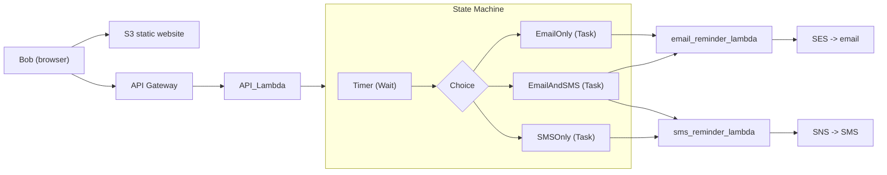

# Step Functions

> **TL;DR:** Step Functions cho phép xây dựng **state machine**, tức các **workflow serverless chạy dài** có điểm đầu, điểm cuối và các **state** ở giữa. Dịch vụ này giải quyết hạn chế của [[Lambda]] (timeout 15 phút, stateless) khi cần ghép nhiều bước, giữ dữ liệu giữa các bước và điều phối nhiều dịch vụ AWS.

## 🖼️ Sơ đồ
![[Step Functions.excalidraw]]
*Mở bằng plugin Excalidraw để chỉnh sửa · ảnh tĩnh: [[Step Functions.svg]]*

## Khái niệm cốt lõi
### Vì sao cần Step Functions
- Lambda được thiết kế cho function **nhỏ, tập trung**, không chứa cả ứng dụng, và **timeout 15 phút**.
- Về lý thuyết có thể **xâu chuỗi Lambda** (function này gọi function kia để "được thêm 15 phút"), nhưng làm vậy **rất rối khi scale**. Thêm nữa môi trường Lambda stateless, dữ liệu phải tự chuyển giữa các lần chạy.
- Ví dụ: đơn hàng in ảnh thú cưng lên kính/kim loại/giấy có thể kéo dài hơn 15 phút, có nhiều điểm rẽ nhánh, đôi khi cần người can thiệp, và có **trạng thái** (đơn hàng) cần giữ. Tương tự quy trình Amazon: tìm hàng, lấy hàng, đóng gói, kiểm tra, đặt vận chuyển, gửi đi.

### State machine
- **State machine** = workflow: start → các **state** → end.
- State có thể *làm việc* hoặc *ra quyết định*; mọi state đều **nhận input, biến đổi và xuất output**, nên dữ liệu được duy trì giữa các bước.
- **Thời gian chạy tối đa của một execution: 1 năm** (Standard).
- Định nghĩa bằng **Amazon States Language (ASL)**, dựa trên **[[JSON]]**; dùng làm template để tạo và export state machine.
- Quyền gọi dịch vụ khác: state machine **assume [[IAM Roles|IAM role]]** khi chạy.
- Cách khởi chạy: [[API Gateway]], IoT Rules, [[EventBridge]], [[Lambda]], hoặc thủ công. Thường dùng cho **xử lý backend**.

### Standard vs Express
| | **Standard** | **Express** |
|---|---|---|
| Mặc định | Có | Không |
| Thời gian tối đa | **1 năm** | **5 phút** |
| Phù hợp | Workflow chạy dài, có trạng thái, cần audit | Xử lý event **khối lượng lớn**: IoT streaming, transform dữ liệu, mobile backend |
| Ngữ nghĩa thực thi* | Exactly-once | At-least-once (async) / at-most-once (sync) |

\*Dòng ngữ nghĩa thực thi là bổ sung theo tài liệu AWS, khóa học chỉ yêu cầu nhớ thời lượng và loại workload.

### Các loại state
| State | Chức năng |
|---|---|
| **Succeed / Fail** | Tới đây thì execution kết thúc thành công / thất bại |
| **Wait** | Dừng một khoảng thời gian, hoặc tới một thời điểm cụ thể (lấy từ input) |
| **Choice** | Rẽ nhánh theo input (vd. tồn kho khác nhau thì xử lý khác nhau) |
| **Parallel** | Tạo các nhánh chạy **song song** |
| **Map** | Nhận một **danh sách** (vd. các item trong đơn hàng) và chạy cùng tập hành động cho **từng phần tử** |
| **Task** | **Một đơn vị công việc**: gọi dịch vụ khác như Lambda, AWS Batch, DynamoDB, ECS, SNS, SQS, Glue, SageMaker, EMR... |
| (Pass) | Chuyển input sang output, có thể chèn dữ liệu; khóa học không nhắc |

- State machine **không tự làm việc**: nó **điều phối (orchestrate)**. Các state luồng (Choice, Wait, Parallel, Map) điều khiển dòng chảy; **Task** state giao việc cho dịch vụ bên ngoài.

## Cách hoạt động / Kiến trúc: Pet Cuddle-O-Tron
Mèo Whiskers muốn nhắc Bob đến ôm nó; khoảng cách giữa các lần có thể **hơn 15 phút, thậm chí nhiều giờ** → không dùng Lambda đơn lẻ được → dùng Step Functions.

1. Bob tải web app (HTML + JS) từ S3; nhập số giây tới lần cuddle tiếp theo, message, email và/hoặc số điện thoại; bấm một trong 3 nút (email / SMS / cả hai).
2. Request đi qua [[API Gateway]] → **API Lambda** → khởi chạy execution của state machine, truyền theo toàn bộ input.
3. **Timer** (Wait) chờ đúng số giây → **Choice** chọn 1 trong 3 nhánh → **Task** gọi một hoặc cả hai Lambda: email qua **SES**, SMS qua [[SNS]].
4. Toàn bộ ứng dụng là serverless; triển khai chi tiết trong [[Lab - Serverless App Pet-Cuddle-o-Tron]].

## 🎯 Mẹo thi SAA-C03
- Workflow **dài hơn 15 phút**, **nhiều bước**, có **rẽ nhánh/song song/chờ**, cần **giữ trạng thái**, hoặc có **bước phê duyệt của con người** → **Step Functions**, không xâu chuỗi Lambda.
- **Standard = tối đa 1 năm**, mặc định, chạy dài. **Express = tối đa 5 phút**, cho khối lượng event lớn (IoT, streaming, mobile backend).
- Từ khóa: "orchestrate", "state machine", "coordinate multiple AWS services", "visual workflow" → Step Functions.
- Định nghĩa bằng **ASL (JSON)**; quyền qua **IAM role**.
- Khởi chạy từ API Gateway, EventBridge, Lambda, IoT Rules.
- Phân biệt: [[SQS]] = hàng đợi decouple; [[SNS]] = pub/sub; [[EventBridge]] = định tuyến event; Step Functions = **điều phối luồng có trạng thái**.

## Liên kết
- Tiên quyết: [[Lambda]], [[Serverless Architecture]], [[JSON]]
- Dùng cùng: [[API Gateway]], [[SNS]], [[SQS]], [[EventBridge]], [[IAM Roles]], [[ECS]]
- Thực hành: [[Lab - Serverless App Pet-Cuddle-o-Tron]]
- Phân biệt với: [[EventBridge]], [[SQS]], [[Event-Driven Architecture]]
