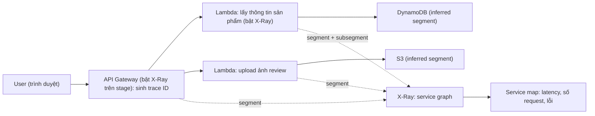

# X-Ray

> **TL;DR:** AWS X-Ray là dịch vụ **distributed tracing**: lần theo **từng request** khi nó đi qua nhiều dịch vụ của một ứng dụng phân tán (API Gateway, Lambda, Elastic Beanstalk, load balancer, DynamoDB...). Dịch vụ đầu tiên có tích hợp X-Ray mà request chạm tới sẽ gắn một **tracing header** chứa trace ID; mỗi thành phần gửi **segment** (có thể kèm **subsegment**) về X-Ray; X-Ray ghép lại thành **service graph** và hiển thị dưới dạng **service map (trace map)** với latency, số request và lỗi của từng chặng. X-Ray **không** đo phía trình duyệt (dùng CloudWatch RUM cho việc đó).

## 🖼️ Sơ đồ
![[X-Ray.excalidraw]]
*Mở bằng plugin Excalidraw để chỉnh sửa · ảnh tĩnh: [[X-Ray.svg]]*

## Khái niệm cốt lõi
- **Vấn đề**: ứng dụng hiện đại thường là **ứng dụng phân tán**, ghép từ nhiều dịch vụ riêng rẽ. Với người dùng nó là "một ứng dụng", nhưng phía sau là API Gateway, Lambda, DynamoDB, S3... Trước đây ứng dụng monolithic nằm trên một EC2 thì theo dõi ở đó là đủ; với kiến trúc phân tán thì lần theo một request qua mọi thành phần rất khó. X-Ray gom dữ liệu từ các dịch vụ riêng lẻ thành **một cái nhìn tập trung** về các request chảy qua ứng dụng.
- **Tracing header + trace ID**: khi user bắt đầu tương tác với ứng dụng đã cấu hình X-Ray, **dịch vụ tích hợp X-Ray đầu tiên** mà request tới sẽ sinh **tracing ID** và chèn vào **tracing header**. Header này đi theo request qua mọi dịch vụ, nhờ ID duy nhất mà X-Ray theo dõi được **từng request riêng**.
- **Segment**: một khối dữ liệu mà một dịch vụ gửi về X-Ray, gồm:
  - **host**: hostname, IP hoặc alias;
  - **request**: method, client address, path, user agent (trình duyệt nào);
  - **response**: công việc đã làm, thời điểm bắt đầu/kết thúc, lỗi hoặc vấn đề.
- **Subsegment**: chi tiết hơn bên trong một segment, ví dụ một thao tác gọi nhiều HTTP endpoint hoặc gọi database.
- X-Ray **ghép các segment** của cùng một request để thấy luồng **end-to-end**.
- **Service graph**: cấu trúc tổng thể của ứng dụng. Dịch vụ nào gửi dữ liệu về X-Ray thì được ghi nhận là một **service** trong graph, kèm **kết nối** giữa các dịch vụ (ví dụ web front-end → app back-end → database tier).
- **Service map** (còn gọi **trace map**): hình ảnh trực quan của service graph trong X-Ray console: luồng request qua ứng dụng, **response time / latency trung bình**, **tần suất** truy cập, **lỗi** ở từng thành phần.
- **Inferred segment**: dịch vụ **không gửi dữ liệu trực tiếp** cho X-Ray (ví dụ **S3**, **DynamoDB**) vẫn hiện trên map, nhờ dịch vụ phía trên (Lambda) ghi lại lời gọi tới chúng.
- **Phạm vi**: X-Ray bắt đầu từ **dịch vụ AWS hỗ trợ X-Ray đầu tiên** trong chuỗi. X-Ray **không cung cấp observability phía trình duyệt** (thời gian tải trang, latency người dùng cảm nhận...): việc đó dùng công cụ khác như **CloudWatch RUM**.

## Cách hoạt động / Kiến trúc

Ví dụ trong bài: web store serverless của **Aus-E-Mart**.

1. User truy cập web store, kết nối đầu tiên tới **API Gateway**. Đây là dịch vụ X-Ray đầu tiên trong chuỗi nên nó sinh **tracing header** và một **segment** (latency trung bình, tần suất truy cập phần này).
2. Request đi tiếp tới **Lambda** (lấy thông tin sản phẩm từ **DynamoDB**, hoặc xử lý ảnh review lưu vào **S3**). Header đi kèm, mỗi thành phần hỗ trợ ghi segment của mình.
3. S3 và DynamoDB không tự gửi dữ liệu nhưng vẫn xuất hiện qua **inferred segment** từ Lambda.
4. X-Ray dựng **service graph**; console hiện **service map** cho thấy luồng, response time, request và lỗi của từng chặng.

### Bật X-Ray và đường dữ liệu theo từng dịch vụ
| Dịch vụ | Cách gửi dữ liệu tới X-Ray |
|---|---|
| [[API Gateway]] | Bật trên **từng stage** cần theo dõi |
| [[Lambda]] | Bật **ở mức function** (từng function) |
| EC2 | Cài **X-Ray daemon** trên instance |
| [[ECS]] | Cũng dùng **daemon** để gửi dữ liệu |
| Elastic Beanstalk | Daemon **cài sẵn** |
| [[SNS]], [[SQS]] | Cấu hình được để gửi dữ liệu tới X-Ray |
| S3, DynamoDB | Không gửi trực tiếp; hiện qua **inferred segment** |

- **Quyền**: như mọi dịch vụ AWS làm việc thay bạn, thành phần gửi dữ liệu cần quyền. Ví dụ Lambda: **execution role** phải có quyền ghi tới X-Ray (xem [[IAM Roles]]).

## Bảng so sánh / số liệu
| Công cụ | Trả lời câu hỏi | Ghi chú |
|---|---|---|
| **X-Ray** | Một request đi qua những dịch vụ nào, chậm hay lỗi ở chặng nào? | Distributed tracing, service map |
| [[CloudWatch Basics\|CloudWatch]] metrics / [[CloudWatch Logs]] | Chỉ số, log của từng tài nguyên | Không nối các chặng của một request |
| [[CloudTrail]] | Ai gọi API nào lên account? | Audit API call, không phải tracing ứng dụng |
| CloudWatch RUM | Trải nghiệm phía trình duyệt (tải trang, latency người dùng) | Phần X-Ray không làm |

## 🎯 Mẹo thi SAA-C03
- Từ khóa **"distributed tracing"**, **"trace request qua nhiều dịch vụ / microservices"**, **"tìm chặng gây chậm hoặc lỗi"**, **"service map"** → **X-Ray**.
- Lambda không gửi được trace → kiểm tra đã **bật X-Ray trên function** và **execution role có quyền X-Ray**. EC2/ECS cần **X-Ray daemon**; Elastic Beanstalk có sẵn daemon; API Gateway bật **theo stage**.
- Dịch vụ không hỗ trợ trực tiếp (S3, DynamoDB) vẫn có mặt trên map nhờ **inferred segment**.
- Đo trải nghiệm trên trình duyệt (page load) → **CloudWatch RUM**, không phải X-Ray. Ai gọi API gì → **CloudTrail**.

## Liên kết
- Dùng cùng: [[Lambda]], [[API Gateway]], [[ECS]], [[SNS]], [[SQS]], [[DynamoDB Architecture]], [[IAM Roles]]
- Phân biệt với: [[CloudWatch Basics]], [[CloudWatch Logs]], [[CloudTrail]]
- Bối cảnh: [[Event-Driven Architecture]]
- Section: [[_MOC 14 Serverless and Application Services]]
