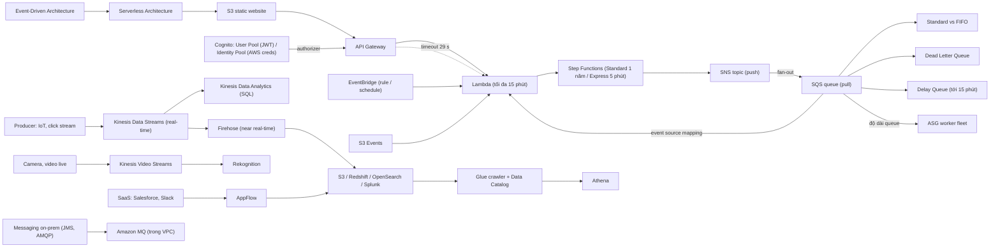

# 14 Serverless and Application Services

Section dài nhất về application services: bắt đầu từ [[Lambda]] và [[EventBridge]], ghép thành kiến trúc serverless với API Gateway, Step Functions, SNS, rồi đi qua họ messaging/streaming (SQS, Kinesis) và các dịch vụ tích hợp (Cognito, Glue, Amazon MQ, AppFlow). Nó tiếp nối phần decoupling và event-driven ở cuối [[_MOC 13 HA and Scaling|HA and Scaling]]; trong đề thi, đây là nguồn của rất nhiều câu "chọn dịch vụ nào" (SQS vs SNS vs Kinesis, Lambda vs Step Functions).

← [[00 Home]] · Trước: [[_MOC 13 HA and Scaling]] · Sau: [[_MOC 15 Global Content Delivery]]

## Lộ trình học
1. [[Lambda]] — FaaS, trả tiền theo thời gian chạy; timeout tối đa 15 phút, public vs VPC networking, execution role vs resource policy, 3 kiểu invocation.
2. [[EventBridge]] — tiền thân CloudWatch Events; rule khớp event hoặc lịch cron rồi gửi tới target như Lambda.
3. [[Serverless Architecture]] — kiến trúc quản lý càng ít server càng tốt: function nhỏ, stateless, event-driven + managed service, chi phí gần 0 khi không dùng.
4. [[SNS]] — pub/sub push: publisher gửi vào topic, mọi subscriber nhận; nền của fan-out và thông báo của nhiều dịch vụ AWS.
5. [[Step Functions]] — state machine cho workflow serverless chạy dài (Standard tới 1 năm, Express tới 5 phút), khắc phục giới hạn của Lambda.
6. [[API Gateway]] — cửa vào managed cho API: authorizer, throttling, caching, CORS; Lambda phía sau bị giới hạn 29 s.
7. [[Lab - Serverless App Pet-Cuddle-o-Tron]] — demo S3 → API Gateway → Lambda → Step Functions → SES/SNS, hoàn toàn serverless.
8. [[SQS]] — message queue pull, decouple và async; visibility timeout, long polling, scale worker theo độ dài queue.
9. [[SQS Standard vs FIFO]] — Standard: throughput gần vô hạn, at-least-once; FIFO: đúng thứ tự, exactly-once, đuôi `.fifo`.
10. [[SQS Delay Queues]] — hoãn giao message tối đa 15 phút; khác visibility timeout (ẩn sau khi nhận).
11. [[SQS Dead Letter Queues]] — gom message xử lý thất bại nhiều lần (`maxReceiveCount`) để cô lập và phân tích.
12. [[Kinesis Data Streams]] — ingest streaming khối lượng lớn, rolling window 24 h tới 365 ngày, nhiều consumer đọc real-time và replay.
13. [[Kinesis Data Firehose]] — deliver streaming data tới S3/Redshift/OpenSearch/Splunk, fully managed, **near** real-time (~60 s).
14. [[Kinesis Data Analytics]] — xử lý stream real-time bằng SQL, làm giàu bằng reference data trên S3.
15. [[Kinesis Video Streams]] — ingest video live và dữ liệu time-serialized, thường ghép với Rekognition.
16. [[Cognito]] — User Pool (sign-in → JWT) và Identity Pool (đổi identity lấy temporary AWS credentials).
17. [[Glue]] — ETL serverless + Data Catalog; crawler sinh metadata cho Athena/Redshift Spectrum.
18. [[Amazon MQ]] — message broker mã nguồn mở được quản lý (JMS, AMQP, MQTT...), chạy trong VPC, để migrate hệ thống messaging on-prem.
19. [[AppFlow]] — tích hợp dữ liệu no-code giữa SaaS (Salesforce, Slack...) và dịch vụ AWS qua các flow.
20. [[Compare - SQS vs SNS vs Kinesis]] — queue (pull, decouple) vs pub/sub (push, fan-out) vs stream (ingest, nhiều consumer, replay).

## Bản đồ khái niệm

## Liên kết sang section khác
- Nền tảng kiến trúc: [[Event-Driven Architecture]]
- Quyền và mạng của Lambda: [[IAM Roles]], [[NAT Gateway]], [[Interface VPC Endpoints]]
- Nguồn event và lưu trữ: [[S3 Events]], [[S3 Static Website Hosting]], [[DynamoDB Architecture]]
- Đích phân tích dữ liệu: [[Athena]], [[Redshift]]
- Bảo vệ API: [[WAF]]

## 🎯 Top mẹo thi của section
- Lambda timeout tối đa **15 phút**; job dài hơn hoặc nhiều bước có trạng thái → **Step Functions**, không xâu chuỗi Lambda. ([[Lambda]], [[Step Functions]])
- Lambda trong VPC **không ra Internet** nếu không có NAT Gateway/VPC endpoint; **execution role** = function làm được gì, **resource policy** = ai được gọi. ([[Lambda]])
- Cold start → **provisioned concurrency**; async invocation có retry → code phải **idempotent**, dùng DLQ/destinations. ([[Lambda]])
- Lambda sau **API Gateway** phải trả lời trong **29 s** (quá → 504); 429 = throttling, 502 = output Lambda sai. ([[API Gateway]])
- Cron/tác vụ theo lịch không cần server, hoặc phản ứng với thay đổi trong account → **EventBridge rule + Lambda**. ([[EventBridge]])
- "Không quản lý server, chi phí gần 0 khi không dùng" → **S3 + API Gateway + Lambda + DynamoDB (+ Cognito)**. ([[Serverless Architecture]])
- Một message tới nhiều consumer → **SNS**; mỗi consumer xử lý độc lập có buffer riêng → **fan-out SNS → nhiều SQS**. ([[SNS]])
- Decouple, worker pool, async → **SQS**; message xử lý trùng → tăng **visibility timeout**; giảm request rỗng → **long polling** (tối đa 20 s). ([[SQS]])
- Thứ tự tuyệt đối, exactly-once → **SQS FIFO** (đuôi `.fifo`, không đổi Standard thành FIFO tại chỗ). ([[SQS Standard vs FIFO]])
- "Chờ X phút rồi mới xử lý" (≤ 15 phút) → **delay queue**; message lỗi quay vòng mãi → **DLQ + redrive policy**, retention DLQ dài hơn source. ([[SQS Delay Queues]], [[SQS Dead Letter Queues]])
- "Ingestion of data", real-time, nhiều consumer, replay → **Kinesis Data Streams**; worker pool/decoupling → mặc định **SQS**. ([[Compare - SQS vs SNS vs Kinesis]])
- Đề yêu cầu **real-time** → loại Firehose (chỉ **near real-time**); đẩy stream vào S3/Redshift với ít vận hành nhất → **Firehose**. ([[Kinesis Data Firehose]])
- **User Pool = sign-in → JWT; Identity Pool = đổi identity lấy temporary AWS credentials**. Hàng triệu user mobile/web → Cognito, không dùng IAM user. ([[Cognito]])
- ETL + "serverless / ad hoc / cost effective" → **Glue** (thay Data Pipeline); khám phá schema S3 cho Athena → **Glue crawler**. ([[Glue]])
- Migrate messaging on-prem (JMS, AMQP, MQTT, ActiveMQ) ít sửa app → **Amazon MQ**, và nhớ MQ cần **private networking**. Đồng bộ dữ liệu SaaS → S3/Redshift không code → **AppFlow**. ([[Amazon MQ]], [[AppFlow]])
