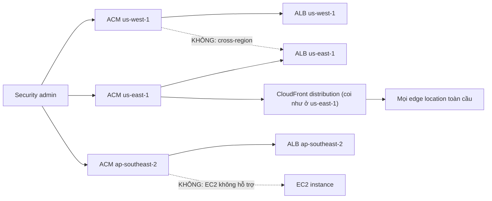

# ACM

> **TL;DR:** AWS Certificate Manager (ACM) tạo, lưu trữ, gia hạn và **deploy SSL/TLS certificate** tới các dịch vụ AWS được hỗ trợ (chủ yếu **CloudFront** và **load balancer**). ACM là dịch vụ **regional**: cert chỉ dùng được trong region của nó. Riêng **CloudFront luôn dùng cert ở us-east-1**.

## 🖼️ Sơ đồ
![[ACM.excalidraw]]
*Mở bằng plugin Excalidraw để chỉnh sửa · ảnh tĩnh: [[ACM.svg]]*

## Bối cảnh: HTTP → HTTPS
- **HTTP** ban đầu không có xác thực danh tính server, cũng không mã hóa đường truyền. Nếu kẻ tấn công **spoof DNS** thì có thể dẫn người dùng tới server giả mà trình duyệt vẫn hiện địa chỉ "bình thường", từ đó đánh cắp credential hoặc sniff dữ liệu.
- **HTTPS** chạy HTTP bên trong một tunnel **SSL/TLS** (xem [[SSL and TLS]]), mang lại hai thứ:
  1. **Mã hóa in-transit** đối với người quan sát bên ngoài.
  2. **Xác thực danh tính server** bằng **certificate** do một **CA (Certificate Authority)** mà client tin cậy ký (xem [[Digital Signatures]]). Client tin CA nên tin cert mà CA ký, và do đó tin site. Một site tự xưng netflix.com phải có cert netflix.com được CA tin cậy ký.
- Tên DNS và certificate gắn với nhau: site chọn tên miền, có cert cho tên đó, và dùng cert để chứng minh danh tính.

## Khái niệm cốt lõi
- **Public CA**: cert được trình duyệt/thiết bị public tin cậy. Hệ điều hành và trình duyệt có sẵn danh sách CA tin cậy, các CA này lại tin CA khác, tạo thành **chain of trust**.
- **Private CA**: cùng kiến trúc nhưng chỉ nội bộ tổ chức (thường gặp ở doanh nghiệp lớn). Client phải được **cấu hình để tin** private CA, thủ công trong image máy hoặc tự động qua policy.
- **Generate vs Import**:
  - **ACM tạo cert**: chỉ cần chứng minh sở hữu domain bằng **DNS validation** (thêm một CNAME record, dễ nhất nếu domain ở Route 53) hoặc **email validation**. ACM **tự động gia hạn**.
  - **Import cert** từ nguồn ngoài: **bạn tự chịu trách nhiệm gia hạn** (gia hạn ở nguồn ngoài rồi import lại).
- Cert luôn được **lưu mã hóa** và deploy một cách managed, an toàn tới **dịch vụ được hỗ trợ**.

## Dịch vụ được hỗ trợ
- **Hỗ trợ**: chủ yếu **CloudFront** và **load balancer** ([[Elastic Load Balancer|ALB/NLB]]). (Ngoài ra còn API Gateway và một số dịch vụ khác.)
- **KHÔNG hỗ trợ: EC2**. Lý do: EC2 là compute tự quản lý, ai có quyền root trên instance thì luôn có cách lấy được cert. Mục đích của ACM là bảo vệ việc lưu trữ và triển khai cert, nên AWS không cho deploy lên EC2.
  - (Ghi chú 2025+: ACM đã có tùy chọn *exportable public certificate* có tính phí, cho phép export cert để tự cài ở nơi khác, kể cả EC2. Khi đó việc lưu, cài đặt và gia hạn trên máy đích là việc của bạn. Với đề thi, vẫn nhớ quy tắc "ACM không deploy được lên EC2".)
- **S3 không dùng ACM**. S3 tự xử lý certificate của nó khi làm origin cho CloudFront.

## Kiến trúc regional

- Mỗi region có một ACM **độc lập**. Cert được tạo hoặc import vào region nào thì **bị khóa ở region đó**, không di chuyển hay deploy cross-region được.
- Muốn dùng cert cho ALB ở `ap-southeast-2` thì cert **phải nằm trong ACM ở `ap-southeast-2`**. Admin phải tạo/import cert **ở từng region có dịch vụ cần dùng**.
- **CloudFront**: là dịch vụ global, nhưng về mặt ACM hãy coi **distribution nằm ở us-east-1 (N. Virginia)**. Cert phải ở **us-east-1**. ACM deploy cert vào distribution, rồi distribution đẩy cert ra mọi edge location ở mọi nơi. Cert tạo ở region khác sẽ **không gắn được** vào CloudFront.
- Khi cert đã được deploy, khách hàng có thể thiết lập kết nối tin cậy và an toàn tới ALB hoặc edge location.

## 🎯 Mẹo thi SAA-C03
- **ACM generate thì tự gia hạn. Import thì tự gia hạn bằng tay.**
- **ACM không dùng được với EC2** (câu bẫy rất phổ biến). Muốn HTTPS cho ứng dụng trên EC2 với cert ACM thì đặt **ALB phía trước** và terminate TLS ở ALB (xem [[SSL Offload and Session Stickiness]]).
- **Cert phải cùng region với dịch vụ** (ALB ở Sydney thì cert ở Sydney). **Không cross-region.**
- **CloudFront thì cert luôn ở us-east-1.** Các tích hợp regional khác của CloudFront cũng nghĩ theo hướng us-east-1.
- Đề thường cho tình huống lỗi "không chọn được cert trong CloudFront hoặc ALB": nguyên nhân thường là **sai region**.

## Liên kết
- Tiên quyết: [[SSL and TLS]], [[Encryption Fundamentals]], [[Digital Signatures]]
- Dùng cùng: [[CloudFront and SSL]], [[Elastic Load Balancer]], [[SSL Offload and Session Stickiness]], [[API Gateway]]
- Liên quan: [[R53 Public Hosted Zones]] (DNS validation), [[CloudFront Architecture]]
- Phân biệt với: [[KMS]], [[CloudHSM]] (quản lý key, không phải certificate)
- Section: [[_MOC 15 Global Content Delivery]]
