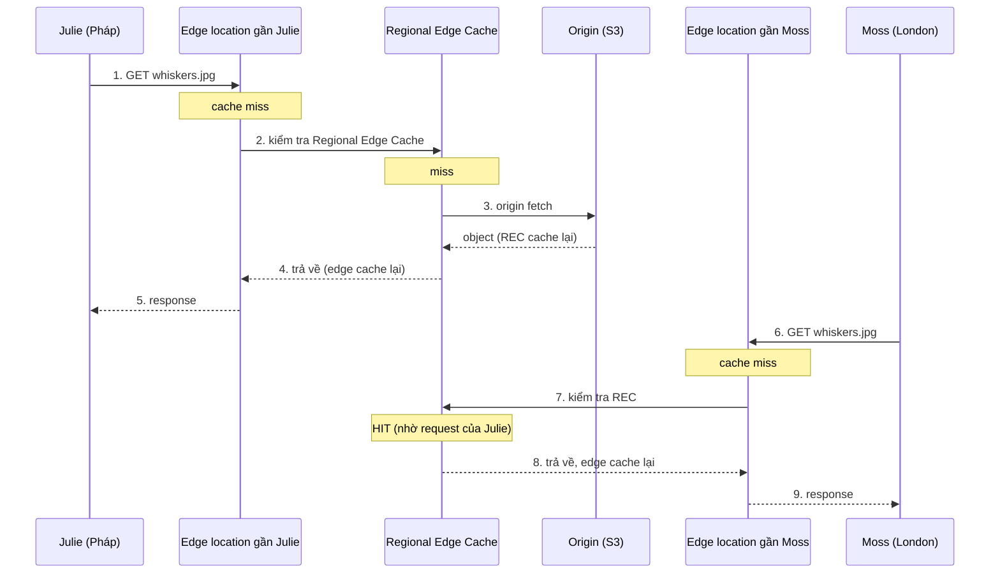
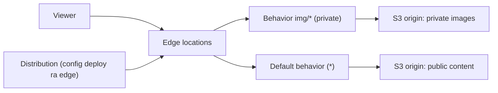

# CloudFront Architecture

> **TL;DR:** CloudFront là **CDN (Content Delivery Network)** của AWS. Nó đưa nội dung từ nơi gốc (origin) tới người dùng toàn cầu nhanh hơn bằng hai cách: **cache** nội dung ở các edge location gần người dùng và chuyển dữ liệu qua **mạng toàn cầu của AWS**. Kết quả là latency thấp hơn, tốc độ tải cao hơn, và origin chịu ít tải hơn.

## 🖼️ Sơ đồ
![[CloudFront Architecture.excalidraw]]
*Mở bằng plugin Excalidraw để chỉnh sửa · ảnh tĩnh: [[CloudFront Architecture.svg]]*

## Vấn đề CloudFront giải quyết
- Ứng dụng chạy ở một region (ví dụ Úc) nhưng có người dùng toàn cầu (Bob ở bờ Tây Mỹ, Julie ở Anh). Dữ liệu phải đi đường dài, qua nhiều hop không trực tiếp, dẫn tới hai vấn đề: **latency cao** và **tốc độ truyền chậm**.
- Tệ hơn, dữ liệu bị kéo xuyên lục địa **mỗi lần** có request, kể cả khi trước đó đã có người lấy đúng object đó.

## Khái niệm cốt lõi (thuật ngữ phải thuộc)
| Thuật ngữ | Ý nghĩa |
|---|---|
| **Origin** | Nơi chứa bản gốc của nội dung. Có 2 loại: **S3 origin** hoặc **custom origin** (bất cứ thứ gì chạy web server và có **public IPv4 routable**). Một distribution có thể có **một hoặc nhiều** origin. Chi tiết: [[CloudFront Origins]] |
| **Distribution** | **Đơn vị cấu hình** của CloudFront. Tạo distribution, rồi distribution được deploy ra mạng CloudFront. Hầu hết mọi thứ được cấu hình trong distribution, trực tiếp hoặc gián tiếp qua behavior |
| **Edge location** | Hạ tầng toàn cầu nơi nội dung được cache. **Nhiều hơn và nhỏ hơn** region (lúc quay bài: hơn 200 edge location; hiện nay CloudFront có hơn 600 PoP). Thường là một hoặc vài rack trong data center bên thứ ba, chủ yếu là storage (khoảng 90%) và một ít compute cho một số dịch vụ. **Không thể deploy EC2** vào edge location |
| **Regional Edge Cache (REC)** | **Lớn hơn** edge location và **ít hơn** về số lượng. Phục vụ nhiều edge location trong cùng vùng địa lý, giữ được nhiều dữ liệu hơn, hợp với object ít được truy cập nhưng vẫn đáng cache gần khách hàng hơn origin |
| **Behavior** | Cấu hình con trong distribution, chọn theo **path pattern**. Đây mới là nơi chứa phần lớn cấu hình quan trọng. Chi tiết: [[CloudFront Behaviors]] |

- Mỗi distribution có một **domain name mặc định** dạng `d111111abcdef8.cloudfront.net` (duy nhất, luôn kết thúc bằng `cloudfront.net`). Có thể thêm **alternate domain name** (CNAME) như `animals4life.org` (xem [[CloudFront and SSL]]).
- Khi deploy, cấu hình distribution được đẩy tới **tất cả edge location được chọn** (theo price class).

## Cách hoạt động: luồng cache hit / cache miss

- **Cache hit**: object có sẵn ở edge location, trả ngay. Đây là trường hợp tốt nhất (latency thấp, tốc độ cao).
- **Cache miss**: edge không có object thì hỏi **Regional Edge Cache**. REC vẫn không có thì thực hiện **origin fetch**: lấy từ origin, lưu ở REC, đẩy về edge, edge lưu lại rồi trả cho người dùng. Người dùng không thấy các bước này.
- Từ lần truy cập thứ hai trở đi (cùng edge), object được trả thẳng từ edge.
- REC có lợi khi nhiều edge trong cùng vùng: Moss dùng edge khác Julie nên vẫn miss ở edge, nhưng hit ở REC nên không phải về origin.
- Hệ quả: **giảm tải cho origin** và **tăng hiệu năng** cho khách toàn cầu.

## Hai điểm kiến trúc quan trọng
1. **Tích hợp [[ACM]]** để dùng SSL/TLS certificate, cho phép HTTPS với tên miền riêng.
2. **CloudFront chỉ cache cho chiều download (read)**. Upload đi **thẳng tới origin**, CloudFront **không cache khi ghi** (no write caching).

## Distribution, behavior và origin liên quan với nhau thế nào

- Dễ tưởng origin gắn trực tiếp vào distribution, nhưng thật ra **origin gắn với behavior**, behavior nằm trong distribution. Behavior là lớp ở giữa.
- Mọi distribution có ít nhất **một behavior: default, path pattern `*`** (wildcard, khớp mọi thứ). Có thể thêm behavior cụ thể hơn (ví dụ `img/*`), và behavior cụ thể hơn được **ưu tiên**.
- Những thứ hay bị nói là "set trên distribution" như **origin / origin group, TTL, protocol policy, restricted (private) access** thực ra được cấu hình **trên behavior**.

## 🎯 Mẹo thi SAA-C03
- Đề hỏi CloudFront cache **read hay read/write**: chỉ **read (download)**. Upload đi thẳng tới origin, không cache.
- Thuộc 4 thuật ngữ: origin, distribution, edge location, regional edge cache, cùng các khái niệm cache hit, cache miss, origin fetch.
- Edge location **không chạy được EC2**. Muốn compute ở edge thì xem [[Lambda@Edge]].
- Muốn HTTPS với tên miền riêng thì cần [[ACM]] (cert ở **us-east-1**).
- Cần tối ưu mạng cho TCP/UDP, không cache: đó là [[Global Accelerator]], không phải CloudFront.

## Liên kết
- Tiên quyết: [[AWS Global Infrastructure]], [[S3 Basics]], [[DNS Fundamentals]]
- Đi sâu: [[CloudFront Behaviors]], [[CloudFront Origins]], [[CloudFront TTL and Invalidations]], [[CloudFront and SSL]], [[CloudFront OAI and OAC]], [[CloudFront Private Distributions]], [[Lambda@Edge]]
- Dùng cùng: [[ACM]], [[WAF]], [[Shield]], [[S3 Static Website Hosting]]
- Phân biệt với: [[Global Accelerator]]
- Section: [[_MOC 15 Global Content Delivery]]
