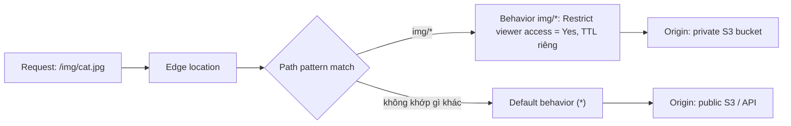

# CloudFront Behaviors

> **TL;DR:** Behavior là **cấu hình con** trong một CloudFront distribution, được chọn theo **path pattern** của request. Thi cần phân biệt rõ setting nào nằm ở **distribution** và setting nào nằm ở **behavior**. Mọi **caching control** và **restrict viewer access** đều nằm ở behavior.

## 🖼️ Sơ đồ
![[CloudFront Behaviors.excalidraw]]
*Mở bằng plugin Excalidraw để chỉnh sửa · ảnh tĩnh: [[CloudFront Behaviors.svg]]*

## Khái niệm cốt lõi
- Mỗi request tới edge location được **so khớp path pattern** với các behavior của distribution.
- **Default behavior** có path pattern `*`, khớp mọi request không khớp behavior nào cụ thể hơn. Distribution luôn có ít nhất behavior này.
- Khi request khớp một behavior, nó phải tuân theo mọi option của behavior đó. Option quan trọng nhất là **origin hoặc origin group** dùng để origin fetch.
- Vì setting nằm ở behavior nên **một distribution có thể có nhiều cấu hình khác nhau** cho các phần khác nhau của ứng dụng (ví dụ `/login` public còn `/private/*` thì restricted).

## Bảng: Distribution-level vs Behavior-level
| Cấu hình ở **Distribution** | Cấu hình ở **Behavior** |
|---|---|
| **Price class**: deploy tới edge location nào (tất cả edge = best performance, đắt nhất; chỉ North America + Europe = rẻ nhất; hoặc NA + Europe + Asia + Middle East + Africa) | **Path pattern** (`*`, `img/*`...) |
| **AWS WAF web ACL** (WAF gắn ở mức distribution) | **Origin / origin group** |
| **Alternate domain names (CNAME)** | **Viewer protocol policy**: HTTP and HTTPS / Redirect HTTP to HTTPS / HTTPS only |
| **Custom SSL certificate** (từ [[ACM]], **phải ở us-east-1**), chọn **SNI vs dedicated IP** | **Allowed HTTP methods**: GET, HEAD / + OPTIONS / + PUT, POST, PATCH, DELETE |
| **Security policy** (phiên bản TLS tối thiểu, ví dụ `TLSv1.2_2018`) | **Field-level encryption** |
| **Supported HTTP versions** (HTTP/2, 1.1, 1.0) | **Cache settings**: legacy cache settings hoặc (khuyến nghị) **cache policy + origin request policy**; cache theo headers, cookies, query strings |
| **Standard logging**, cookie logging | **Minimum / Default / Maximum TTL** (xem [[CloudFront TTL and Invalidations]]) |
| **Default root object** (ví dụ `index.html`) | **Restrict viewer access**: cần **trusted key groups** (mới) hoặc **trusted signers** (legacy). Xem [[CloudFront Private Distributions]] |
| Geographic restrictions, error pages (tab riêng của distribution) | **Compress objects automatically** |
| | **Gắn [[Lambda@Edge]] function** |

- **Security policy** là đánh đổi: policy mới hơn thì an toàn hơn nhưng có thể chặn khách dùng trình duyệt cũ. Chọn mức cân bằng giữa bảo mật và khả năng truy cập.
- Price class thấp giúp giảm chi phí nhưng người dùng ngoài các vùng đã chọn sẽ có hiệu năng kém hơn.

## Cách hoạt động

- Thực tế nhiều distribution có behavior **non-restricted** (ví dụ trang đăng nhập) song song với behavior **restricted** cho nội dung nhạy cảm.

## Demo / Lab
- Console CloudFront: tab General (settings của distribution: price class, WAF, CNAME, cert, security policy, HTTP versions, logging, default root object). Tab Behaviors: edit default behavior để thấy viewer protocol policy, allowed methods, restrict viewer access, cache key and origin requests, TTL...
- Distribution cũ dùng "Legacy cache settings". AWS khuyến nghị chuyển sang **cache policy và origin request policy** (nhóm setting dùng lại được, ví dụ managed policy `CachingOptimized`, `CachingDisabled`).

## 🎯 Mẹo thi SAA-C03
- **Mọi caching control (TTL, cache key, headers/cookies/query strings) nằm ở behavior**, cùng với **restrict viewer access**. Vì vậy cùng một distribution có thể có TTL khác nhau và public/private khác nhau theo path.
- Thấy **"trusted key groups"** hoặc **"trusted signers"** thì behavior đang **private**, phải dùng **signed URL / signed cookie**.
- WAF, price class, alternate domain name, SSL cert, security policy nằm ở **distribution**.
- Đề hỏi giảm chi phí CloudFront khi user chủ yếu ở Mỹ/châu Âu: chọn **price class** hẹp hơn.
- Muốn ép HTTPS: đặt **viewer protocol policy = Redirect HTTP to HTTPS** hoặc **HTTPS only** trên behavior.

## Liên kết
- Tiên quyết: [[CloudFront Architecture]]
- Liên quan: [[CloudFront Origins]], [[CloudFront TTL and Invalidations]], [[CloudFront and SSL]], [[CloudFront Private Distributions]], [[Lambda@Edge]]
- Dùng cùng: [[WAF]], [[ACM]], [[Kinesis Data Streams]] (real-time logs)
- Section: [[_MOC 15 Global Content Delivery]]
