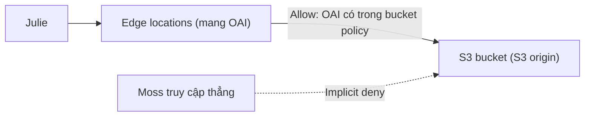
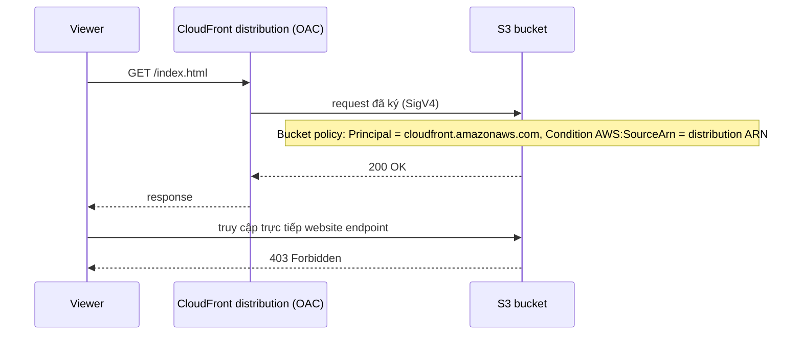

# CloudFront OAI and OAC

> **TL;DR:** OAI (Origin Access Identity, legacy) và OAC (Origin Access Control, khuyến nghị) khóa **S3 origin** để **chỉ CloudFront truy cập được**, chặn người dùng bypass CloudFront và đi thẳng tới bucket. **Custom origin** không dùng được OAI/OAC, mà phải bảo vệ bằng **custom header bí mật** và/hoặc **firewall theo IP range của CloudFront**.

## 🖼️ Sơ đồ
![[CloudFront OAI and OAC.excalidraw]]
*Mở bằng plugin Excalidraw để chỉnh sửa · ảnh tĩnh: [[CloudFront OAI and OAC.svg]]*

![[CloudFront OAI and OAC - custom origin.excalidraw]]
*Mở bằng plugin Excalidraw để chỉnh sửa · ảnh tĩnh: [[CloudFront OAI and OAC - custom origin.svg]]*

## Bối cảnh: bảo vệ content delivery path
Đường đi của nội dung có 3 vùng: **Origin** → **mạng CloudFront (edge)** → **Internet/viewer**.
- Note này: phía **origin fetch** (origin → CloudFront). Mục tiêu là **chỉ CloudFront** lấy được dữ liệu từ origin.
- Phía viewer (CloudFront → khách) được bàn ở [[CloudFront Private Distributions]].
- Nếu không khóa origin, mọi giới hạn đặt trên CloudFront (signed URL/cookie, geo restriction, [[WAF]]...) đều **vô nghĩa** vì người dùng có thể đi thẳng tới origin.

## OAI: Origin Access Identity (legacy)
- Là một **loại identity** (không phải IAM user hay IAM role, nhưng có đặc điểm của cả hai).
- **Gắn OAI vào distribution**: khi distribution (edge location) truy cập S3 origin, nó **"trở thành" OAI** đó.
- OAI được dùng trong **bucket policy** (explicit allow hoặc deny).
- Pattern phổ biến: bucket policy **explicit allow cho OAI**, gỡ mọi quyền khác, để **implicit deny** áp dụng cho tất cả còn lại.
- Một OAI có thể dùng cho nhiều distribution và nhiều bucket, nhưng Adrian khuyên **một OAI cho một distribution** để dễ quản lý quyền.
- **Chỉ áp dụng cho S3 origin**, không áp dụng cho S3 static website endpoint (vì đó là custom origin).

## OAC: Origin Access Control (mới, AWS khuyến nghị)
- Cùng mục tiêu với OAI: S3 origin chỉ truy cập được qua CloudFront.
- Khác biệt về cơ chế:
  - CloudFront **ký (sign) mọi request** gửi tới S3 origin (signing behavior mặc định: *Sign requests*; các tùy chọn khác như *Do not sign* hay *không override Authorization header* nằm ngoài phạm vi thi).
  - Bucket policy cho phép **service principal `cloudfront.amazonaws.com`** thực hiện `s3:GetObject`, kèm **Condition `AWS:SourceArn` = ARN của đúng distribution đó**. Như vậy quyền được cấp cho **một distribution cụ thể**, không phải một identity dùng chung.
- (Kiến thức thêm so với bài giảng: OAC hỗ trợ bucket mã hóa **SSE-KMS**, các request ghi như PUT/DELETE, và mọi region. OAI không hỗ trợ SSE-KMS. Vì vậy nếu đề có S3 + KMS + CloudFront thì chọn OAC.)

## Bảo vệ custom origin (không dùng được OAI/OAC)
1. **Custom headers**:
   - Viewer ↔ edge dùng **HTTPS** (ép bằng viewer protocol policy). Edge ↔ origin cũng dùng **HTTPS** (origin protocol policy).
   - CloudFront **chèn một custom header bí mật** vào request gửi origin. Origin **chỉ phục vụ request có header đó**.
   - Vì toàn tuyến là HTTPS nên không ai nhìn thấy header để giả mạo.
2. **Firewall theo IP**: AWS **công bố IP range** của các dịch vụ, trong đó có các edge location của CloudFront. Đặt firewall hoặc Security Group trước custom origin, **chỉ cho phép IP range của CloudFront** và chặn mọi nguồn khác.
- Dùng một trong hai cách hoặc **kết hợp cả hai**.
- (Hiện nay còn có AWS-managed prefix list cho CloudFront dùng trong Security Group, và tính năng *VPC origins* cho phép origin là ALB/EC2 trong **private subnet**. Hai tính năng này ngoài phạm vi bài giảng.)

## Bảng so sánh
| | **OAI** | **OAC** | **Custom origin** |
|---|---|---|---|
| Trạng thái | Legacy | **Khuyến nghị** | |
| Áp dụng cho | S3 origin | S3 origin | Web server, ALB, EC2, S3 website endpoint |
| Cơ chế | Identity ảo gắn với distribution, bucket policy allow OAI | CloudFront ký request; bucket policy allow `cloudfront.amazonaws.com` + điều kiện ARN distribution | Custom header bí mật + HTTPS; firewall theo IP range CloudFront |
| SSE-KMS | Không | Có | n/a |

## Demo / Lab: dùng OAC
1. Hiện trạng: bucket Top10Cats public (tắt block public access, policy cho mọi principal GetObject), nên truy cập thẳng website endpoint được (bypass CloudFront).
2. CloudFront → distribution → **Origins** → edit S3 origin → **Origin access**: đổi từ *Public* sang **Origin access control settings** (bỏ qua *Legacy access identities*).
3. **Create control setting** (giữ mặc định *Sign requests*) → Create.
4. **Copy policy** mà CloudFront sinh sẵn → sang S3 bucket **Permissions** → **xóa hết bucket policy cũ**, dán policy mới (Principal `cloudfront.amazonaws.com`, Action `s3:GetObject`, Condition StringEquals ARN distribution) → Save.
   - Lưu ý: CloudFront **không tự sửa bucket policy**, bạn phải tự làm.
5. Truy cập thẳng S3 thì nhận **403 Forbidden**. Save distribution, chờ deploy, truy cập qua CloudFront thì bình thường.
6. **Cleanup**: phải **Disable** distribution trước rồi mới **Delete** được. Sau đó xóa OAC (Security → Origin access), xóa cert ACM, xóa 2 record Route 53 (CNAME validation + Alias) nếu đã làm demo SSL, rồi xóa CloudFormation stack.

## 🎯 Mẹo thi SAA-C03
- "Đảm bảo user **chỉ truy cập S3 qua CloudFront**, không truy cập trực tiếp bucket" thì dùng **OAC** (hoặc OAI ở đề cũ) + bucket policy.
- OAI/OAC **chỉ cho S3 origin**. Nếu đề dùng **S3 static website endpoint** hoặc EC2/ALB/on-prem thì cần **custom header** và/hoặc **giới hạn IP range CloudFront**.
- Private distribution (signed URL/cookie) **phải đi kèm** khóa origin, nếu không người dùng bypass được.
- Bucket mã hóa **SSE-KMS** + CloudFront thì dùng **OAC** (OAI không hỗ trợ).

## Liên kết
- Tiên quyết: [[CloudFront Origins]], [[S3 Security]], [[IAM Identity Policies]]
- Liên quan: [[CloudFront Private Distributions]], [[S3 Static Website Hosting]], [[S3 Encryption]], [[KMS]]
- Dùng cùng: [[Security Groups]], [[WAF]], [[CloudFront and SSL]]
- Phân biệt với: [[IAM Roles]] (OAI là identity nhưng không phải IAM role)
- Section: [[_MOC 15 Global Content Delivery]]
