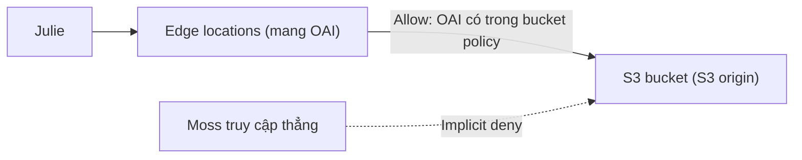
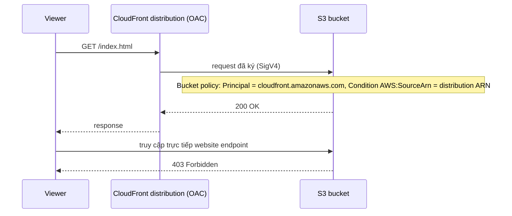

# CloudFront OAI and OAC

> **TL;DR:** OAC (Origin Access Control, khuyến nghị) và OAI (Origin Access Identity, legacy) khóa **S3 origin** để **chỉ CloudFront truy cập được**, chặn người dùng bypass CloudFront và đi thẳng tới bucket. OAC **không phải identity**: CloudFront ký mọi request bằng SigV4 thay mặt distribution, bucket policy cho phép `cloudfront.amazonaws.com` với điều kiện **`AWS:SourceArn` = đúng distribution**, chạy được khi **Block Public Access bật hoàn toàn**. **Custom origin** không dùng được OAC/OAI, mà phải bảo vệ bằng **custom header bí mật** và/hoặc **firewall/Security Group chỉ cho CloudFront** (IP range hoặc **prefix list** của CloudFront).

## 🖼️ Sơ đồ
![[CloudFront OAI and OAC.excalidraw]]
*Mở bằng plugin Excalidraw để chỉnh sửa · ảnh tĩnh: [[CloudFront OAI and OAC.svg]]*

![[CloudFront OAI and OAC - custom origin.excalidraw]]
*Mở bằng plugin Excalidraw để chỉnh sửa · ảnh tĩnh: [[CloudFront OAI and OAC - custom origin.svg]]*

## Bối cảnh: bảo vệ content delivery path
Đường đi của nội dung có 3 vùng: **Origin** → **mạng CloudFront (edge)** → **Internet/viewer**.
- Note này: phía **origin fetch** (origin → CloudFront). Mục tiêu là **chỉ CloudFront** lấy được dữ liệu từ origin.
- Phía viewer (CloudFront → khách) được bàn ở [[CloudFront Private Distributions]].
- Nếu không khóa origin, mọi giới hạn đặt trên CloudFront (signed URL/cookie, geo restriction, [[WAF]]...) đều **vô nghĩa** vì người dùng có thể đi thẳng tới origin.

## OAI: Origin Access Identity (legacy)
- Cách cũ để khóa S3 origin. Vẫn chạy và còn gặp ở môi trường cũ, nhưng console đánh dấu **legacy**, không phải mặc định; thiết kế mới dùng **OAC**.
- Là một **identity thật** (không phải IAM user hay IAM role, nhưng có đặc điểm của cả hai).
- **Gắn OAI vào distribution**: khi distribution (edge location) truy cập S3 origin, nó **"trở thành" OAI** đó.
- OAI được dùng làm **principal trong bucket policy** (explicit allow hoặc deny).
- Pattern phổ biến: bucket policy **explicit allow cho OAI**, gỡ mọi quyền khác, để **implicit deny** áp dụng cho tất cả còn lại.
- Điểm yếu: bucket policy **tin chính OAI**, nên **mọi distribution gắn OAI đó đều có quyền**; không có gì tương đương điều kiện `AWS:SourceArn` để giới hạn theo từng distribution. *(Bản khóa cũ nêu: một OAI dùng được cho nhiều distribution và nhiều bucket, nên dùng một OAI cho một distribution để dễ quản lý quyền.)*
- **Chỉ áp dụng cho S3 origin**, không áp dụng cho S3 static website endpoint (vì đó là custom origin).

## OAC: Origin Access Control (mới, AWS khuyến nghị)
- Cùng mục tiêu với OAI: origin chỉ truy cập được qua CloudFront.
- OAC là **resource của CloudFront** do bạn tạo, **cho từng loại origin**, cho phép CloudFront **xác thực** với origin. Loại origin hỗ trợ: **S3 origin**, **Lambda function URL** và một số loại khác. **Custom origin** (EC2, ALB, S3 website endpoint) **không có** tùy chọn OAC.
- OAC **không phải identity**: không có credential dài hạn nằm ở đâu cả, và **bản thân OAC không cấp quyền gì**. Nó giống một "công tắc" bật hành vi ký request cho origin.
- Cơ chế:
  - Tạo OAC rồi gắn vào origin tương ứng trong distribution. Từ đó CloudFront **ký (sign) mọi request** gửi tới origin bằng **Signature Version 4** (credential ngắn hạn), **thay mặt đúng distribution đó** (signing behavior mặc định: *Sign requests*; các tùy chọn khác như *Do not sign* hay *không override Authorization header* nằm ngoài phạm vi thi).
  - Resource policy của origin quyết định ai được vào. Với S3: bucket policy cho phép **service principal `cloudfront.amazonaws.com`** thực hiện `s3:GetObject`, kèm **Condition `AWS:SourceArn` = ARN của đúng distribution đó**. Chỉ có principal mà không có điều kiện thì mọi distribution có request ký đều vào được.
  - Kết quả: một allow cho một distribution, còn lại (kể cả truy cập thẳng) rơi vào **implicit deny**.
- Vì allow chỉ định đích danh một service và một distribution nên **không phải public grant**: OAC chạy được khi **S3 Block Public Access bật hoàn toàn**.
- **Một OAC dùng lại được** cho nhiều origin và nhiều distribution cùng lúc; việc cho distribution nào vào là do `AWS:SourceArn` trong resource policy.
- (Bổ sung theo AWS hiện tại, bài không nói: OAC hỗ trợ bucket mã hóa **SSE-KMS**, các request ghi như PUT/DELETE, và mọi region. OAI không hỗ trợ SSE-KMS. Vì vậy nếu đề có S3 + KMS + CloudFront thì chọn OAC.)

## Bảo vệ custom origin (không dùng được OAI/OAC)
1. **Custom headers**:
   - Viewer ↔ edge dùng **HTTPS** (ép bằng viewer protocol policy). Edge ↔ origin cũng dùng **HTTPS** (origin protocol policy).
   - CloudFront **chèn một custom header bí mật** vào request gửi origin. Origin **chỉ phục vụ request có header đó**.
   - Vì toàn tuyến là HTTPS nên không ai nhìn thấy header để giả mạo.
2. **Firewall theo IP**: AWS **công bố IP range** của các dịch vụ, trong đó có các edge location của CloudFront. Đặt firewall trước custom origin, **chỉ cho phép IP range của CloudFront** và chặn mọi nguồn khác.
   - Origin nằm trong AWS sau **Security Group** thì dễ hơn nữa: tham chiếu **prefix list của CloudFront** (AWS-managed) trong rule SG, **AWS tự cập nhật** dải IP, không phải bảo trì tay.
- Dùng một trong hai cách hoặc **kết hợp cả hai**.
- Lưu ý: mọi thứ ở đây chỉ kiểm soát **CloudFront tới origin thế nào**, không kiểm soát **viewer nào** được xem nội dung (phần đó ở [[CloudFront Private Distributions]]).
- (Thêm: *VPC origins* cho phép origin là ALB/NLB/EC2 trong **private subnet**, xem [[CloudFront Origins]].)

## Bảng so sánh
| | **OAI** | **OAC** | **Custom origin** |
|---|---|---|---|
| Trạng thái | Legacy | **Khuyến nghị** | |
| Áp dụng cho | S3 origin | S3 origin, Lambda function URL… | Web server, ALB, EC2, S3 website endpoint |
| Cơ chế | Identity gắn với distribution, bucket policy allow OAI | Không phải identity; CloudFront ký request SigV4; bucket policy allow `cloudfront.amazonaws.com` + điều kiện ARN distribution | Custom header bí mật + HTTPS; firewall/SG theo IP range hoặc prefix list CloudFront |
| Giới hạn theo từng distribution | Không (mọi distribution gắn OAI đều vào được) | Có (`AWS:SourceArn`) | n/a |
| Dùng lại | | Một OAC cho nhiều origin/distribution | |
| SSE-KMS (bổ sung, bài không nói) | Không | Có | n/a |

## Demo / Lab: dùng OAC
Nối tiếp demo web store Aus-E-Mart (xem [[CloudFront Origins]]).
1. Hiện trạng: bucket nội dung tĩnh đang **public** (tắt Block Public Access, policy cho mọi principal đọc) nên mở thẳng URL object trên S3 được. Bypass CloudFront nghĩa là bypass luôn mọi lớp bảo vệ đặt ở CloudFront: WAF, cache policy, redirect HTTPS…
2. CloudFront → distribution → **Origins** → edit S3 origin → **Origin access**: đổi từ *Public* sang **Origin access control settings** (bỏ qua *Legacy access identities* = OAI).
3. **Create new OAC** `OAC-S3`, giữ *Sign requests* → Create. OAC loại S3 này **dùng lại được** cho nhiều origin trong nhiều distribution: nó chỉ bật hành vi ký request.
4. **Copy policy** mà CloudFront sinh sẵn → **Go to S3 bucket permissions** → thay toàn bộ bucket policy public bằng policy mới (Principal service `cloudfront.amazonaws.com`, Condition `AWS:SourceArn` = ARN distribution) → Save. CloudFront **không tự sửa bucket policy**, bạn phải tự dán.
5. Save origin, mở web store qua CloudFront: vẫn chạy, ảnh vẫn được cache từ S3. Mở thẳng URL public của object trên S3: **lỗi** (bị từ chối).
6. Bật lại **Block all public access** cho bucket: web store vẫn chạy bình thường, vì quyền của OAC không phải public grant.
7. Edit origin EC2 (custom origin): **không có** tùy chọn OAC; OAC chỉ cho một số loại origin như S3 và Lambda function URL.
- Giữ hạ tầng cho demo sau.

*(Bản khóa cũ nêu, bài mới không làm)*: demo cũ dùng bucket Top10Cats (truy cập thẳng website endpoint thì nhận **403 Forbidden** sau khi đổi policy) và phần **cleanup**: phải **Disable** distribution trước rồi mới **Delete** được, sau đó xóa OAC (Security → Origin access), xóa cert ACM, xóa 2 record Route 53 (CNAME validation + Alias) nếu đã làm demo SSL, rồi xóa CloudFormation stack.

## 🎯 Mẹo thi SAA-C03
- "Đảm bảo user **chỉ truy cập S3 qua CloudFront**, không truy cập trực tiếp bucket" thì dùng **OAC** (hoặc OAI ở đề cũ) + bucket policy.
- OAI/OAC **chỉ cho S3 origin**. Nếu đề dùng **S3 static website endpoint** hoặc EC2/ALB/on-prem thì cần **custom header** và/hoặc **giới hạn IP range CloudFront**.
- Private distribution (signed URL/cookie) **phải đi kèm** khóa origin, nếu không người dùng bypass được.
- Bucket mã hóa **SSE-KMS** + CloudFront thì dùng **OAC** (OAI không hỗ trợ; bổ sung, bài không nói).
- OAC: **không phải identity**, policy giới hạn **đúng một distribution** bằng `AWS:SourceArn`, chạy được khi **Block Public Access bật**. OAI: identity, mọi distribution gắn OAI đều có quyền.
- Custom origin trong AWS sau Security Group → rule SG tham chiếu **prefix list của CloudFront** (AWS tự cập nhật IP).

## Liên kết
- Tiên quyết: [[CloudFront Origins]], [[S3 Security]], [[IAM Identity Policies]]
- Liên quan: [[CloudFront Private Distributions]], [[S3 Static Website Hosting]], [[S3 Encryption]], [[KMS]]
- Dùng cùng: [[Security Groups]], [[WAF]], [[CloudFront and SSL]]
- Phân biệt với: [[IAM Roles]] (OAI là identity nhưng không phải IAM role)
- Section: [[_MOC 15 Global Content Delivery]]
