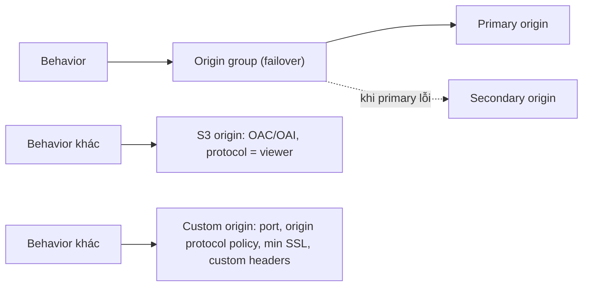

# CloudFront Origins

> **TL;DR:** Origin là nơi CloudFront lấy nội dung khi cache miss. Có hai nhóm chính với feature set khác nhau: **S3 origin** (đơn giản, có OAC/OAI) và **custom origin** (mọi web server, kể cả **S3 static website endpoint**, cấu hình chi tiết hơn: port, origin protocol policy, minimum SSL protocol). Origin không còn bắt buộc phải public: **VPC origins** cho phép ALB, NLB, EC2 trong **private subnet** làm origin. **Origin group** gộp nhiều origin để có **failover/resilience**.

## 🖼️ Sơ đồ
![[CloudFront Origins.excalidraw]]
*Mở bằng plugin Excalidraw để chỉnh sửa · ảnh tĩnh: [[CloudFront Origins.svg]]*

## Khái niệm cốt lõi
- Khi edge cache miss thì xảy ra **origin fetch** tới origin (hoặc origin group) mà **behavior** chỉ định. Origin được chọn **trong behavior**, không phải trực tiếp trên distribution (xem [[CloudFront Behaviors]]).
- **Origin group**: nhóm hai hoặc nhiều origin trong cùng distribution. Behavior dùng origin group để có **resilience**: primary lỗi thì chuyển sang secondary (có cấu hình failover criteria). *(Bản khóa cũ nêu, bài mới không nói về origin group.)*
- **Các loại origin** (theo màn hình tạo distribution trong demo mới):
  - **Amazon S3** (S3 origin)
  - **Elastic Load Balancer**, **API Gateway**, **AWS Elemental MediaPackage** (media streaming)
  - **VPC origin**: origin nằm trong **private subnet** (ALB, NLB, EC2), CloudFront vẫn tới được mà không cần mở origin ra Internet. Trước đây custom origin phải là endpoint public resolve được (xem [[CloudFront Architecture]]).
  - **Other**: mọi web server khác có tên public, gọi chung là **custom origin**
  - (Bản khóa cũ còn liệt kê **MediaStore container endpoint**.)
- **Bẫy quan trọng**: S3 bucket bật **static website hosting** mà dùng **website endpoint** làm origin thì CloudFront coi là **custom origin**, với feature set khác S3 origin.
  - Trong console: chọn bucket từ dropdown "Amazon S3 buckets" thì là **S3 origin**. Gõ DNS của **static website endpoint** thì là **custom origin**.

## Bảng so sánh S3 origin vs Custom origin
| Tính năng | **S3 origin** | **Custom origin** (web server, EC2, ALB, on-prem, S3 website endpoint) |
|---|---|---|
| Origin path (lấy từ sub-path, ví dụ `/images`) | Có | Có |
| **Origin access (OAI / OAC)**: chỉ cho CloudFront truy cập | **Có** (OAC khuyến nghị, OAI legacy) | **Không**. Thay bằng custom header và/hoặc firewall theo IP range của CloudFront |
| **Origin protocol policy** | **Không chọn được**: dùng **cùng protocol với viewer** (viewer protocol = origin protocol) | **HTTP only / HTTPS only / Match viewer** |
| **Minimum origin SSL protocol** | Không | Có (best practice: chọn bản mới nhất origin hỗ trợ) |
| **HTTP/HTTPS port** tùy chỉnh | Không (S3 không có port cấu hình được) | Có (mặc định **80 / 443**, đổi được) |
| Custom origin headers (pass-through) | Có | Có, và là **cách bảo vệ custom origin** |
| Certificate | S3 tự xử lý | Cert public phải khớp tên DNS origin (xem [[CloudFront and SSL]]) |

## Demo / Lab: thêm CDN cho web store Aus-E-Mart
**Bối cảnh**: one-click CloudFormation ở us-east-1 dựng web store Aus-E-Mart chạy trên EC2 (`AEM instance A`, ứng dụng Python, nội dung động). Mở bằng public IP thì trang chạy nhưng thiếu nội dung tĩnh (ảnh sản phẩm). Mục tiêu: đặt CloudFront trước EC2, rồi để nội dung tĩnh trên S3 sau cùng distribution.

**Phần 1: distribution với EC2 làm origin**
- **Create distribution** → bước đầu tiên là chọn **pricing plan**: **Free**, **Pro** ($15/tháng), **Business** ($200/tháng), **Premium** ($1,000/tháng), mỗi plan có bộ tính năng và hạn mức request/dữ liệu riêng; hoặc **Pay as you go** (trả theo lưu lượng và tính năng dùng, đã kèm nhiều tính năng và request miễn phí). Demo chọn **Pay as you go**.
- Distribution name `aem-webstore-cdn`, loại **Single website or app**. Có thể gắn domain riêng ngay lúc tạo (demo để sau, xem [[CloudFront and SSL]]).
- **Origin type**: các lựa chọn S3, Elastic Load Balancer, API Gateway, MediaPackage, **VPC origin**, **Other**. Demo chọn **Other** và dán **public DNS của EC2**. Giảng viên lưu ý: thực tế nên để EC2 trong **private subnet** và dùng **VPC origin**; demo để public chỉ cho dễ kiểm tra.
- Để mặc định origin settings và cache settings; **không bật WAF** (WAF có phí; xem [[WAF]]).
- Distribution ở trạng thái **Deploying** cho tới khi cột *Last modified* hiện thời điểm: cấu hình đang được đẩy ra các edge location. Mỗi lần sửa cũng phải chờ như vậy.
- Xem lại: domain `*.cloudfront.net` riêng, tab Security (WAF tắt, không geographic restriction), tab **Origins** có một origin EC2, tab **Behaviors** có **default behavior** do wizard tạo: compress objects tự động, **Redirect HTTP to HTTPS**, và **cache policy** wizard chọn sẵn cho EC2 với **minimum TTL 0**: nội dung sau EC2 **không được cache** trừ khi ứng dụng tự gửi header TTL (xem [[CloudFront TTL and Invalidations]]).
- Tab **Error pages** và **default root object** (`index.html`, ở General → Edit): có thể làm static website hosting qua CloudFront thay vì bật trên S3. Tab **Invalidations** để xóa cache.
- **Logging**: *Create access log delivery*, đích là **CloudWatch Logs**, **Data Firehose** hoặc **S3** (S3 để phân tích bằng Athena hay công cụ bên thứ ba). Demo gửi vào log group `aem-webstore-cdn-logs` của CloudWatch Logs.
- Mở `http://<id>.cloudfront.net` thì **lỗi**. Nguyên nhân: kết nối chia hai chặng (viewer → CloudFront, CloudFront → origin), và origin đang để **CloudFront nói chuyện với EC2 bằng HTTPS** trong khi EC2 không hỗ trợ HTTPS. Edit origin, đổi **origin protocol** sang **HTTP only** → chờ deploy → web store chạy qua CloudFront.

**Phần 2: thêm S3 origin cho nội dung tĩnh**
- Tạo bucket `aem-webstore-static-<ký tự riêng>`, **tắt Block Public Access** và gắn bucket policy cho đọc public (lúc này CloudFront cần bucket public; cách khóa lại bằng OAC ở [[CloudFront OAI and OAC]]). Upload thư mục `static/` (ảnh sản phẩm…).
- Tab Origins → **Create origin** → chọn bucket: đây là **S3 origin**, phần setting khác custom origin EC2. Origin access để **Public**.
- Tạo origin thôi thì **chưa có tác dụng**: origin chỉ "có sẵn" cho distribution. Phải **Create behavior**: path pattern **`/static/*`** → S3 origin, compress tự động, Redirect HTTP to HTTPS, cache policy **CachingOptimized** (**minimum TTL 1**, nên nội dung tĩnh được cache; default behavior trỏ EC2 vẫn không cache).
- Sau khi deploy, web store hiện đủ ảnh sản phẩm, ảnh được cache ở edge.
- Kiểm tra cache bằng `curl -i` (CloudShell hoặc máy mình) tới một ảnh: lần đầu header báo **Miss from cloudfront**, chạy lại vài lần thì **Hit**. Gọi vào root (default behavior, min TTL 0) thì **luôn Miss**. `curl -i` là cách thường dùng để chẩn đoán CloudFront.
- General → Edit: **price class**: tất cả edge location, chỉ Bắc Mỹ + châu Âu, hoặc Bắc Mỹ + châu Âu + châu Á + Trung Đông + châu Phi (xem [[CloudFront Behaviors]]).
- Giữ hạ tầng cho các demo sau (OAC, domain riêng).

*(Bản khóa cũ nêu, bài mới không làm)*: demo cũ thêm CDN cho website tĩnh Top10Cats trên S3 static website hosting (S3 website **không hỗ trợ HTTPS**, CloudFront giải quyết bằng cert `*.cloudfront.net`), chọn bucket làm S3 origin, viewer protocol HTTP and HTTPS, cache policy `CachingOptimized`, nhắc **Real-time logs** gửi vào **Kinesis Data Streams**, IPv6 bật mặc định, deploy mất từ vài phút tới khoảng 45 phút; rồi ghi đè `img/merlin.jpg` để thấy edge vẫn trả ảnh cũ tới khi hết TTL hoặc invalidation.

## 🎯 Mẹo thi SAA-C03
- Đề nhắc **custom port**, **origin protocol policy**, **minimum origin SSL protocol** thì đó là **custom origin**.
- **S3 static website endpoint làm origin = custom origin**, nên **không dùng được OAI/OAC**.
- S3 origin: **origin protocol = viewer protocol** (khớp nhau).
- Bảo vệ custom origin: **custom header bí mật** + HTTPS và/hoặc **firewall/Security Group chỉ cho IP range của CloudFront**.
- Cần **failover giữa origin** thì dùng **origin group**.
- Origin là **ALB/NLB/EC2 trong private subnet**, không muốn mở ra Internet → **VPC origin**.
- CloudFront trả lỗi dù origin chạy bình thường: kiểm tra **origin protocol** (CloudFront gọi origin bằng HTTPS mà origin chỉ có HTTP). Hai chặng viewer ↔ edge và edge ↔ origin cấu hình riêng.
- Cùng distribution mà phần động không cache, phần tĩnh cache: mỗi **behavior** một **cache policy** (ví dụ min TTL 0 cho app, CachingOptimized cho `/static/*` trên S3).
- CloudFront giải quyết bài toán **S3 static website không có HTTPS**.

## Liên kết
- Tiên quyết: [[CloudFront Architecture]], [[S3 Static Website Hosting]], [[S3 Basics]]
- Liên quan: [[CloudFront Behaviors]], [[CloudFront OAI and OAC]], [[CloudFront and SSL]], [[CloudFront TTL and Invalidations]]
- Origin thường gặp: [[Elastic Load Balancer]], [[EC2 Basics]], [[API Gateway]]
- Dùng cùng: [[WAF]], [[Kinesis Data Streams]], [[Security Groups]]
- Section: [[_MOC 15 Global Content Delivery]]
