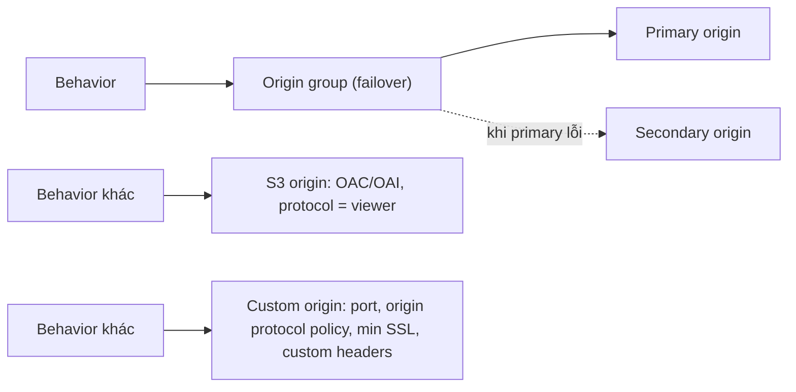

# CloudFront Origins

> **TL;DR:** Origin là nơi CloudFront lấy nội dung khi cache miss. Có hai nhóm chính với feature set khác nhau: **S3 origin** (đơn giản, có OAI/OAC) và **custom origin** (mọi web server, kể cả **S3 static website endpoint**, cấu hình chi tiết hơn: port, origin protocol policy, minimum SSL protocol). **Origin group** gộp nhiều origin để có **failover/resilience**.

## 🖼️ Sơ đồ
![[CloudFront Origins.excalidraw]]
*Mở bằng plugin Excalidraw để chỉnh sửa · ảnh tĩnh: [[CloudFront Origins.svg]]*

## Khái niệm cốt lõi
- Khi edge cache miss thì xảy ra **origin fetch** tới origin (hoặc origin group) mà **behavior** chỉ định. Origin được chọn **trong behavior**, không phải trực tiếp trên distribution (xem [[CloudFront Behaviors]]).
- **Origin group**: nhóm hai hoặc nhiều origin trong cùng distribution. Behavior dùng origin group để có **resilience**: primary lỗi thì chuyển sang secondary (có cấu hình failover criteria).
- **Các loại origin**:
  - **Amazon S3 bucket**
  - **AWS Elemental MediaPackage channel endpoint**, **AWS Elemental MediaStore container endpoint** (media streaming)
  - **Mọi thứ khác (web server)**, gọi là **custom origin**
- **Bẫy quan trọng**: S3 bucket bật **static website hosting** mà dùng **website endpoint** làm origin thì CloudFront coi là **custom origin**, với feature set khác S3 origin.
  - Trong console: chọn bucket từ dropdown "Amazon S3 buckets" thì là **S3 origin**. Gõ DNS của **static website endpoint** thì là **custom origin**.

## Bảng so sánh S3 origin vs Custom origin
| Tính năng | **S3 origin** | **Custom origin** (web server, EC2, ALB, on-prem, S3 website endpoint) |
|---|---|---|
| Origin path (lấy từ sub-path, ví dụ `/images`) | Có | Có |
| **Origin access (OAI / OAC)**: chỉ cho CloudFront truy cập | **Có** (OAC khuyến nghị, OAI legacy) | **Không**. Thay bằng custom header và/hoặc firewall theo IP range của CloudFront |
| **Origin protocol policy** | **Không chọn được**: dùng **cùng protocol với viewer** (viewer protocol = origin protocol) | **HTTP only / HTTPS only / Match viewer** |
| **Minimum origin SSL protocol** | Không | Có (best practice: chọn bản mới nhất origin hỗ trợ) |
| **HTTP/HTTPS port** tùy chỉnh | Không (S3 không có port cấu hình được) | Có (mặc định **80 / 443**, đổi được) |
| Custom origin headers (pass-through) | Có | Có, và là **cách bảo vệ custom origin** |
| Certificate | S3 tự xử lý | Cert public phải khớp tên DNS origin (xem [[CloudFront and SSL]]) |

## Demo / Lab: thêm CDN cho static website (Top10Cats)
**Bối cảnh**: website tĩnh trên S3 (us-east-1), public (tắt block public access, bucket policy cho mọi principal `s3:GetObject`). Hai vấn đề:
1. User ngoài us-east-1 có hiệu năng kém.
2. **S3 static website không hỗ trợ HTTPS** (thử `https://` với website endpoint thì không tải được).

**Các bước tạo distribution**:
- **Origin domain**: chọn bucket từ dropdown, nên dùng **S3 origin** (không phải custom). Origin path để trống (root bucket).
- Origin access: tạm để public. Lúc này user **vẫn truy cập thẳng bucket được** (bypass CloudFront). Lỗ hổng này được sửa ở [[CloudFront OAI and OAC]].
- **Viewer protocol policy**: HTTP and HTTPS (demo). Best practice là redirect hoặc HTTPS only.
- **Cache policy**: `CachingOptimized` (managed). Đây là cách cấu hình mới (cache policy + origin request policy) thay cho legacy TTL settings.
- **Restrict viewer access**: không bật. Nếu bật thì cần **trusted key groups / trusted signers**, biến distribution thành private.
- **Real-time logs**: tính năng gửi log real-time vào **Kinesis Data Streams** (khác standard logging không real-time).
- **Price class**: Use all edge locations (best performance).
- **WAF web ACL**: có thể gắn (Layer 7 firewall).
- Cert mặc định `*.cloudfront.net`. Alternate domain + cert riêng làm ở demo sau ([[CloudFront and SSL]]).
- **Default root object = `index.html`**: thường bị quên. Khi truy cập tên distribution mà không chỉ định object thì CloudFront trả `/index.html`. Request object cụ thể (ví dụ `logo.jpg`) thì không dùng default root object.
- IPv6 bật mặc định. Deploy mất từ vài phút tới khoảng 45 phút (demo: khoảng 7,5 phút).

**Kết quả và quan sát** (part 2):
- Truy cập `https://<id>.cloudfront.net` chạy được, HTTPS nhờ cert wildcard mặc định. Refresh thì nhanh hơn rõ rệt do object được cache ở edge.
- Ghi đè `img/merlin.jpg` trên S3: truy cập trực tiếp S3 thấy ảnh mới, qua CloudFront vẫn ảnh cũ cho tới khi hết TTL hoặc invalidation (chi tiết: [[CloudFront TTL and Invalidations]]).
- Origin chưa bị khóa nên ai cũng truy cập thẳng S3 được. Nếu distribution có giới hạn (geo restriction, signed URL/cookie) thì **phải chặn bypass** bằng OAC.

## 🎯 Mẹo thi SAA-C03
- Đề nhắc **custom port**, **origin protocol policy**, **minimum origin SSL protocol** thì đó là **custom origin**.
- **S3 static website endpoint làm origin = custom origin**, nên **không dùng được OAI/OAC**.
- S3 origin: **origin protocol = viewer protocol** (khớp nhau).
- Bảo vệ custom origin: **custom header bí mật** + HTTPS và/hoặc **firewall/Security Group chỉ cho IP range của CloudFront**.
- Cần **failover giữa origin** thì dùng **origin group**.
- CloudFront giải quyết bài toán **S3 static website không có HTTPS**.

## Liên kết
- Tiên quyết: [[CloudFront Architecture]], [[S3 Static Website Hosting]], [[S3 Basics]]
- Liên quan: [[CloudFront Behaviors]], [[CloudFront OAI and OAC]], [[CloudFront and SSL]], [[CloudFront TTL and Invalidations]]
- Origin thường gặp: [[Elastic Load Balancer]], [[EC2 Basics]], [[API Gateway]]
- Dùng cùng: [[WAF]], [[Kinesis Data Streams]], [[Security Groups]]
- Section: [[_MOC 15 Global Content Delivery]]
