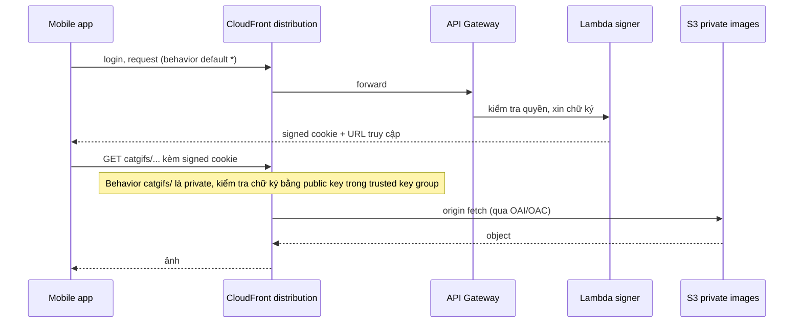

# CloudFront Private Distributions

> **TL;DR:** Một behavior của CloudFront có thể chạy ở chế độ **private**. Khi đó mọi request phải mang **signed URL** hoặc **signed cookie**, nếu không sẽ bị từ chối. Bên tạo chữ ký gọi là **signer**: cách mới là **trusted key groups**, cách cũ (legacy) là **trusted signers** (CloudFront key do account root user tạo). Signed URL cấp quyền cho **1 object**, còn signed cookie cấp quyền cho **nhiều object** và giữ nguyên URL của ứng dụng.

## 🖼️ Sơ đồ
![[CloudFront Private Distributions.excalidraw]]
*Mở bằng plugin Excalidraw để chỉnh sửa · ảnh tĩnh: [[CloudFront Private Distributions.svg]]*

![[CloudFront Private Distributions - signed URL vs cookie.excalidraw]]
*Mở bằng plugin Excalidraw để chỉnh sửa · ảnh tĩnh: [[CloudFront Private Distributions - signed URL vs cookie.svg]]*

## Khái niệm cốt lõi
- CloudFront có hai chế độ bảo mật nội dung:
  - **Public** (mặc định): viewer nào cũng truy cập được mọi nội dung.
  - **Private**: request phải kèm **signed cookie** hoặc **signed URL**, thiếu thì bị **deny**.
- Chế độ public/private được đặt ở mức **behavior** (option *Restrict viewer access* trong [[CloudFront Behaviors]]):
  - Distribution mới tạo chỉ có **một behavior** (default `*`). Lúc đó cả distribution là public hoặc private.
  - Thực tế thường có **nhiều behavior**, phần public và phần private. Request "lạc" vào phần private mà không có chữ ký có thể được dẫn về phần public, ví dụ để bắt đầu quy trình **login**.
- **Signer** là thực thể (một hoặc nhiều) có quyền tạo signed URL/cookie. **Gắn signer vào behavior thì behavior đó trở thành private**.

### Hai cách cấu hình signer
| | **Trusted signer** (cách cũ, legacy) | **Trusted key groups** (cách mới, khuyến nghị) |
|---|---|---|
| Thành phần | Tạo **CloudFront key** (key pair) trong account, rồi thêm **AWS account** đó làm trusted signer cho behavior | Tạo **public key**, gom vào **key group**, gắn key group làm signer cho behavior |
| Ai quản lý key | **Bắt buộc account root user** tạo và quản lý. Key gắn với **account**, không gắn với identity nào bên trong account | **Không cần root user**. Quản lý bằng IAM thông thường và **CloudFront API** |
| Linh hoạt | Kém | Gắn được **nhiều public key hơn** cho một behavior, quản trị và xoay vòng key dễ hơn |
| Dùng khi | Hệ thống cũ. Vẫn phải **nhận ra thuật ngữ** này khi đi thi | Mọi triển khai mới |

- Cả hai cách đều theo mô hình chữ ký bất đối xứng: ứng dụng giữ **private key** để ký, CloudFront giữ **public key** để kiểm tra. Xem [[Digital Signatures]].
- (Theo tài liệu AWS hiện tại, ngoài bài giảng: một key group chứa tối đa 5 public key, một cache behavior gắn tối đa 4 key group. AWS khuyến nghị dùng key group thay cho CloudFront key pair của root user.)

## Signed URL vs Signed Cookie
| Tiêu chí | **Signed URL** | **Signed Cookie** |
|---|---|---|
| Phạm vi | **Đúng 1 object** | **Nhóm object**: nhiều file, mọi file một loại (ví dụ mọi file `.gif`), cả một path |
| Client không hỗ trợ cookie | **Chỉ cách này dùng được** | Không dùng được |
| URL | Mỗi object có URL **riêng, chứa chữ ký** (query string) | **Giữ nguyên URL** của ứng dụng, chữ ký nằm trong cookie |
| Ghi chú lịch sử | RTMP distribution (đã ngừng) chỉ dùng được signed URL. Điểm này không còn áp dụng | |

## Cách hoạt động / Kiến trúc
Ví dụ Catagram có ứng dụng iPhone mới: phần lớn nội dung là public, riêng một số ảnh "nhạy cảm" (mèo phơi bụng) cần phân phối có kiểm soát. Backend là serverless: [[API Gateway]], [[Lambda]] và S3.

Distribution có 2 behavior:
| Behavior | Path | Origin | Forward cookies | Restrict viewer access |
|---|---|---|---|---|
| Public (default) | `*` | API Gateway | All | No |
| Private | `catgifs/` | S3 bucket ảnh private | No | **Yes** (trusted key group) |

Luồng:
1. App đăng nhập bằng **identity federation** (Google, Twitter, Facebook), xem [[Cognito]], qua behavior default tới API Gateway.
2. App cần ảnh private. API Gateway gọi **Lambda signer**. Lambda kiểm tra quyền của user với các ảnh đó.
3. Hợp lệ thì Lambda (dùng private key thuộc trusted key group của behavior private) **tạo signed cookie** cho đúng nhóm ảnh của user, rồi trả cookie và thông tin URL truy cập về app.
4. App gửi request tới path `catgifs/` kèm cookie. CloudFront **kiểm tra chữ ký**. Nếu hợp lệ thì thực hiện origin fetch từ S3 và trả ảnh.

### Phải khóa cả origin
- Private behavior chỉ chặn ở **phía viewer** (viewer ↔ edge). Nếu S3 origin vẫn mở thì người dùng có thể **bypass CloudFront** và lấy object thẳng từ bucket.
- Vì vậy S3 origin phải cấu hình **OAI** (hoặc OAC theo cách mới) để chỉ nhận request từ distribution. Xem [[CloudFront OAI and OAC]].

## Phân biệt với S3 presigned URL (bổ sung)
| | CloudFront signed URL/cookie | [[S3 Presigned URLs\|S3 presigned URL]] |
|---|---|---|
| Truy cập qua | CloudFront (có cache ở edge) | Thẳng tới S3 endpoint |
| Ký bằng | Private key của trusted key group / CloudFront key | Credentials của IAM identity tạo URL |
| Quyền | Do policy trong chữ ký quyết định (thời hạn, path...) | Bằng quyền của identity đã ký |
| Phạm vi | URL: 1 object. Cookie: nhiều object | 1 object, 1 thao tác |

## 🎯 Mẹo thi SAA-C03
- Thấy **"trusted signer"** hoặc **"trusted key group"** thì biết ngay đề nói về **private distribution / private behavior**.
- Ưu tiên **trusted key groups** cho mọi thiết kế mới. **Trusted signer** gắn với CloudFront key và **cần root user**, là cách legacy.
- **Truy cập 1 object** → **signed URL**. Đây là cách phân biệt nhanh nhất.
- **Nhiều object / cả nhóm file / mọi file một loại** → **signed cookie**.
- **Client không hỗ trợ cookie** → **signed URL**.
- **Muốn giữ nguyên URL** của ứng dụng (không đổi format URL) → **signed cookie**.
- Private distribution luôn phải đi kèm **khóa origin** (OAI/OAC cho S3, custom header/IP allowlist cho custom origin). Nếu đề hỏi "người dùng vẫn tải được file trực tiếp từ S3" thì đáp án là cấu hình OAC/OAI và bucket policy.
- Restrict viewer access là setting của **behavior**, không phải của distribution.

## Liên kết
- Tiên quyết: [[CloudFront Architecture]], [[CloudFront Behaviors]], [[Digital Signatures]]
- Dùng cùng: [[CloudFront OAI and OAC]], [[Lambda]], [[API Gateway]], [[Cognito]], [[Lambda@Edge]]
- Phân biệt với: [[S3 Presigned URLs]], [[S3 Security]]
- MOC: [[_MOC 15 Global Content Delivery]]
