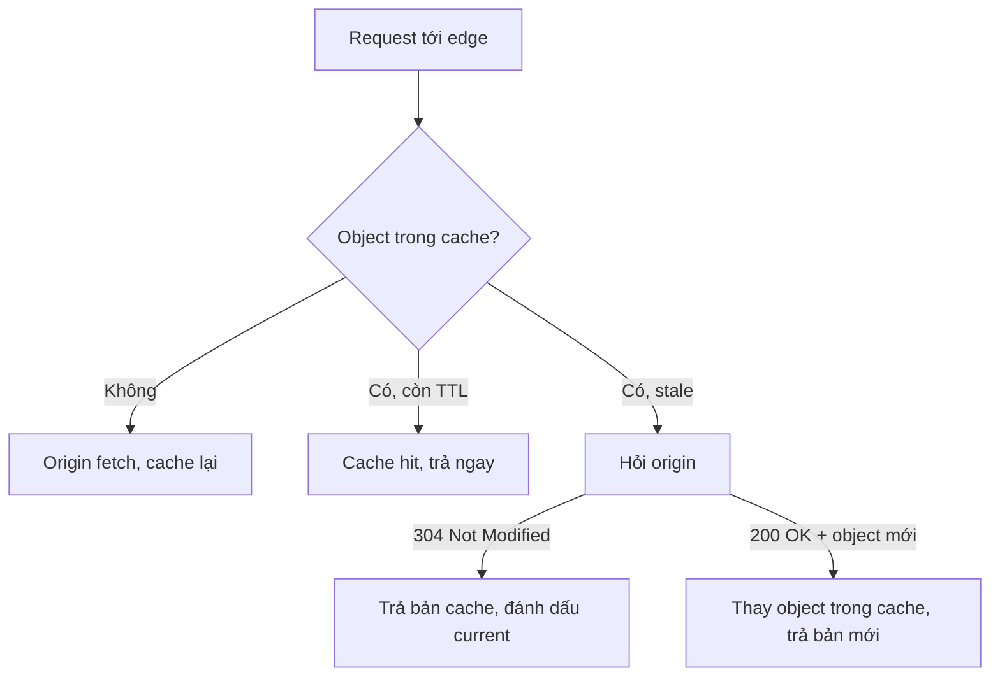

# CloudFront TTL and Invalidations

> **TL;DR:** **TTL (Time To Live)** quyết định một object được cache ở edge location bao lâu trước khi bị coi là hết hạn (stale). **Invalidation** ép mọi edge location hết hạn ngay các object khớp một pattern. Nếu nội dung thay đổi thường xuyên thì dùng **versioned file names** thay vì invalidation.

## 🖼️ Sơ đồ
![[CloudFront TTL and Invalidations.excalidraw]]
*Mở bằng plugin Excalidraw để chỉnh sửa · ảnh tĩnh: [[CloudFront TTL and Invalidations.svg]]*

![[CloudFront TTL and Invalidations - update.excalidraw]]
*Mở bằng plugin Excalidraw để chỉnh sửa · ảnh tĩnh: [[CloudFront TTL and Invalidations - update.svg]]*

## Vấn đề: edge trả bản cũ
1. User 1 request `whiskers.jpg`: cache miss, origin fetch, edge cache lại bản "mèo khóc".
2. Ứng dụng thay ảnh trên origin bằng bản "mèo cười".
3. User 2 request ở cùng edge và nhận **bản cũ**, vì bản trong cache vẫn được coi là hợp lệ nên CloudFront **không hề kiểm tra origin**.
- Đây là điểm cần nắm: origin đã có bản mới nhưng người dùng vẫn thấy bản cũ cho tới khi object hết hạn hoặc bị invalidate.

## Khi object hết hạn (stale)
- Object hết TTL **không bị xóa ngay**, nó chuyển sang trạng thái **stale**.
- Request tiếp theo: edge **hỏi origin** (conditional request) thay vì trả thẳng:
  - Origin vẫn giữ bản cũ → **`304 Not Modified`**: edge trả bản đang cache, object được đánh dấu **current** lại. Không truyền lại dữ liệu.
  - Origin có bản mới → **`200 OK`** kèm object mới, thay bản trong cache.
- Object có thể bị đẩy khỏi cache sớm hơn TTL nếu edge thiếu dung lượng.
- Cache hit càng nhiều thì origin càng nhẹ tải và người dùng càng nhanh. Mục tiêu là hạn chế origin fetch.

## TTL: default, min, max
| Setting (trên **behavior**) | Ý nghĩa |
|---|---|
| **Default TTL** | Mặc định **24 giờ (86400 s)**. Áp dụng cho object **không có TTL riêng** |
| **Minimum TTL** | Chặn dưới cho TTL riêng của object |
| **Maximum TTL** | Chặn trên cho TTL riêng của object |
- Min/Max **tự thân không làm gì**. Chúng chỉ là **giới hạn (limiter)** cho các giá trị per-object.

### TTL per-object qua header (phải nhớ cho thi)
| Header | Đơn vị |
|---|---|
| `Cache-Control: max-age=<seconds>` | giây |
| `Cache-Control: s-maxage=<seconds>` | giây (dành cho shared cache như CDN) |
| `Expires: <date/time>` | một thời điểm cụ thể |
- Khóa học coi `max-age` và `s-maxage` có tác dụng như nhau. (Thực tế nếu có cả hai thì CloudFront ưu tiên `s-maxage`.)
- Giá trị **dưới Minimum TTL** thì dùng Minimum TTL. Giá trị **trên Maximum TTL** thì dùng Maximum TTL.
- Ai set header:
  - **Custom origin**: ứng dụng hoặc web server chèn header.
  - **S3 origin**: đặt qua **object metadata** (API, CLI hoặc console).

## Cache invalidation
- Thực hiện **trên distribution**, áp dụng cho **mọi edge location** của distribution đó. **Không tức thời**, cần thời gian để lan ra toàn mạng.
- Hết hạn ngay mọi object khớp pattern, **bất kể TTL**.
- Ví dụ pattern:
  - `/images/whiskers1.jpg`: một object cụ thể
  - `/images/whiskers*`: mọi object trong `/images/` bắt đầu bằng `whiskers` (whiskers1, whiskers2, whiskers1337.jpg...)
  - `/images/*`: mọi object trong path `/images/`
  - `/*`: **toàn bộ** object của distribution
- **Có phí**. Chi phí **giống nhau bất kể pattern khớp bao nhiêu object** (một path có wildcard được tính như một path; hiện nay 1.000 path đầu mỗi tháng miễn phí). Vì thế nên invalidate **ít lần, mỗi lần rộng** thay vì nhiều lần nhỏ lẻ.
- Invalidation nên được coi là cách **sửa lỗi**, không phải quy trình cập nhật thường xuyên.

## Versioned file names (đáp án hay gặp trong đề)
- Thay vì ghi đè `whiskers1.jpg`, upload `whiskers1_v2.jpg`, `_v3.jpg`... rồi cập nhật ứng dụng/HTML trỏ sang tên mới. **Không cần invalidation.**
- Lợi ích:
  1. Không bị ảnh hưởng bởi **cache trong trình duyệt** của user, vì tên đã đổi.
  2. **Logging chính xác hơn**: biết rõ phiên bản nào được phục vụ.
  3. Giữ mọi phiên bản, nhất quán giữa các edge, dễ chuyển qua lại.
  4. **Rẻ hơn** vì không tốn tiền invalidation liên tục.
- **Đừng nhầm với [[S3 Versioning and MFA Delete|S3 object versioning]]**: S3 versioning giữ nhiều phiên bản dưới **cùng một tên**, và CloudFront mặc định luôn lấy phiên bản mới nhất. Versioned file names là **tên file khác nhau**, mỗi tên được cache độc lập.

## Demo / Lab
- Truy cập website Top10Cats qua CloudFront rồi refresh vài lần để mọi ảnh được cache ở edge.
- Upload ảnh khác đè lên `img/merlin.jpg` trong bucket. Mở **trực tiếp S3 website endpoint** thì thấy ảnh mới. Mở **qua CloudFront** thì vẫn thấy ảnh cũ vì edge còn cache.
- Tạo invalidation `/*` (có thể dùng `/img/*` hoặc `/img/merlin.jpg`). Sau khi trạng thái Completed, mở lại (nên dùng tab private để tránh cache trình duyệt) thì thấy ảnh mới.
- Bài học: muốn cập nhật thường xuyên thì dùng versioned names (`merlin_v2.jpg`). Invalidation có tính phí.

## 🎯 Mẹo thi SAA-C03
- Default TTL = **24 giờ**. TTL đặt trên **behavior**. Min/Max TTL là giới hạn cho header per-object.
- Thuộc 3 header: **`Cache-Control max-age`**, **`Cache-Control s-maxage`** (giây), **`Expires`** (ngày giờ). S3 dùng **object metadata** để set.
- User thấy nội dung cũ sau khi cập nhật origin thì cần **invalidation** (nhanh, có phí) hoặc **giảm TTL**.
- Đề hỏi cách **cost-effective** để cập nhật nội dung thường xuyên: **versioned file names**, không phải invalidation, cũng không phải S3 versioning.
- Invalidation áp dụng cho **cả distribution** và tốn thời gian lan tỏa.

## Liên kết
- Tiên quyết: [[CloudFront Architecture]], [[CloudFront Behaviors]]
- Liên quan: [[CloudFront Origins]], [[S3 Basics]], [[S3 Static Website Hosting]]
- Phân biệt với: [[S3 Versioning and MFA Delete]]
- Section: [[_MOC 15 Global Content Delivery]]
