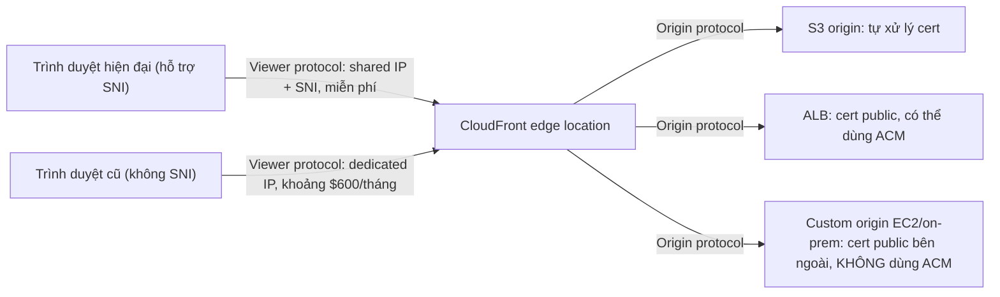

# CloudFront and SSL

> **TL;DR:** CloudFront có sẵn HTTPS cho domain mặc định `*.cloudfront.net`. Muốn dùng **tên miền riêng** (alternate domain name) thì phải gắn một certificate **public, khớp tên**, lấy từ ACM ở **us-east-1** hoặc import. Có hai chặng TLS: **viewer protocol** (viewer ↔ edge) và **origin protocol** (edge ↔ origin), và cả hai đều cần **cert public tin cậy, không self-signed**. Mặc định dùng **SNI (miễn phí)**. Hỗ trợ trình duyệt cũ không có SNI cần **dedicated IP (khoảng $600/tháng/distribution)**.

## 🖼️ Sơ đồ
![[CloudFront and SSL.excalidraw]]
*Mở bằng plugin Excalidraw để chỉnh sửa · ảnh tĩnh: [[CloudFront and SSL.svg]]*

![[CloudFront and SSL - SNI.excalidraw]]
*Mở bằng plugin Excalidraw để chỉnh sửa · ảnh tĩnh: [[CloudFront and SSL - SNI.svg]]*

## Default domain và alternate domain name
- Mỗi distribution có domain mặc định dạng `d111111abcdef8.cloudfront.net` (một CNAME). HTTPS dùng được ngay vì CloudFront có sẵn cert wildcard **`*.cloudfront.net`**.
- Dùng tên riêng (ví dụ `cdn.catagram.io`) qua tính năng **alternate domain name (CNAME)**, rồi trỏ DNS (ví dụ [[Route 53 Fundamentals|Route 53]], bản ghi **Alias** tới distribution, xem [[CNAME vs Alias]]) về distribution.
- **Dù có dùng HTTPS hay không**, muốn thêm alternate domain name vẫn phải gắn **cert khớp tên đó**. Cert đóng vai trò chứng minh bạn sở hữu/kiểm soát domain.
- Cert lấy từ [[ACM]] (generate hoặc import). ACM là regional, nhưng với CloudFront (dịch vụ global) cert **phải ở us-east-1 (N. Virginia)**.

## Viewer protocol policy (đặt trên behavior)
| Option | Hành vi |
|---|---|
| **HTTP and HTTPS** | Cho phép cả hai, viewer tự chọn |
| **Redirect HTTP to HTTPS** | HTTP bị redirect sang HTTPS (lựa chọn phổ biến) |
| **HTTPS only** | Kết nối HTTP **bị từ chối hoàn toàn** |

## Hai chặng kết nối và yêu cầu certificate

- **Viewer side** (viewer ↔ edge):
  - Cert phải **publicly trusted** (CA lớn như Comodo, DigiCert, Symantec, hoặc ACM ở **us-east-1**).
  - Cert phải **khớp tên DNS** mà viewer dùng để truy cập. DNS trỏ về CloudFront, và cert khớp tên đó.
- **Origin side** (edge ↔ origin):
  - Cũng phải **publicly trusted**, **không self-signed**, kèm đủ intermediate certificate trong chain.
  - **S3 origin**: S3 tự xử lý, bạn không cần và **không thể** thay cert trên S3.
  - **ALB**: cert public, có thể tạo từ nguồn ngoài hoặc dùng ACM.
  - **Custom origin (EC2, on-prem)**: cert public do **CA bên ngoài** cấp và **cài thủ công**. ACM không hỗ trợ EC2 hay on-prem.
  - Cert trên origin phải **khớp tên DNS mà CloudFront dùng để kết nối tới origin**.

## SNI: vì sao có chuyện "dedicated IP"
- Trước **2003**, mỗi site HTTPS cần **một IP riêng**. Lý do:
  - Một web server có thể host nhiều site trên một IP nhờ **Host header** của HTTP. Nhưng Host header thuộc **Layer 7**, chỉ được gửi **sau khi** kết nối đã thiết lập.
  - TLS handshake diễn ra **trước** đó (khi thiết lập kết nối TCP mã hóa), và server phải đưa cert ngay lúc này. Khi chưa biết client muốn site nào thì server chỉ đưa được **một cert**, nên mỗi IP chỉ phục vụ được một site HTTPS.
- **SNI (Server Name Indication)** là **extension của TLS** (2003). Client gửi tên miền muốn truy cập **ngay trong TLS handshake**, server chọn đúng cert. Nhờ vậy **nhiều site HTTPS dùng chung một IP**.
- **Trình duyệt rất cũ không hỗ trợ SNI**. Muốn phục vụ chúng thì CloudFront phải cấp **dedicated IP ở mỗi edge location**.

| Chế độ | Chi phí | Khi nào |
|---|---|---|
| **SNI-only** | **Miễn phí** | Mặc định, mọi trình duyệt hiện đại |
| **Dedicated IP** | **Khoảng $600/tháng/distribution** (theo bài giảng) | Phải hỗ trợ client cũ không có SNI |

## Demo / Lab: thêm alternate CNAME và SSL
1. Làm ở **us-east-1** (bắt buộc cho ACM + CloudFront). Cần domain đã đăng ký và host trên Route 53.
2. CloudFront → edit distribution → **Add item** ở alternate domain name (ví dụ `merlin.animals4life1337.org`) → **Request certificate**.
3. ACM: **Request a public certificate**, nhập đúng FQDN, chọn **DNS validation** → **Create record in Route 53** (ACM tạo một CNAME để xác minh) → chờ trạng thái **Issued** (thường vài phút; quá khoảng 20 phút thì nghi cấu hình DNS sai).
4. Quay lại CloudFront, refresh và chọn cert vừa tạo. Giữ mặc định **SNI** (không cần hỗ trợ legacy client). Save rồi chờ distribution **Deploying → Deployed** (trong demo khoảng 15 phút).
5. Route 53: tạo **A record (Alias) → CloudFront distribution** cùng tên. (AAAA nếu dùng IPv6.)
6. Truy cập `https://<tên riêng>`: HTTPS hoạt động với cert riêng.
- Điều rút ra: **tên trong alternate domain name = tên trên cert = tên DNS record**. Ba thứ phải khớp nhau.

## 🎯 Mẹo thi SAA-C03
- **Cert cho CloudFront phải ở us-east-1.** Mọi tích hợp regional của CloudFront (cert, logging...) đều nghĩ theo hướng us-east-1.
- **Self-signed certificate không dùng được** với CloudFront, ở cả viewer side lẫn origin side.
- Muốn alternate domain name thì **bắt buộc có cert khớp tên**, kể cả khi không dùng HTTPS.
- Câu hỏi về **chi phí** khi phải hỗ trợ **trình duyệt cũ / không hỗ trợ SNI**: cần **dedicated IP**, có tính phí. Còn lại dùng **SNI** miễn phí.
- **S3 origin** không cần cấu hình cert. **Custom origin EC2/on-prem** không dùng được ACM, phải dùng cert public từ CA bên ngoài.
- Cert trên origin phải khớp **tên DNS của origin** mà CloudFront kết nối tới.

## Liên kết
- Tiên quyết: [[SSL and TLS]], [[ACM]], [[CloudFront Architecture]], [[Layer 4 Transport]]
- Liên quan: [[CloudFront Behaviors]] (viewer protocol policy, security policy), [[CloudFront Origins]] (origin protocol policy)
- Dùng cùng: [[Route 53 Fundamentals]], [[CNAME vs Alias]], [[R53 Public Hosted Zones]]
- So sánh: [[SSL Offload and Session Stickiness]] (TLS ở ELB)
- Section: [[_MOC 15 Global Content Delivery]]
