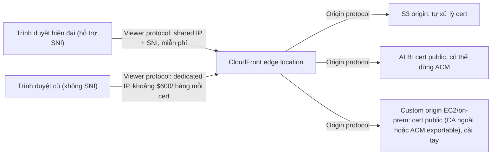

# CloudFront and SSL

> **TL;DR:** CloudFront có sẵn HTTPS cho domain mặc định `*.cloudfront.net`. Muốn dùng **tên miền riêng** (alternate domain name) thì phải gắn một certificate **public, khớp tên**, lấy từ ACM ở **us-east-1** hoặc import. Có hai chặng TLS: **viewer protocol** (viewer ↔ edge) và **origin protocol** (edge ↔ origin), và cả hai đều cần **cert public tin cậy, không self-signed**. Mặc định dùng **SNI (miễn phí)**. Hỗ trợ trình duyệt cũ không có SNI cần **dedicated IP (khoảng $600/tháng cho mỗi certificate)**.

## 🖼️ Sơ đồ
![[CloudFront and SSL.excalidraw]]
*Mở bằng plugin Excalidraw để chỉnh sửa · ảnh tĩnh: [[CloudFront and SSL.svg]]*

![[CloudFront and SSL - SNI.excalidraw]]
*Mở bằng plugin Excalidraw để chỉnh sửa · ảnh tĩnh: [[CloudFront and SSL - SNI.svg]]*

## Default domain và alternate domain name
- Mỗi distribution có domain mặc định dạng `d111111abcdef8.cloudfront.net` (một CNAME). HTTPS dùng được ngay vì CloudFront có sẵn cert wildcard **`*.cloudfront.net`**.
- Dùng tên riêng (ví dụ `cdn.ausemart.net`) qua tính năng **alternate domain name (CNAME)**, rồi trỏ DNS (ví dụ [[Route 53 Fundamentals|Route 53]], bản ghi **Alias** tới distribution, xem [[CNAME vs Alias]]) về distribution.
- **Dù có dùng HTTPS hay không**, muốn thêm alternate domain name vẫn phải gắn **cert khớp tên đó**. Cert đóng vai trò chứng minh bạn sở hữu/kiểm soát domain.
- Cert lấy từ [[ACM]] (generate hoặc import). ACM là regional, nhưng với CloudFront (dịch vụ global) cert **phải ở us-east-1 (N. Virginia)**.

## Viewer protocol policy (đặt trên behavior)
| Option | Hành vi |
|---|---|
| **HTTP and HTTPS** | Cho phép cả hai, viewer tự chọn |
| **Redirect HTTP to HTTPS** | HTTP bị redirect sang HTTPS (lựa chọn phổ biến) |
| **HTTPS only** | Kết nối HTTP **bị từ chối hoàn toàn** |

## Hai chặng kết nối và yêu cầu certificate

- **Viewer side** (viewer ↔ edge):
  - Cert phải **publicly trusted** (CA mà trình duyệt tin, ví dụ DigiCert, Let's Encrypt, hoặc ACM ở **us-east-1**).
  - Cert phải **khớp tên DNS** mà viewer dùng để truy cập. DNS trỏ về CloudFront, và cert khớp tên đó.
- **Origin side** (edge ↔ origin):
  - Cũng phải **publicly trusted**, **không self-signed**, kèm đủ intermediate certificate trong chain.
  - **S3 origin**: S3 tự xử lý, bạn không cần và **không thể** thay cert trên S3.
  - **ALB**: cert public, có thể tạo từ nguồn ngoài hoặc dùng ACM.
  - **Custom origin (EC2, on-prem)**: cert public, lấy từ **CA bên ngoài** hoặc **request một exportable public certificate từ ACM**, rồi **cài thủ công** lên origin. ACM **không tự deploy hay tự gia hạn** cert trên EC2/on-prem (xem [[ACM]]).
  - Cert trên origin phải **khớp tên DNS mà CloudFront dùng để kết nối tới origin**.

## SNI: vì sao có chuyện "dedicated IP"
- Trước **2003**, mỗi site HTTPS cần **một IP riêng**. Lý do:
  - Một web server có thể host nhiều site trên một IP nhờ **Host header** của HTTP. Nhưng Host header thuộc **Layer 7**, chỉ được gửi **sau khi** kết nối đã thiết lập.
  - TLS handshake diễn ra **trước** đó (khi thiết lập kết nối TCP mã hóa), và server phải đưa cert ngay lúc này. Khi chưa biết client muốn site nào thì server chỉ đưa được **một cert**, nên mỗi IP chỉ phục vụ được một site HTTPS.
- **SNI (Server Name Indication)** là **extension của TLS** (2003). Client gửi tên miền muốn truy cập **ngay trong TLS handshake**, server chọn đúng cert. Nhờ vậy **nhiều site HTTPS dùng chung một IP**.
- **Trình duyệt rất cũ không hỗ trợ SNI** (nói chung trình duyệt ra đời trước khoảng 2010). Muốn phục vụ chúng thì CloudFront phải cấp **dedicated IP ở mỗi edge location**.

| Chế độ | Chi phí | Khi nào |
|---|---|---|
| **SNI-only** | **Miễn phí** | Mặc định, mọi trình duyệt hiện đại |
| **Dedicated IP** | **Khoảng $600/tháng cho mỗi certificate** dùng dedicated IP, tính theo giờ (theo bài giảng; bản khóa cũ ghi theo distribution) | Phải hỗ trợ client cũ không có SNI |

## Demo / Lab: thêm alternate CNAME và SSL
Nối tiếp demo web store Aus-E-Mart ở [[CloudFront Origins]] (distribution `aem-webstore-cdn`). Cần một domain mình **sở hữu**; demo dùng domain host trên Route 53 (`ausemart.net`), thực tế không bắt buộc Route 53.
1. Làm ở **us-east-1** vì ACM dùng cho CloudFront luôn ở us-east-1.
2. CloudFront → distribution → **Add domain** → nhập `store.ausemart.net` → Next.
3. Bước TLS certificate: wizard tích hợp sẵn với **ACM ở us-east-1**. Có thể tạo cert **wildcard** (dùng cho mọi subdomain) hoặc thêm **apex domain**; demo bỏ hai lựa chọn này rồi **Create certificate**. (Làm tay thì vào ACM ở us-east-1 tạo cert rồi quay lại chọn.)
4. **View in ACM**: cert có một **CNAME record để validation**. Domain ở registrar khác thì phải tự thêm record này; domain ở Route 53 thì record được **tạo tự động** (refresh hosted zone sẽ thấy CNAME mới).
5. Quay lại CloudFront, chọn cert `store.ausemart.net` → **Add domains**. Mở thử thì chưa vào được vì Route 53 chưa có record cho tên này.
6. **Route domains to CloudFront → Set up routing automatically**: CloudFront tự tạo bản ghi **A và AAAA** (IPv4 và IPv6) trong Route 53 trỏ về distribution.
7. Mở `https://store.ausemart.net`: web store chạy với cert do Amazon cấp. Vẫn lỗi thì có thể do **DNS cache trên máy** (flush DNS hoặc khởi động lại).
- Điều rút ra: **tên trong alternate domain name = tên trên cert = tên DNS record**. Ba thứ phải khớp nhau.
- *(Bản khóa cũ nêu, bài mới không làm)*: demo cũ (domain `merlin.animals4life1337.org`) tự **Request a public certificate** trong ACM với **DNS validation → Create record in Route 53**, chờ **Issued** (quá khoảng 20 phút thì nghi DNS sai), chọn cert, giữ mặc định **SNI**, chờ distribution **Deploying → Deployed** (khoảng 15 phút), rồi tự tạo **A record (Alias)** trong Route 53.

## 🎯 Mẹo thi SAA-C03
- **Cert cho CloudFront phải ở us-east-1.** Mọi tích hợp regional của CloudFront (cert, logging...) đều nghĩ theo hướng us-east-1.
- **Self-signed certificate không dùng được** với CloudFront, ở cả viewer side lẫn origin side.
- Muốn alternate domain name thì **bắt buộc có cert khớp tên**, kể cả khi không dùng HTTPS.
- Câu hỏi về **chi phí** khi phải hỗ trợ **trình duyệt cũ / không hỗ trợ SNI**: cần **dedicated IP**, có tính phí. Còn lại dùng **SNI** miễn phí.
- **S3 origin** không cần cấu hình cert. **Custom origin EC2/on-prem**: ACM không tự deploy/gia hạn được, phải cài tay cert public (CA bên ngoài hoặc exportable cert của ACM).
- Cert trên origin phải khớp **tên DNS của origin** mà CloudFront kết nối tới.

## Liên kết
- Tiên quyết: [[SSL and TLS]], [[ACM]], [[CloudFront Architecture]], [[Layer 4 Transport]]
- Liên quan: [[CloudFront Behaviors]] (viewer protocol policy, security policy), [[CloudFront Origins]] (origin protocol policy)
- Dùng cùng: [[Route 53 Fundamentals]], [[CNAME vs Alias]], [[R53 Public Hosted Zones]]
- So sánh: [[SSL Offload and Session Stickiness]] (TLS ở ELB)
- Section: [[_MOC 15 Global Content Delivery]]
