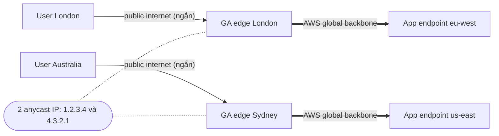

# Global Accelerator

> **TL;DR:** AWS Global Accelerator cấp **2 anycast IP**. Người dùng ở đâu cũng vào được **edge location gần nhất** qua public internet, rồi traffic đi tiếp trên **AWS global backbone** tới ứng dụng. Nó đưa **mạng AWS** tới gần khách hàng, còn CloudFront đưa **nội dung (cache)** tới gần khách hàng. Global Accelerator là **network product**, chạy với **mọi ứng dụng TCP/UDP** và **không cache**.

## 🖼️ Sơ đồ
![[Global Accelerator.excalidraw]]
*Mở bằng plugin Excalidraw để chỉnh sửa · ảnh tĩnh: [[Global Accelerator.svg]]*

![[Global Accelerator - vs CloudFront.excalidraw]]
*Mở bằng plugin Excalidraw để chỉnh sửa · ảnh tĩnh: [[Global Accelerator - vs CloudFront.svg]]*

## Vấn đề cần giải quyết
- Ứng dụng host ở một region (ví dụ US). Người dùng ở US có trải nghiệm tốt. Khi ứng dụng phổ biến toàn cầu, người dùng ở xa (London, Australia) trải nghiệm kém hơn.
- Lý do: dữ liệu trên internet đi qua **nhiều router (hop)**. Mỗi hop thêm **độ trễ, độ biến động và nguy cơ lỗi**. Route có thể khác nhau giữa các khách, thậm chí chiều đi và chiều về của cùng một khách cũng khác nhau.
- Khách càng xa thì càng nhiều hop và kết nối càng kém. Internet được thiết kế ưu tiên **phân tán, tự trị, resilient**. Tốc độ quan trọng nhưng xếp sau các ưu tiên đó.

## Khái niệm cốt lõi
- **Unicast IP**: một IP cho một thiết bị. Hai thiết bị cùng dùng một unicast IP cùng lúc sẽ gây lỗi.
- **Anycast IP**: **nhiều thiết bị dùng chung một IP**, được quảng bá (advertise) ra internet. Router lõi internet đưa traffic tới **thiết bị gần nguồn nhất**. Xem [[Layer 3 Network]], [[BGP]].
- Tạo một accelerator sẽ được cấp **2 anycast IP** (ví dụ trên slide là `1.2.3.4` và `4.3.2.1`). **Mọi** Global Accelerator edge location đều dùng cặp IP này.
- Người dùng ở London và Australia cùng truy cập một IP nhưng mỗi người được định tuyến tới edge **gần mình nhất**.

## Cách hoạt động / Kiến trúc
1. **Chặng 1, public internet**: viewer → edge location gần nhất (nhờ anycast). Chặng này vẫn chịu biến động của internet nhưng đã được **rút ngắn tối đa**.
2. **Chặng 2, AWS global backbone**: từ edge, dữ liệu đi qua **mạng riêng của AWS** (cáp quang nối các region, do AWS kiểm soát hoàn toàn cả capacity lẫn performance) tới **một hoặc nhiều** vị trí hạ tầng.
   - **Ít hop hơn**, nằm dưới quyền kiểm soát trực tiếp của AWS, mạng được bảo trì tốt hơn nên **hiệu năng tốt hơn đáng kể**.
3. Global Accelerator còn có thể **chọn hạ tầng gần khách nhất** khi ứng dụng chạy ở nhiều region, ví dụ khách London đi tới hạ tầng ở Europe thay vì US.

- Thông tin bổ sung, ngoài bài giảng (theo AWS hiện tại):
  - **Endpoint** có thể là [[Elastic Load Balancer|ALB, NLB]], EC2 instance, Elastic IP. Các endpoint được nhóm theo **endpoint group** cho từng region, có **traffic dial** (% traffic vào region) và **weight** cho từng endpoint.
  - Có **health check**, tự **failover** sang endpoint/region khỏe trong vài giây. Không phụ thuộc DNS TTL vì IP **không đổi**.
  - **IP tĩnh**: tiện cho khách hàng cần **whitelist IP** trong firewall. Có thể dùng IP của bạn (BYOIP).
  - Mặc định được bảo vệ bởi [[Shield]] Standard.
  - Có **client IP preservation** với một số loại endpoint (ALB, EC2).

## Bảng so sánh: Global Accelerator vs CloudFront
| Tiêu chí | **Global Accelerator** | **CloudFront** |
|---|---|---|
| Đưa gì tới gần khách | **Mạng AWS** (điểm vào backbone) | **Nội dung** (cache ở edge) |
| Loại sản phẩm | **Network product** (L4) | Content delivery (L7, HTTP/HTTPS) |
| Giao thức | **Mọi TCP/UDP**, kể cả web app | **Chỉ HTTP/HTTPS** |
| Caching | **Không cache gì cả** | Có (TTL, invalidation) |
| Hiểu HTTP | Không | Có: behaviors, headers, cookies, signed URL/cookie, Lambda@Edge |
| Điểm vào | **2 anycast IP tĩnh** | DNS name `*.cloudfront.net` / CNAME |
| Use case điển hình | Game, VoIP, IoT, MQTT, ứng dụng TCP/UDP cần hiệu năng toàn cầu; cần IP tĩnh; failover nhanh đa region | Website tĩnh/động, video, API, phân phối nội dung có cache |

## 🎯 Mẹo thi SAA-C03
- Câu hỏi **"khi nào chọn Global Accelerator, khi nào chọn CloudFront"** là trọng tâm của bài này.
- Đề nhắc **caching, content delivery, HTTP/HTTPS, signed URL, thao tác nội dung** → **CloudFront**.
- Đề nhắc **TCP hoặc UDP** + **tối ưu hiệu năng toàn cầu** / **non-HTTP** → **Global Accelerator**.
- Từ khóa **anycast IP**, **2 static IP**, **AWS global (backbone) network**, **vào mạng AWS sớm nhất có thể** → Global Accelerator.
- Global Accelerator **không cache, không hiểu HTTP/HTTPS**. Đáp án nào gán cho nó tính năng cache là sai.
- (Bổ sung thường gặp) Cần **IP cố định để khách whitelist** + phục vụ đa region, hoặc **failover region nhanh không phụ thuộc DNS TTL** → Global Accelerator, không phải Route 53.

## Liên kết
- Tiên quyết: [[AWS Global Infrastructure]], [[Layer 3 Network]], [[Layer 4 Transport]], [[BGP]]
- Liên quan: [[Elastic Load Balancer]], [[Compare - ALB vs NLB]], [[Regional and Global Architecture]], [[Shield]], [[R53 Latency Routing]]
- Phân biệt với: [[CloudFront Architecture]], [[Lambda@Edge]], [[S3 Performance Optimization]] (S3 Transfer Acceleration cũng dùng edge + backbone nhưng chỉ cho upload S3)
- MOC: [[_MOC 15 Global Content Delivery]]
