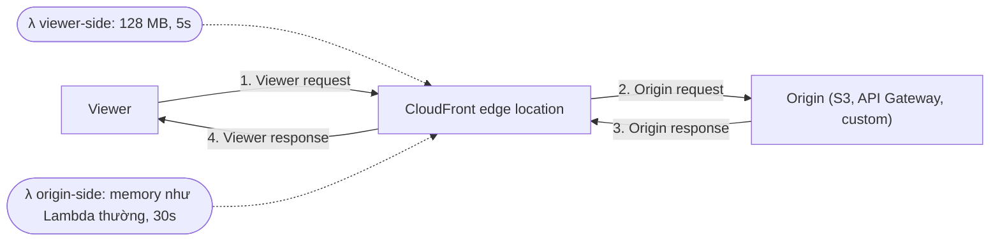

# Lambda@Edge

> **TL;DR:** Lambda@Edge là tính năng của CloudFront cho phép chạy **Lambda function nhẹ tại edge location**, chen vào một trong **4 điểm** của luồng viewer ↔ edge ↔ origin để sửa request/response. Không có đủ tính năng của Lambda thường (chỉ Node.js/Python, không VPC, không layers, giới hạn chặt hơn). Đề thi chỉ hỏi **kiến trúc và use case**, không cần nhớ chi tiết code.

## 🖼️ Sơ đồ
![[Lambda@Edge.excalidraw]]
*Mở bằng plugin Excalidraw để chỉnh sửa · ảnh tĩnh: [[Lambda@Edge.svg]]*

## Khái niệm cốt lõi
- Là **tính năng của CloudFront**, không phải dịch vụ riêng. Function được gắn vào **behavior** (xem [[CloudFront Behaviors]]).
- Function chạy ở **edge location**, tức nằm trong **AWS public zone**. Hệ quả là có một loạt giới hạn so với [[Lambda]] thường:
  - Runtime: **chỉ Node.js và Python**.
  - **Không truy cập được tài nguyên trong VPC**.
  - **Không hỗ trợ Lambda layers**.
  - Giới hạn **kích thước và thời gian chạy khác** Lambda thường (bảng dưới).
- Adrian nhấn mạnh: **không cần thuộc các con số**, quan trọng là hiểu kiến trúc và biết nó làm được gì.
- (Ngoài bài giảng, theo AWS hiện tại: function phải được tạo ở **us-east-1**, CloudFront tự replicate ra các edge. Code đóng gói tối đa 1 MB cho viewer trigger và 50 MB cho origin trigger.)

## Cách hoạt động / Kiến trúc
Mọi tương tác giữa viewer, edge location và origin gồm **4 chặng**, và **mỗi chặng có thể gắn một Lambda function**:

| Chặng | Ý nghĩa | Function chạy khi nào |
|---|---|---|
| **Viewer request** | Viewer → edge | **Sau khi** edge nhận request từ viewer |
| **Origin request** | Edge → origin | **Trước khi** CloudFront chuyển request tới origin (chỉ xảy ra khi cache miss) |
| **Origin response** | Origin → edge | **Sau khi** CloudFront nhận response từ origin |
| **Viewer response** | Edge → viewer | **Trước khi** trả response về viewer |

### Giới hạn theo phía
| | Viewer side (viewer request/response) | Origin side (origin request/response) |
|---|---|---|
| Memory | **128 MB** | Giống Lambda thường |
| Timeout | **5 giây** | **30 giây** |

- Ý nghĩa thực tế: phía viewer chạy với **mọi request** nên phải rất nhẹ và nhanh. Phía origin chỉ chạy khi cache miss nên được phép xử lý nặng hơn.

## Use case thường gặp
| Use case | Chặng | Cách làm |
|---|---|---|
| **A/B testing** | **Viewer request** | Function sửa URL của request để trả **2 phiên bản** (ví dụ 2 ảnh) mà **không redirect, không đổi URL** người dùng thấy. Logic chia tùy ý: theo phần trăm, ngẫu nhiên... |
| **Migration dần giữa các S3 origin** | **Origin request** | Chuyển dần traffic từ S3 origin cũ sang mới theo **trọng số** (ví dụ % traffic), tăng dần theo thời gian, **không phải sửa distribution** |
| **Object khác nhau theo thiết bị** | **Origin request** | Dựa trên loại thiết bị hoặc khả năng của nó để trả object khác (kích thước, chất lượng; ví dụ màn hình **high DPI** nhận ảnh DPI cao) |
| **Nội dung theo quốc gia** | **Origin request** | Điều chỉnh nội dung trả về dựa trên **country** của viewer |

- Lambda@Edge làm được gần như **mọi thứ code được** trong môi trường Lambda. Danh sách trên chỉ là các ví dụ hay gặp. Bài giảng có link tới trang ví dụ của AWS (kèm code mẫu), nên xem qua.
- Các ví dụ khác hay gặp trong tài liệu AWS: thêm security header (HSTS, CSP) ở viewer/origin response; xác thực request ở viewer request (kiểm tra token, header); rewrite/redirect URL; tạo response trực tiếp tại edge.

## So sánh với CloudFront Functions (bổ sung, ngoài bài giảng)
| | Lambda@Edge | CloudFront Functions |
|---|---|---|
| Chạy ở | Regional edge cache | Edge location (gần viewer hơn) |
| Trigger | Cả 4 chặng | Chỉ viewer request / viewer response |
| Runtime | Node.js, Python | JavaScript (bản rút gọn) |
| Thời gian chạy | Tới 5s (viewer) / 30s (origin) | Dưới 1 ms |
| Network / body | Gọi network được, đọc được body | Không network, không đọc body |
| Hợp với | Logic phức tạp, gọi dịch vụ khác | Thao tác header, rewrite URL, chuẩn hóa cache key với khối lượng cực lớn và chi phí thấp |

## 🎯 Mẹo thi SAA-C03
- Đề nói **"chạy code tại edge / tùy biến request-response của CloudFront / không cần đổi distribution"** → Lambda@Edge.
- Nhớ **4 trigger**: viewer request, origin request, origin response, viewer response.
- **A/B testing** → **viewer request**. **Migration S3 origin, nội dung theo thiết bị, nội dung theo quốc gia** → **origin request**.
- Lambda@Edge **không vào được VPC**. Đề cần truy cập RDS/EC2 private trong VPC từ function thì Lambda@Edge không phải đáp án.
- Chỉ **Node.js và Python**, **không layers**.
- Edge location **không chạy được EC2**. Compute ở edge chỉ có Lambda@Edge (và CloudFront Functions).

## Liên kết
- Tiên quyết: [[Lambda]], [[CloudFront Architecture]], [[CloudFront Behaviors]]
- Liên quan: [[CloudFront Origins]], [[CloudFront Private Distributions]], [[CloudFront TTL and Invalidations]], [[S3 Basics]], [[API Gateway]]
- Phân biệt với: [[R53 Weighted Routing]] (chia traffic ở tầng DNS), [[R53 Geolocation Routing]] (nội dung theo vị trí ở tầng DNS), [[Global Accelerator]]
- MOC: [[_MOC 15 Global Content Delivery]]
