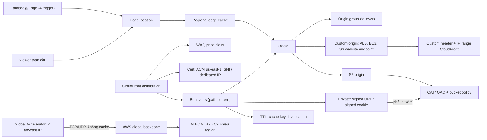

# 15 Global Content Delivery

Section về cách đưa ứng dụng tới người dùng toàn cầu: CloudFront (CDN, cache ở edge) với behaviors, TTL, origins, HTTPS qua ACM, bảo vệ origin bằng OAI/OAC, private distribution, compute ở edge bằng Lambda@Edge, và cuối cùng là Global Accelerator (đưa mạng AWS tới gần user, không cache). Section này là lớp "global" phía trước các kiến trúc regional ở [[_MOC 13 HA and Scaling|HA and Scaling]] và [[_MOC 14 Serverless and Application Services|Serverless]], đồng thời bổ sung cho [[_MOC 10 Route 53|Route 53]].

← [[00 Home]] · Trước: [[_MOC 14 Serverless and Application Services]] · Sau: [[_MOC 16 Advanced VPC Networking]]

## Lộ trình học
1. [[CloudFront Architecture]] — CDN của AWS: origin, distribution, edge location, regional edge cache; chỉ cache read, upload đi thẳng tới origin.
2. [[CloudFront Behaviors]] — cấu hình con chọn theo path pattern; mọi caching control và restrict viewer access nằm ở behavior.
3. [[CloudFront TTL and Invalidations]] — default TTL 24 giờ, header `Cache-Control`/`Expires`, invalidation, và versioned file names.
4. [[ACM]] — tạo, gia hạn, deploy cert TLS cho CloudFront và load balancer; regional, riêng CloudFront dùng cert ở us-east-1.
5. [[CloudFront and SSL]] — alternate domain name cần cert public khớp tên; viewer protocol và origin protocol; SNI miễn phí vs dedicated IP.
6. [[CloudFront Origins]] — S3 origin vs custom origin (kể cả S3 website endpoint), origin group cho failover.
7. [[CloudFront OAI and OAC]] — khóa S3 origin để chỉ CloudFront truy cập; custom origin dùng custom header + IP range.
8. [[CloudFront Private Distributions]] — behavior private bắt buộc signed URL (1 object) hoặc signed cookie (nhiều object); trusted key groups.
9. [[Lambda@Edge]] — Lambda nhẹ chạy tại edge ở 4 điểm viewer/origin request/response; không VPC, chỉ Node.js/Python.
10. [[Global Accelerator]] — 2 anycast IP, vào AWS backbone ở edge gần nhất; network product cho mọi TCP/UDP, không cache.

## Bản đồ khái niệm

## Liên kết sang section khác
- Lớp global và DNS: [[Regional and Global Architecture]], [[Route 53 Fundamentals]], [[CNAME vs Alias]]
- Origin phổ biến: [[S3 Static Website Hosting]], [[Elastic Load Balancer]]
- TLS: [[SSL and TLS]], [[SSL Offload and Session Stickiness]]
- Bảo vệ ở edge: [[WAF]], [[Shield]]
- Phân biệt với: [[S3 Presigned URLs]]

## 🎯 Top mẹo thi của section
- CloudFront chỉ cache **read**; upload đi thẳng tới origin. Edge location **không chạy EC2**. ([[CloudFront Architecture]])
- Caching control (TTL, cache key) và **restrict viewer access** nằm ở **behavior**; WAF, price class, alternate domain, cert nằm ở **distribution**. ([[CloudFront Behaviors]])
- Giảm chi phí khi user chủ yếu ở Mỹ/châu Âu → **price class** hẹp hơn; ép HTTPS → viewer protocol policy **Redirect HTTP to HTTPS**. ([[CloudFront Behaviors]])
- Default TTL **24 giờ**; user thấy nội dung cũ → **invalidation** hoặc giảm TTL; cập nhật thường xuyên mà cost-effective → **versioned file names**. ([[CloudFront TTL and Invalidations]])
- **Cert cho CloudFront phải ở us-east-1**; ALB thì cert cùng region với ALB, không cross-region. ([[ACM]])
- **ACM không dùng được trực tiếp trên EC2** → đặt ALB phía trước. ACM tự gia hạn cert do nó tạo; cert import phải gia hạn tay. ([[ACM]])
- **Self-signed cert không dùng được** với CloudFront ở cả hai chặng; custom origin EC2/on-prem cần cert public từ CA ngoài. ([[CloudFront and SSL]])
- Hỗ trợ trình duyệt cũ không có SNI → **dedicated IP** (tính phí, khoảng $600/tháng); còn lại dùng **SNI** miễn phí. ([[CloudFront and SSL]])
- **S3 website endpoint làm origin = custom origin** → không dùng được OAI/OAC; failover giữa origin → **origin group**. ([[CloudFront Origins]])
- "User chỉ được truy cập S3 qua CloudFront" → **OAC** (OAI ở đề cũ) + bucket policy; bucket **SSE-KMS** → bắt buộc OAC. ([[CloudFront OAI and OAC]])
- **1 object → signed URL**; nhiều object hoặc muốn giữ nguyên URL → **signed cookie**; thiết kế mới dùng **trusted key groups**. ([[CloudFront Private Distributions]])
- Private distribution phải đi kèm **khóa origin**, nếu không user bypass thẳng tới S3. ([[CloudFront Private Distributions]])
- Tùy biến request/response tại edge → **Lambda@Edge**; A/B testing → viewer request; nội dung theo thiết bị/quốc gia → origin request; không vào được VPC. ([[Lambda@Edge]])
- Caching, HTTP/HTTPS, signed URL → **CloudFront**; TCP/UDP non-HTTP, 2 static anycast IP, failover region nhanh không phụ thuộc DNS TTL → **Global Accelerator**. ([[Global Accelerator]])
