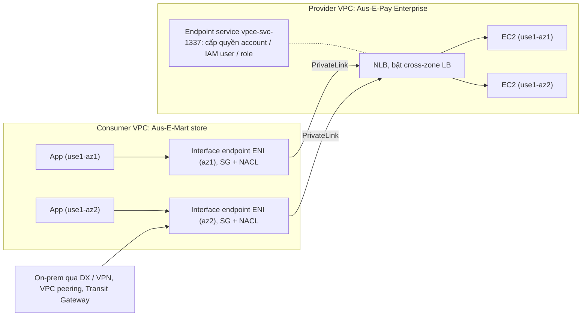

# AWS PrivateLink

> **TL;DR:** AWS PrivateLink tạo kết nối **private, an toàn** tới dịch vụ nằm **ngoài VPC** của bạn: dịch vụ của AWS (qua [[Interface VPC Endpoints|interface endpoint]]), dịch vụ của **account khác** (gọi là **endpoint service**) hoặc dịch vụ **partner trên AWS Marketplace**. Phía **provider** đặt dịch vụ sau một **Network Load Balancer** (bật cross-zone) và tạo **endpoint service**, cấp quyền cho account, IAM user, IAM role (hoặc mở). Phía **consumer** tạo **interface endpoint** (ENI có private IP) trong subnet của mình, nên dịch vụ như được "inject" vào VPC. Muốn HA thì **một endpoint mỗi AZ**. Hỗ trợ **TCP và UDP**, **IPv4 và IPv6 (dual-stack)**, **private DNS**, và dùng được qua **Direct Connect, Site-to-Site VPN, VPC peering, Transit Gateway**.

## 🖼️ Sơ đồ
![[AWS PrivateLink.excalidraw]]
*Mở bằng plugin Excalidraw để chỉnh sửa · ảnh tĩnh: [[AWS PrivateLink.svg]]*

## Khái niệm cốt lõi
- **Vấn đề**: muốn dùng (hoặc cung cấp) một dịch vụ giữa các VPC/account mà **không đi qua Internet**, không mở inbound public, và không nối cả hai mạng với nhau.
- **PrivateLink làm gì**: cho kết nối private và an toàn tới dịch vụ **bên ngoài VPC**. Dịch vụ đó có thể:
  - Nằm ở **AWS account khác**: gọi là **endpoint service**.
  - Là dịch vụ **partner** bán qua **AWS Marketplace**.
  - Là dịch vụ AWS public: chính **interface VPC endpoint** chạy trên PrivateLink (xem [[Interface VPC Endpoints]]).
- **Hai phía của quan hệ**:
  - **Service provider**: VPC nơi dịch vụ chạy.
  - **Service consumer**: một hoặc **nhiều** VPC dùng dịch vụ đó.
- **Phía provider**:
  - Đặt dịch vụ sau một **Network Load Balancer** (NLB có node ở mỗi AZ của provider VPC) để hiệu năng tốt và chịu lỗi.
  - Bật **cross-zone load balancing** cho NLB, để mỗi node chia kết nối sang instance ở AZ khác, tải đều và resilient khi có nhiều consumer.
  - Tạo **endpoint service** gắn với NLB, rồi **cấp quyền** cho: **IAM user**, **IAM role**, **AWS account**, hoặc **mở cho tất cả**.
- **Phía consumer**:
  - Sau khi được cấp quyền, tạo **interface endpoint** trong subnet của VPC mình. Endpoint là **ENI có private IP**, nên dịch vụ truy cập được trong VPC như thể nó **nằm ngay trong VPC consumer**.
  - Bảo vệ endpoint bằng **Security Group** và **NACL** như mọi ENI.
  - Traffic đi: app → interface endpoint → node NLB của provider → instance chạy dịch vụ, **không rời vùng mạng private của AWS**.
- **AZ ID khi làm cross-account**: tên AZ như `us-east-1a` ở account này có thể là `us-east-1c` ở account khác. Vì vậy khi ghép provider và consumer ở hai account thì dùng **AZ ID** (ví dụ `use1-az1`, `use1-az2`) để chắc hai bên nói về cùng một AZ vật lý. Xem [[AWS Global Infrastructure]].
- **Ai dùng**: triển khai AWS lớn, và doanh nghiệp phải theo chuẩn bảo mật chặt như **dữ liệu y tế**, **dịch vụ tài chính**, cần tránh Internet công cộng.

## Cách hoạt động / Kiến trúc

Ví dụ của bài: Aus-E-Mart lập công ty xử lý thanh toán **Aus-E-Pay**. Gói **Aus-E-Pay Enterprise** không nhận inbound từ Internet, chỉ cho truy cập bằng private IP qua PrivateLink. Khách đầu tiên là web store Aus-E-Mart (consumer). Ví dụ ở `us-east-1`, 2 AZ (`use1-az1`, `use1-az2`).

1. Provider chạy dịch vụ trên EC2 ở 2 subnet (2 AZ), đặt **NLB** phía trước (node ở mỗi AZ, bật cross-zone).
2. Provider tạo **endpoint service** và cấp quyền cho account của Aus-E-Mart.
3. Consumer tạo **interface endpoint** trong subnet của mình (mỗi AZ một cái để HA), gắn SG/NACL.
4. App của consumer gọi dịch vụ qua ENI của endpoint; traffic qua PrivateLink tới node NLB rồi tới instance của provider.

### Private DNS
- Provider có thể có domain riêng, ví dụ `ausepay.io`, với một payment gateway public ở `payments.ausepay.io`.
- Với **private DNS** của PrivateLink (domain phải được **xác minh**), consumer **vẫn gọi đúng tên `payments.ausepay.io`**, nhưng trong VPC consumer tên đó trỏ về **IP private của endpoint** thay vì IP public. Ứng dụng không phải đổi tên.

### Truy cập từ mạng khác
- Giống interface endpoint: dịch vụ được "inject" vào VPC qua ENI, nên mạng nào nối được tới VPC đó cũng tới được dịch vụ: **Direct Connect**, **Site-to-Site VPN**, **VPC peering**, **Transit Gateway**.

## Bảng so sánh / số liệu

| Đặc điểm | Giá trị |
|---|---|
| Phía provider | Dịch vụ sau **NLB** (bật **cross-zone LB**) + **endpoint service** |
| Cấp quyền cho | AWS account, IAM user, IAM role, hoặc mở cho tất cả |
| Phía consumer | **Interface endpoint** (ENI, private IP) trong subnet; SG + NACL |
| HA | **Nhiều endpoint**: một endpoint ở **mỗi AZ** mà consumer dùng |
| Protocol | **TCP và UDP** |
| IP | **IPv4 và IPv6** (endpoint **dual-stack**) |
| DNS | **Private DNS** cho domain đã xác minh |
| Truy cập từ | Trong VPC consumer, và qua **Direct Connect, Site-to-Site VPN, VPC peering, Transit Gateway** |

| | AWS PrivateLink | [[VPC Peering]] |
|---|---|---|
| Phạm vi | Truy cập **một dịch vụ** cụ thể (qua NLB của provider) | Nối **cả hai mạng** VPC với nhau |
| Hướng | Consumer gọi provider | Hai chiều, theo route và SG |
| Cách vào | ENI trong subnet consumer | Route tới `pcx-...` ở cả hai phía |

*(Bảng so sánh với peering là bổ sung để phân biệt, bài không trình bày.)*

## 🎯 Mẹo thi SAA-C03
- "Cung cấp dịch vụ cho **VPC/account khác** (hoặc nhiều khách hàng) **riêng tư**, không qua Internet, không mở inbound public" → **PrivateLink**: provider dùng **NLB + endpoint service**, consumer dùng **interface endpoint**.
- Thấy **endpoint service** / **NLB** / **interface endpoint của bên thứ ba / Marketplace partner** → PrivateLink.
- Muốn dịch vụ qua PrivateLink **highly available** → tạo **endpoint ở mỗi AZ** của VPC consumer. Phía provider bật **cross-zone LB** trên NLB.
- PrivateLink hỗ trợ **TCP và UDP**, **IPv4 và IPv6**.
- Consumer muốn **giữ nguyên tên miền** của provider mà vẫn đi private → **private DNS** (domain đã xác minh).
- On-prem dùng dịch vụ PrivateLink qua **Direct Connect / VPN** được, vì endpoint là ENI trong VPC.
- Ghép AZ giữa hai account → dùng **AZ ID**, không dùng tên AZ.

## Liên kết
- Tiên quyết: [[Interface VPC Endpoints]], [[Elastic Load Balancer]], [[Security Groups]], [[NACL]]
- Liên quan: [[Compare - ALB vs NLB]], [[Compare - Gateway vs Interface Endpoints]], [[R53 Private Hosted Zones]], [[AWS Global Infrastructure]]
- Dùng cùng: [[Direct Connect]], [[Site-to-Site VPN]], [[Transit Gateway]]
- Phân biệt với: [[VPC Peering]] (nối cả mạng), [[Gateway VPC Endpoints]]
- Section: [[_MOC 16 Advanced VPC Networking]]
