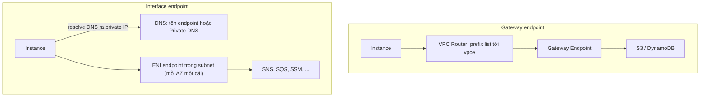

# Compare - Gateway vs Interface Endpoints

> **TL;DR:** Cả hai loại VPC endpoint đều cho resource private truy cập dịch vụ AWS public mà không cần public IP, IGW hay NAT. **Gateway endpoint** dùng **routing (prefix list)**, chỉ cho S3/DynamoDB, HA sẵn, miễn phí, chỉ dùng được từ trong VPC. **Interface endpoint** dùng **DNS + ENI** (PrivateLink), cho hầu hết dịch vụ, nằm trong subnet nên cần một cái mỗi AZ để HA, có Security Group.

## 🖼️ Sơ đồ
![[Compare - Gateway vs Interface Endpoints.excalidraw]]
*Mở bằng plugin Excalidraw để chỉnh sửa · ảnh tĩnh: [[Compare - Gateway vs Interface Endpoints.svg]]*

![[Compare - Gateway vs Interface Endpoints - choose.excalidraw]]
*Mở bằng plugin Excalidraw để chỉnh sửa · ảnh tĩnh: [[Compare - Gateway vs Interface Endpoints - choose.svg]]*

## Bảng so sánh

| Tiêu chí | [[Gateway VPC Endpoints\|Gateway endpoint]] | [[Interface VPC Endpoints\|Interface endpoint]] |
|---|---|---|
| Dịch vụ | **Chỉ S3 và DynamoDB** | Hầu hết dịch vụ AWS, dịch vụ bên thứ ba qua PrivateLink. S3 có (khóa học); DynamoDB có từ 2024 (khóa học nói chưa) |
| Bản chất | Gateway object logic của VPC | **ENI** có private IP trong subnet |
| Cơ chế dẫn traffic | **Route table + prefix list** (AWS tự thêm) | **DNS**: tên resolve ra private IP của ENI |
| Chọn gì khi tạo | VPC + **route table** (subnet) | VPC + **một subnet mỗi AZ** + Security Group |
| Vị trí / AZ | Không nằm trong subnet/AZ nào | Nằm trong **một subnet = một AZ** |
| High availability | **HA mặc định** trên mọi AZ của region | **Không HA mặc định**, cần **một endpoint mỗi AZ** |
| Security Group | **Không** | **Có** |
| Endpoint policy | Có | Có |
| Ứng dụng có phải sửa? | **Không bao giờ** (chỉ đổi đường đi) | Không, nếu bật **Private DNS** (mặc định bật). Nếu tắt thì phải dùng tên endpoint-specific |
| Tên DNS mới | Không | Regional, Zonal, và Private DNS ghi đè tên mặc định |
| Truy cập từ ngoài VPC (on-prem qua VPN/DX, VPC peer) | **Không** | **Có** (chỉ là private IP) |
| Region | Chỉ dịch vụ cùng region | Dịch vụ cùng region (ngoài khóa học: PrivateLink hiện có hỗ trợ cross-region cho một số trường hợp) |
| Protocol | Theo dịch vụ | Khóa học: chỉ TCP, chỉ IPv4 (hiện nay đã có IPv6/dual-stack) |
| Thời gian tạo | Gần như tức thì | Vài phút (pending → available) |
| Chi phí (ngoài khóa học) | **Miễn phí** | Phí theo giờ mỗi AZ + phí theo GB |

## Cách hoạt động khác nhau

- **Gateway**: ứng dụng tưởng mình đang nói chuyện thẳng với S3/DynamoDB. Ta chỉ **đổi route**: thay vì đi IGW (cần public IP) thì đi qua gateway endpoint bằng private IP.
- **Interface**: không dùng routing. Tên DNS được resolve ra **private IP của interface endpoint**, và IP đó được dùng để kết nối tới dịch vụ.

## Khi nào chọn cái nào
- **S3 hoặc DynamoDB, truy cập từ trong cùng VPC, muốn rẻ và đơn giản** → **Gateway endpoint**.
- **Dịch vụ khác S3/DynamoDB** (SNS, SQS, KMS, SSM, ECR, CloudWatch, ...) → **Interface endpoint**.
- **S3 nhưng cần truy cập từ on-premises (VPN/Direct Connect) hoặc từ VPC khác** → **Interface endpoint cho S3**.
- **Cần kiểm soát bằng Security Group** → Interface endpoint.
- **Đưa dịch vụ của bên thứ ba/vendor vào VPC private** → Interface endpoint / **PrivateLink**.
- Hai loại có thể **dùng cùng lúc** trong một VPC, như demo: gateway cho S3, interface cho SNS.

## 🎯 Mẹo thi SAA-C03
- **Gateway = route table/prefix list, HA sẵn, không SG, chỉ trong VPC.** **Interface = DNS/ENI, theo AZ, có SG, PrivateLink.** Nắm được hai dòng này là trả lời được phần lớn câu hỏi.
- Đáp án "gateway endpoint trong mỗi AZ" là **sai**. Đáp án "một interface endpoint là đủ HA" cũng **sai**.
- "Ứng dụng không sửa được" + interface endpoint → bật **Private DNS** (Route 53 private hosted zone ghi đè tên mặc định).
- "Bucket chỉ nhận traffic từ VPC" → bucket policy với điều kiện `aws:SourceVpce` (thường đi cùng gateway endpoint).
- "Giới hạn VPC chỉ truy cập một số bucket" → **endpoint policy** (có ở cả hai loại).
- Từ khóa **PrivateLink** → interface endpoint.
- Không loại endpoint nào cấp đường ra Internet. Cần ra Internet thì dùng [[NAT Gateway]] (IPv4) hoặc [[Egress-Only Internet Gateway]] (IPv6).

## Liên kết
- Chi tiết: [[Gateway VPC Endpoints]], [[Interface VPC Endpoints]]
- Liên quan: [[AWS Public vs Private Services]], [[VPC Routing and Internet Gateway]], [[R53 Private Hosted Zones]], [[S3 Security]], [[Security Groups]], [[Site-to-Site VPN]], [[Direct Connect]]
- Phân biệt với: [[NAT Gateway]], [[Egress-Only Internet Gateway]], [[VPC Peering]]
- Section: [[_MOC 16 Advanced VPC Networking]]
